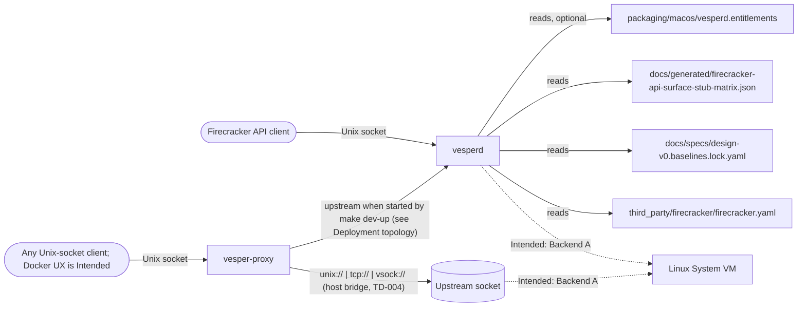
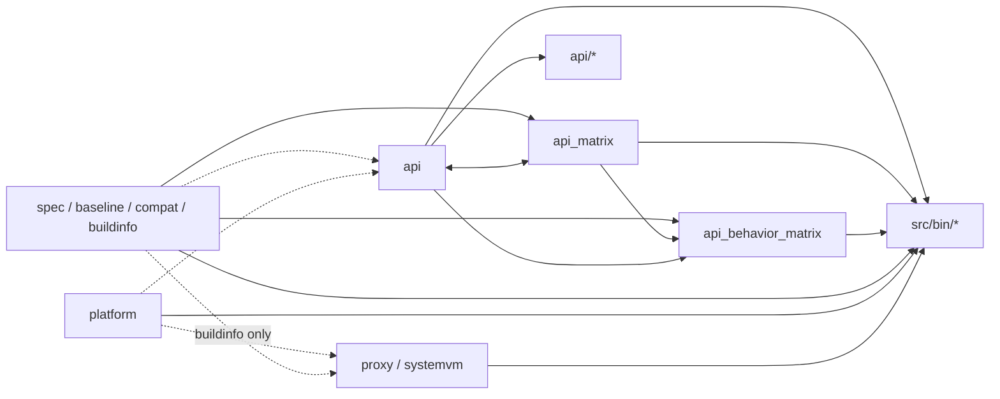
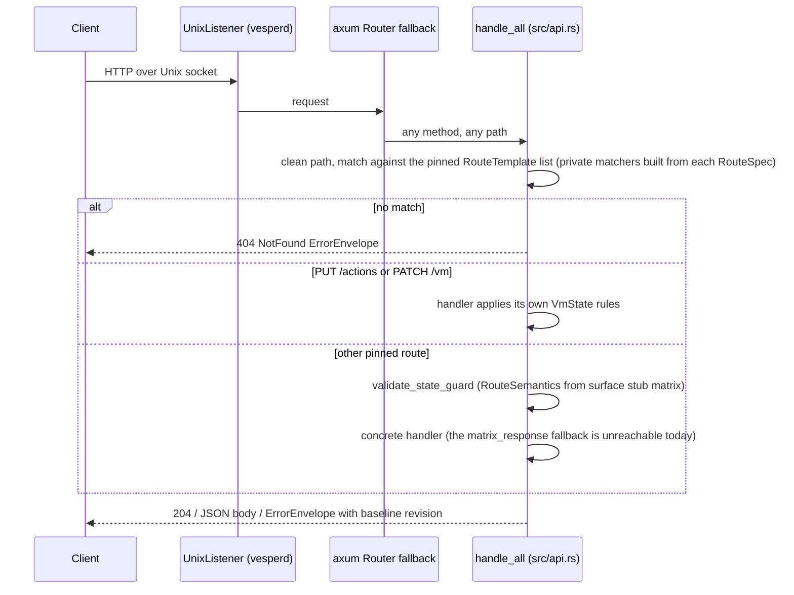

# Architecture

This is the top-level map of Vesper: what exists, where it lives and which way dependencies may point. It is
authoritative for component boundaries and dependency rules. Every claim is labelled **Verified**, **Intended**,
**Proposed** or **Unknown** as defined in [docs/README.md](docs/README.md#evidence-labels); a section labelled once
applies that label to every row or bullet in it.

## Terms

**Verified** against the files each term points at.

- `TD-nnn`: a row in the [tech-debt tracker](docs/exec-plans/tech-debt-tracker.md).
- `WOR-nnn`: an issue identifier in the Linear tracker; the [milestone log](docs/progress/symphony-milestones.md)
  records one entry per verified slice of work under that identifier.
- *Baseline*: the pinned upstream Firecracker revision recorded in
  [docs/specs/design-v0.baselines.lock.yaml](docs/specs/design-v0.baselines.lock.yaml).
- *Parity*: matching upstream Firecracker's observable behaviour at that revision.
- *Route family*: the set of handlers for one Firecracker path prefix.
- *Harness*: the docs, scripts and checks that keep agent work verifiable ([Code map](#code-map)).
- *Symphony*: the issue-execution orchestrator driven by [WORKFLOW.md](WORKFLOW.md).
- *Surface stub matrix*: a generated per-route table described under [Governance tooling](#governance-tooling).

## Purpose

**Verified.** Vesper exposes a Firecracker-compatible control plane on macOS. The `vesperd` binary serves the pinned
Firecracker OpenAPI route set over a Unix socket from an in-memory VM state machine, and every response produced after
request extraction is either a success or a deterministic envelope carrying the pinned Firecracker baseline
revision (the pre-extraction exceptions are listed in Invariant 3; [src/api.rs](src/api.rs),
[src/bin/vesperd.rs](src/bin/vesperd.rs)). The repository today contains that control
plane, governance tooling, a socket proxy, and System VM scaffolding. It does not yet run guest microVMs.

**Intended** (per [design-v0](docs/specs/design-v0.md#backends-how-we-guarantee-parity)): parity is reached through
staged backends. Backend A (`Vesper-KVMHost`) runs stock Firecracker inside a System VM, a Linux guest booted by
Virtualization.framework that hosts containerd and Firecracker, because Firecracker needs KVM and macOS has none;
the guest supplies KVM through nested virtualization on M3 and later hosts, per design-v0.
Backend B (`Vesper-HVF`, titled `Vesper-HVF/VF` in design-v0) is an eventual native macOS implementation behind the
same API and lifecycle contract.

Out of scope for this repository: the System VM image contents, containerd shim code, and any Docker Desktop UX.
Those are design-v0 phases that have no code here yet.

## System context

**Verified** for every edge except the two marked `Intended:`, which are design-only and not exercised by any test.

## Components

**Verified.** The "Source" column names the library module that implements the component.

| Component | Responsibility | Entry point | Owns data | Source |
|---|---|---|---|---|
| `vesperd` | Firecracker-compatible HTTP API and VM state machine (contracts: [src/README.md](src/README.md), [src/bin/README.md](src/bin/README.md); route families in [src/api/README.md](src/api/README.md)) | [src/bin/vesperd.rs](src/bin/vesperd.rs) | In-memory `AppState`; may create log and metrics files and open drive, pmem, kernel and initrd paths during validation | [src/api.rs](src/api.rs) |
| `vesper-proxy` | Forward a Unix socket to a unix, tcp or vsock upstream | [src/bin/vesper-proxy.rs](src/bin/vesper-proxy.rs) | None | [src/proxy.rs](src/proxy.rs) |
| `baselinectl` | Parity metadata, surface stub matrix, behavior matrix | [src/bin/baselinectl.rs](src/bin/baselinectl.rs) | `docs/generated/*.json`, `artifacts/parity-metadata.json` | [src/baseline.rs](src/baseline.rs), [src/spec.rs](src/spec.rs), [src/api_matrix.rs](src/api_matrix.rs), [src/api_behavior_matrix.rs](src/api_behavior_matrix.rs) |
| `compatexctl` | Compat exception registry validation | [src/bin/compatexctl.rs](src/bin/compatexctl.rs) | None | [src/compat.rs](src/compat.rs) |
| `contractgen` | Golden route contract generate/check | [src/bin/contractgen.rs](src/bin/contractgen.rs) | `testdata/contracts/firecracker-routes.golden.json` | [src/spec.rs](src/spec.rs) |
| `systemvmctl` | System VM image lock verification, manifest, launch config, boot smoke (repeated launcher runs with timing) | [src/bin/systemvmctl.rs](src/bin/systemvmctl.rs) | `build/systemvm/*.json`, `run/systemvm/*` | [src/systemvm.rs](src/systemvm.rs) |
| `vesper-vmlauncher` | Boot one launch config on Virtualization.framework (NAT, virtio console, virtio socket), run the config's console probe, serve the vsock bridge socket, report ready, probe, running and stop status (contract: [launcher/README.md](launcher/README.md); decision: [ADR 0001](docs/design-docs/adr/0001-systemvm-launcher-swift-helper.md)) | [launcher/Sources/vesper-vmlauncher/main.swift](launcher/Sources/vesper-vmlauncher/main.swift) | `run/systemvm/console.log` | Swift, not part of the crate |

The six Rust binaries are discovered by Cargo from `src/bin/*.rs`; see [src/bin/README.md](src/bin/README.md). The
launcher is a separate Swift package built by `make vmlauncher-build`.

## Domain boundaries and dependency rules

**Verified** for single-path `crate::x` and `vesper::x` references in the 18 files enumerated in the `RULES`
allowlist of [scripts/harness/check_structure.py](scripts/harness/check_structure.py) (the top-level `src/*.rs`
modules, the four route-family modules under `src/api/` and the two `src/systemvm/` children), which CI checks. The allowlist is a fixed list, not a
glob: a new module is unchecked until a `RULES` row is added. Grouped `use crate::{..}` imports, `super::super`
paths, `src/lib.rs`, the binaries and `tests/` are not checked (TD-018); `src/api/tests.rs` is outside both the
allowlist and the line budgets (TD-015).

| Layer | Purpose | Modules | May reference | Enforced |
|---|---|---|---|---|
| 0. Leaf modules | Pinned upstream contract, parity metadata, build metadata | `spec`, `baseline`, `compat`, `buildinfo` | nothing local | mechanical |
| 1. Platform policy | Host capability and entitlement rules | `platform` | nothing local | mechanical |
| 2. Control plane: `api` | State machine, dispatch, deterministic errors | `api` | `api_matrix`, `baseline`, `buildinfo`, `compat`, `platform`, `spec` | mechanical |
| 2. Control plane: matrices | Generated route matrices | `api_matrix`, `api_behavior_matrix` | `api`, `baseline`, `spec`; `api_behavior_matrix` also `api_matrix` | mechanical |
| 2. Control plane: families | Extracted route-family handlers | `api/*` | `super` only (no `crate::` references) | mechanical |
| 3. Runtime adapters | Socket proxying, System VM artifacts, guest control channel | `proxy`, `systemvm` (+ `systemvm/image_lock`, `systemvm/packages`, `super` only), `control` | `buildinfo`, `platform` (`control`: nothing local) | mechanical |
| 4. Entry points | `clap` binaries | `src/bin/*` | any library layer | review |
| 5. Tests and harness | Contract tests, sensors (CI scripts that detect drift), docs, Symphony templates | `tests/`, `src/api/tests.rs`, `scripts/harness/`, `harness/`, `.github/workflows/`, `docs/`, `.symphony/templates/` | may import the library; nothing imports them | review |

`api_matrix` imports `api::RouteSpec`, and `api` imports the matrix types from `api_matrix`. `RouteSpec` duplicates
`spec::Route`, forcing hand conversions in `vesperd`, `baselinectl`, `tests/api_contract.rs` and the two
`validates_repo_generated_*` unit tests; TD-020 removes them by moving the type to `spec`.

The diagram below is a simplified view; the table is authoritative. An arrow points from the referenced module to
the module that references it. Solid edges are references that exist today (including test-only references, which
the allowlist counts); dashed edges are allowed but unused.

Disallowed directions (**Verified** by the same allowlist, with the same scope limit): control-plane code must not
import `proxy` or `systemvm`; `proxy` and `systemvm` must not import `api`; leaf modules must not import runtime or
control-plane modules.

## Code map

**Verified.**

- `src/`: the `vesper` library crate. Public modules and their contracts are listed in [src/README.md](src/README.md).
  `src/api.rs` holds `AppState`, the dispatch table and most handlers; `src/api/` holds the extracted route families.
- `src/bin/`: the six binaries ([src/bin/README.md](src/bin/README.md)).
- `tests/`: integration suites `api_contract.rs` and `contract_golden.rs` ([docs/TESTING.md](docs/TESTING.md)).
- `scripts/`: CI lint, macOS dev loop, System VM wrapper scripts, harness sensors, and `update-issue-checklists.sh`,
  which performs live `gh issue edit` writes to GitHub issues #1 to #40 (no dry run, but idempotent via a body
  marker; [scripts/README.md](scripts/README.md)).
- `harness/`: the knowledge-base checker (`check_docs.py`, `config.toml`), its installer (`install.py`), its unit
  tests (`tests/`) and the recurring agent prompts ([harness/README.md](harness/README.md)); see [Terms](#terms).
- `.github/workflows/`: nine workflows, each listed as "steps (triggers)"; every one runs on pull requests and on
  pushes to `main` within its trigger paths.
  - `rust-tests.yml`: `make build`, `cargo test`, both matrix checks, entitlement lint (`src/**`, `tests/**`,
    `Cargo.*`, `Makefile`, `third_party/**`, `docs/generated/**`, `docs/specs/*.yaml`, `packaging/**`, `scripts/ci/**`).
  - `contract-tests.yml`: golden check, `make contract-test` (swagger, `src/spec.rs`, `src/api.rs`, `contractgen`, golden file).
  - `baseline-governance.yml`: `cargo test`, parity metadata generate and validate (lock file, `src/baseline.rs`, `baselinectl`).
  - `compat-exceptions.yml`: `cargo test`, `compatexctl` (registry, `src/compat.rs`, `compatexctl`).
  - `harness-docs.yml`: `check_docs.py` (docs, `AGENTS.md`, `ARCHITECTURE.md`, `WORKFLOW.md`).
  - `harness-structure.yml`: `check_structure.py` (`src/**`, the script, `ARCHITECTURE.md`).
  - `harness-quality-score.yml`: `compute_quality_score.py` (docs, `scripts/harness/**`, `src/**`, `tests/**`,
    `third_party/**`, `.symphony/templates/**`).
  - `harness-garbage-collection.yml`: `janitor_scan.py`, weekly and the only CI run of it; non-blocking by default
    (`--fail-on never`, a manual dispatch can select `errors` or `warnings`).
  - `docs.yml`: `harness/check_docs.py --strict` and its unit tests (every PR and every push to `main`).
- `docs/`: system of record ([docs/README.md](docs/README.md)). `docs/specs/` is normative; `docs/generated/` is
  machine-written.
- `third_party/firecracker/`: vendored Firecracker OpenAPI, read by `spec::load_routes` (route table) and
  `spec::load_info_version` (pinned version string).
- `packaging/macos/`: entitlement plists for `vesperd`, `vesper-proxy` and `vesper-vmlauncher`. The `vesperd` plist
  is validated by `platform` at startup when `--entitlements-file` is given; the launcher plist is applied by
  `scripts/macos/build-vmlauncher.sh` at signing time; all three are linted by `scripts/ci/validate-entitlements.sh`
  (syntax lint on macOS, required-key check on Linux CI, TD-010).
- `launcher/`: Swift package for `vesper-vmlauncher` ([launcher/README.md](launcher/README.md)).
- `systemvm/overlay/`: Alpine overlay applied to the guest at boot ([systemvm/overlay/README.md](systemvm/overlay/README.md),
  [ADR 0002](docs/design-docs/adr/0002-systemvm-overlay-via-initramfs.md)); `docs/specs/systemvm-packages.lock.yaml`
  pins the packages it installs; it carries the supervised guest agent (`vesper-agent`, [ADR 0003](docs/design-docs/adr/0003-systemvm-control-channel.md)).
- `testdata/contracts/`: golden route list written by `contractgen`.
- `docs/specs/systemvm-image.lock.yaml`: the pinned System VM boot image (Alpine virt ISO: URL and SHA-256, the
  kernel and initramfs members with unpack method and digests, the ISO as boot media, kernel command line, console
  ready pattern, expected `image_id`). `make systemvm-fetch` downloads it into `build/systemvm/` (gitignored) and
  `systemvmctl verify-image` checks the digests; `make systemvm-boot-smoke` boots it through the launcher.
- `.symphony/templates/`: templates for Symphony (see [Terms](#terms)):
  `verification-manifest-template.yaml` (used by WORKFLOW.md), `symphony-milestones-template.md` and
  `milestone-report-template.md` (used by [docs/progress/index.md](docs/progress/index.md)), and `council-rubric.md`
  (cited by [core beliefs](docs/design-docs/core-beliefs.md)).

## Main flows

### API request

**Verified.**

The state machine has three states: `PreBoot`, `Running`, `Paused`. `PUT /actions` (`InstanceStart`) and `PATCH /vm`
(`Paused`, `Resumed`) move between them and apply their own rules, which is why they bypass the guard; a successful
`PUT /snapshot/load` also sets the state. Every other route is gated first by its matrix semantics: `PreBoot` rejects
after boot, `PostBoot` rejects before boot, and `Any` and `PreBootRuntime` (allowed in both phases, the latter with
runtime effects) never reject. The guard does not distinguish `Running` from `Paused`. A duplicate `("PATCH", "/vm")`
arm near the end of the dispatch table (second to last) is shadowed by the early bypass and is dead code (TD-022).

State is held in `AppState` behind `std::sync::RwLock` fields on a multi-thread tokio runtime. There is no state
persistence and no background work. Handlers open caller-supplied host files synchronously with `std::fs` on the
async worker thread (log and metrics creation, kernel, initrd, drive and pmem validation) with no `spawn_blocking`,
so a hung path stalls that thread (TD-024). Startup order in `vesperd` is: validate
entitlements (only when `--entitlements-file` is given), load the baseline lock and fail if the Firecracker revision
is blank, load routes and version from the swagger, load the surface stub matrix, build `AppState::new_with_matrix` (which
validates the matrix against `documented_route_semantics`), create the socket's parent directory and remove any
stale socket file, bind, then chmod the socket to `0o660`.

### Proxy connection

**Verified.** `vesper-proxy` parses the upstream once at startup with `proxy::parse_target`, binds a Unix listener,
and then spawns one tokio task per client that dials the upstream within `dial_timeout` and relays bytes both ways. A
`vsock://<cid>:<port>` upstream is bridged through `<vsock_socket_dir>/<cid>.sock` (`--vsock-socket-dir`, default
`/tmp/vesper/vsock`) with a `CONNECT <port>\n` preface; nothing in this repository creates that bridge socket, so the
vsock path is not runnable today (TD-004; [src/proxy.rs](src/proxy.rs),
[docs/process/systemvm-bringup.md](docs/process/systemvm-bringup.md)).

## Governance tooling

**Verified.** `contractgen` runs in `contract-tests.yml` and via `make contract-check`; the `baselinectl` matrix modes
run in `rust-tests.yml` via `make surface-matrix-check` and `make behavior-matrix-check`, while its metadata modes are
invoked directly in `baseline-governance.yml` and have no Make target; `compatexctl` runs only in
`compat-exceptions.yml` and by hand. Together they keep these
artefacts in step with the pinned baseline ([docs/process/baseline-governance.md](docs/process/baseline-governance.md)):

| Artefact | Path | Purpose | Read by |
|---|---|---|---|
| Baseline lock | `docs/specs/design-v0.baselines.lock.yaml` | Pinned upstream revisions and required parity metadata keys | `vesperd`, `baselinectl`, `tests/api_contract.rs`, the `validates_repo_generated_*` unit tests (in the test modules of `src/api_matrix.rs` and `src/api_behavior_matrix.rs`) |
| Golden route list | `testdata/contracts/firecracker-routes.golden.json` | `contractgen`'s serialisation of the pinned swagger routes | `contractgen --mode check`, `tests/contract_golden.rs`, `check_structure.py` and `janitor_scan.py` (route coverage) |
| Surface stub matrix | `docs/generated/firecracker-api-surface-stub-matrix.json` | Per-route semantics (`Any`, `PreBoot`, `PostBoot`, `PreBootRuntime`, stored on disk as `Any`, `PB`, `PO`, `PB/RT`) plus a stub status: the `501 NotImplemented` response a route would get if it had no handler. Every route has one today, so no stub is served | `vesperd` at startup (drives `validate_state_guard`), `baselinectl`, `tests/api_contract.rs`, `validates_repo_generated_matrix` |
| Behavior matrix | `docs/generated/firecracker-api-behavior-matrix.json` | Per-route expected status and error cases with upstream evidence | `baselinectl`, `validates_repo_generated_behavior_matrix` |
| Behavior capture registry | `docs/specs/firecracker-api-behavior-captures.yaml` | Upstream evidence that feeds the behavior matrix | `baselinectl` |
| Baseline capture registry | `docs/specs/firecracker-api-baseline-captures.yaml` | Empty placeholder (`captures: []`) kept for a code path that `route_uses_matrix_backed_placeholder` currently disables (it always returns `false`); generation requires it to stay empty ([src/README.md](src/README.md)) | `baselinectl` |
| Compat registry | `docs/specs/compat-exceptions.yaml` | Allowed behaviour deviations before GA | `compatexctl` |
| System VM image lock | `docs/specs/systemvm-image.lock.yaml` | Pinned upstream boot image: archive URL, SHA-256 of archive, kernel and initramfs, expected `image_id` | `systemvmctl lock-env` and `verify-image` (`src/systemvm.rs`), `scripts/systemvm/fetch-image.sh`, `validates_repo_image_lock` unit test, `systemvm-image.yml` |
| Parity metadata | `artifacts/parity-metadata.json` (not committed) | Backend, host and baseline revision stamp for a parity claim | `baselinectl --mode validate` |

## Deployment topology

**Verified.** The only runnable deployment in the repository is the local macOS dev loop. `make dev-up` builds
`vesperd` and `vesper-proxy`, starts `vesperd` on `run/vesperd.sock` and `vesper-proxy` on `run/docker.sock` with
its upstream set to `vesperd`'s socket, so `run/docker.sock` is a second path to the API. The dev loop always passes
`--entitlements-file packaging/macos/vesperd.entitlements`, so the entitlement check runs and the plist must exist.
`vesper-proxy` sets no mode on its listener (TD-017) and handles Ctrl-C only (TD-021;
[scripts/macos/README.md](scripts/macos/README.md)). Entitlement
plists live in `packaging/macos/`. No installer, launchd or packaging manifests exist. The System VM path is
`make systemvm-fetch` (pinned Alpine ISO, verified), `make systemvm-launch-config`, `make vmlauncher-build`
(ad-hoc signed Swift helper; `make systemvm-prepare` runs all of these plus `make systemvm-overlay`, which packs the
guest overlay and the pinned `socat`, `containerd` and Docker packages into the initramfs) and
`make systemvm-boot-smoke`, which boots the VM N times, logs in on the console,
obtains a DHCP lease from the NAT and pings the gateway, powers the guest off, and checks each boot against the 5 s
threshold. `make systemvm-up` keeps the VM running with the owner-only bridge socket `run/systemvm/vsock/3.sock`
served by the launcher; `systemvmctl control` reaches the supervised guest agent through it (handshake, keepalive,
reconnect and 2 MiB echo proven by `make systemvm-control-suite`); `make systemvm-down` powers the guest off.
`containerd` and `dockerd` run under `supervise-daemon` inside the guest (cgroup v2, `eth0` by DHCP) and
`make systemvm-services-suite` proves they recover from SIGKILL; dockerd listens only inside the guest until the
Docker socket ingress lands (TD-005).

**Intended:** design-v0 describes a packaged macOS host process plus a Linux System VM running containerd and
Firecracker.

## Invariants

Rules that must always hold. "Verify with" is the command or test that checks the rule; "See" is where the rule lives.
Rows marked Verified without a mechanical check are tracked in the
[tech-debt tracker](docs/exec-plans/tech-debt-tracker.md); Intended and Proposed rows are tracked by the linked design
or parity documents.

| # | Invariant | Status | Enforced by | Verify with | See |
|---|---|---|---|---|---|
| 1a | `vesperd` is the only binary that serves the control-plane API; `vesper-proxy` is the only other host-visible socket and only relays bytes (plus the vsock `CONNECT` preface) | Verified | Review only; no mechanical check (TD-008) | `grep -n 'UnixListener::bind' src/bin/vesperd.rs src/proxy.rs` (expect 1 hit in `vesperd.rs` and 3 in `proxy.rs`, of which the two inside the `#[cfg(test)]` module are test fixtures) | [src/bin/vesperd.rs](src/bin/vesperd.rs), [src/proxy.rs](src/proxy.rs) |
| 1b | Raw Firecracker and containerd sockets stay private to the System VM | Intended | Nothing yet; the System VM does not exist here | n/a | [design-v0](docs/specs/design-v0.md#security-model-firecrackerequivalent-hardening-on-macos), [docs/SECURITY.md](docs/SECURITY.md) |
| 2 | Intra-crate single-path references in the 18 `RULES` files follow the layer table | Verified | `RULES` in `check_structure.py`, run by `harness-structure.yml` on `src/**` changes; a new module needs a `RULES` row (TD-018) | `python3 scripts/harness/check_structure.py --root .` | [scripts/harness/check_structure.py](scripts/harness/check_structure.py) |
| 3 | Every error response produced by `handle_all` is an `ErrorEnvelope` with the pinned baseline revision. Exceptions before extraction: a body over axum's default 2 MiB limit gets a plain `413`, a body-read failure gets a plain `400`, and a poisoned `RwLock` panics the task (TD-019) | Verified | `AppState::new_with_matrix` rejects a blank revision; `tests/api_contract.rs` asserts envelopes; `rust-tests.yml` runs `cargo test` for every `src/**` change | `make contract-test` | [tests/api_contract.rs](tests/api_contract.rs) |
| 4 | The golden route list equals `contractgen`'s serialisation of the pinned swagger | Verified | `contractgen --mode check` and `tests/contract_golden.rs` in `contract-tests.yml`; `tests/**` changes are covered by `rust-tests.yml` | `make contract-check` | [tests/contract_golden.rs](tests/contract_golden.rs) |
| 5 | Generated surface stub and behavior matrices are complete and fresh | Verified | `baselinectl --mode validate-api-matrix` and `validate-api-behavior-matrix` in `rust-tests.yml`; the `validates_repo_generated_*` unit tests also fail under `cargo test` | `make surface-matrix-check`, `make behavior-matrix-check` | [docs/process/baseline-governance.md](docs/process/baseline-governance.md) |
| 6 | Compat exceptions carry required fields, and none is open past expiry | Verified | On change only: `compatexctl` in `compat-exceptions.yml` when the registry or its code changes; no scheduled run (TD-016) | `cargo run --bin compatexctl -- --registry docs/specs/compat-exceptions.yaml` | [docs/process/compat-exceptions.md](docs/process/compat-exceptions.md) |
| 7 | Inputs are parsed into typed structs once where they enter the crate (request bodies, registries, lock file, proxy targets, launch config); internal code never re-probes raw JSON or YAML. Exceptions: the MMDS data store is schemaless JSON by contract and is handled as `serde_json::Value`; `spec` probes the swagger as untyped `serde_yaml::Value` at load ([src/README.md](src/README.md)) | Verified | Per module: unit tests in each module; no cross-cutting lint (TD-008) | `cargo test --lib` | [src/README.md](src/README.md), [core beliefs](docs/design-docs/core-beliefs.md) |
| 8 | Library modules stay under their error budgets; warn budgets are advisory and two are currently exceeded (`src/api.rs`, TD-001; `src/api_behavior_matrix.rs`, TD-023) | Verified | Budgets in `check_structure.py` (`src/api.rs` warn 2500 / error 3200; others warn 800 / error 1200; `src/api/tests.rs` unbudgeted, TD-015) and `janitor_scan.py` (top-level `src/*.rs` only, no 800 tier: `api.rs` over 2500 warns, any other file over 1200 errors) | `python3 scripts/harness/check_structure.py --root .` | [Hotspots](#hotspots-and-decomposition-queue) |
| 9 | When started with `--entitlements-file`, `vesperd` refuses to start unless the plist contains `com.apple.security.virtualization`; without the flag no check runs | Verified | `platform::validate_entitlements_file` (substring match on the key, value not checked); `make validate-entitlements` lints the plists in `rust-tests.yml` | `make validate-entitlements` | [src/platform.rs](src/platform.rs) |
| 10 | Having a dispatch arm in `src/api.rs`, or answering `501`, does not count as parity with upstream Firecracker at the pinned revision | Proposed | Review against the parity matrix; `scripts/harness/janitor_scan.py` only warns on routes with no arm | n/a | [docs/specs/firecracker-feature-parity.md](docs/specs/firecracker-feature-parity.md), TD-003 |

## Known limits

**Verified.** Limits recorded in the per-directory contracts that a reader of this map should know:

- A poisoned `RwLock` panics the request task instead of returning an envelope; bodies over 2 MiB get a plain `413`
  and body-read failures a plain `400` before extraction (TD-019).
- Handlers open caller-supplied host files synchronously on the async runtime with no `spawn_blocking`; a slow or
  hung path (network volume, FIFO) stalls the worker thread and the shutdown future (TD-024).
- The proxy relay has no size or idle limits and handles Ctrl-C but not SIGTERM (TD-021); it drops per-client errors
  silently (TD-007); it sets no mode on its listener and has no entitlement check (TD-017). Details in
  [src/README.md](src/README.md) and [src/bin/README.md](src/bin/README.md).
- `make dev-up` has no idempotency guard and does not wait for `vesperd`'s socket before starting the proxy
  ([scripts/macos/README.md](scripts/macos/README.md)).
- `vesper-vmlauncher` is ad-hoc signed (runs only on the building machine); the guest probe is console-scripted
  (password-less root login on the live ISO). The control channel is a shell line protocol over `socat`, not a
  typed RPC (TD-026), and its bridge socket is host-visible, owner-only, and reaches any guest vsock port (TD-027);
  no workload runs inside the guest (TD-005). GitHub's macOS runners cannot boot it; boot evidence comes from
  developer hardware.

## Guardrails for future work

**Proposed** policy, drawn from [core beliefs](docs/design-docs/core-beliefs.md); the TD-002 reference is Verified.

- Add new parity behavior only with matching tests or runtime evidence.
- Prefer small, testable repo-local abstractions over opaque helper libraries.
- When a rule is repeated in review, promote it into a doc, a template, a script, or a workflow.
- Tracker automation (GitHub Actions that move issues) must never become a source of truth. The retired promotion
  workflows are TD-002; the protocol is in [harness-engineering.md](docs/process/harness-engineering.md).

## Hotspots and decomposition queue

**Verified.** As counted by `check_structure.py` on 2026-11-06, `src/api.rs` is 3153 lines: above the 2500-line
warning budget and 47 lines under the 3200-line error budget, so extracting the remaining `errors` and `vm_config`
route families (TD-001) is a prerequisite for further growth. The WOR-105 slice extracted `actions`,
`machine_config`, `boot_source` and `logger_metrics`. `src/api_behavior_matrix.rs` (1066 lines by the same count)
already trips the 800-line warning (TD-023). Each extraction must preserve behavior and move its tests with it, and
must leave the `("METHOD", "/path") =>` dispatch arms in `src/api.rs`, because both route-coverage sensors scan
only that file (TD-003).

## See also

- [Core beliefs](docs/design-docs/core-beliefs.md): the principles behind these rules.
- [Reliability](docs/RELIABILITY.md) and [Security](docs/SECURITY.md): cross-cutting requirements.
- [Quality score](docs/QUALITY_SCORE.md): how well the code currently follows this architecture.
- [Harness engineering](docs/process/harness-engineering.md): how the boundaries are kept honest in practice.
- [design-v0](docs/specs/design-v0.md), [parity matrix](docs/specs/firecracker-feature-parity.md),
  [ADRs](docs/design-docs/adr/index.md): the normative design and decision records.
