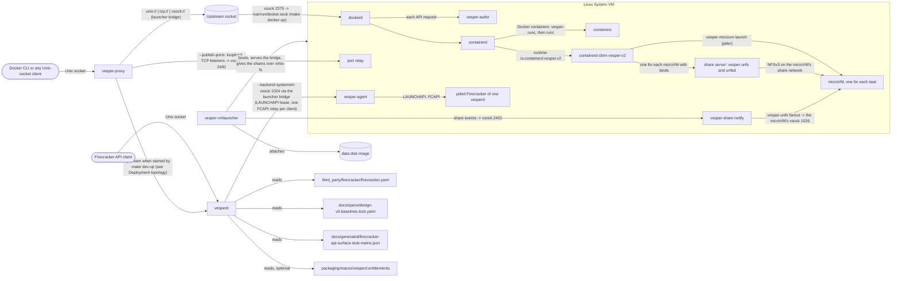
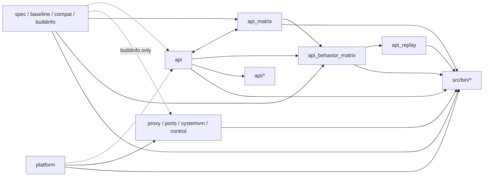
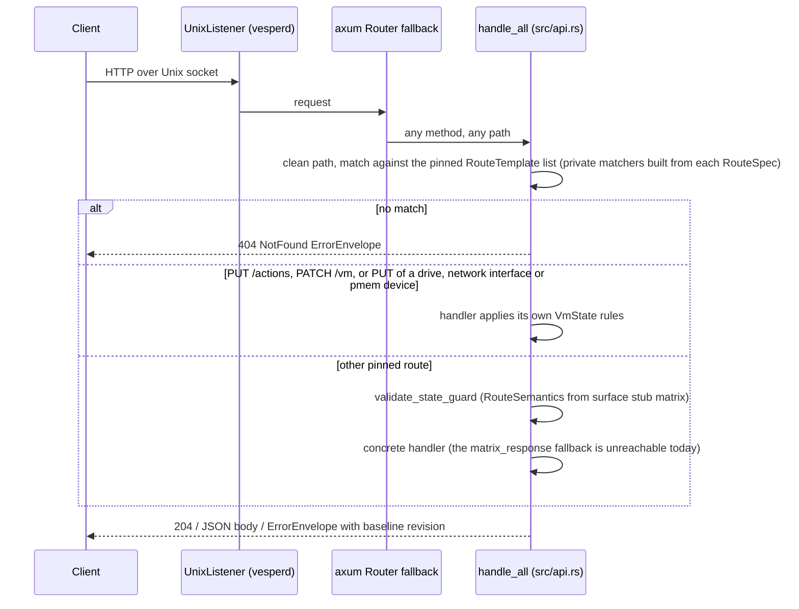

# Architecture

This is the top-level map of Vesper: what exists, where it lives and which way dependencies may point. It is
authoritative for component boundaries and dependency rules. Every claim is labelled **Verified**, **Intended**,
**Proposed** or **Unknown** as defined in [docs/README.md](docs/README.md#evidence-labels); a section labelled once
applies that label to every row or bullet in it.

## Terms

**Verified** against the files each term points at.

- `TD-nnn`: a row in the [tech-debt tracker](docs/exec-plans/tech-debt-tracker.md).
- `WOR-nnn`: an issue identifier in the Linear tracker; the [milestone log](docs/progress/symphony-milestones.md)
  records one entry per verified slice of work under that identifier.
- `GH #n`: an issue of the GitHub repository. `ADR nnnn`: a decision record under
  [docs/design-docs/adr/](docs/design-docs/adr/index.md). `CE-nnnn`: an entry of the compat registry
  ([Governance tooling](#governance-tooling)). `D-nnn`: a row of the [decision log](docs/design-docs/decision-log.md).
- *System VM*: the Linux guest that Virtualization.framework boots on the Mac; it runs dockerd, containerd and
  Firecracker. *MicroVM*: one Firecracker virtual machine inside the System VM.
- *Share*: a macOS directory that the launcher gives to the System VM over virtio-fs. *Share server*: the NFS server
  (`unfsd` in a sandbox, run by `vesper-unfs`) that gives one microVM its bind mounts from the shares.
- *Baseline*: the pinned upstream Firecracker revision recorded in
  [docs/specs/design-v0.baselines.lock.yaml](docs/specs/design-v0.baselines.lock.yaml).
- *Parity*: matching upstream Firecracker's observable behaviour at that revision.
- *Route family*: the set of handlers for one Firecracker path prefix.
- *Harness*: the docs, scripts and checks that keep agent work verifiable ([Code map](#code-map)).
- *Symphony*: the issue-execution orchestrator driven by [WORKFLOW.md](WORKFLOW.md).
- *Surface stub matrix*: a generated per-route table described under [Governance tooling](#governance-tooling).

## Purpose

**Verified.** Vesper exposes a Firecracker-compatible control plane on macOS. The `vesperd` binary serves the pinned
Firecracker OpenAPI route set over a Unix socket. By default it relays the socket to one jailed Firecracker in the
System VM (see below). With `--backend model` it answers from an in-memory VM state machine, a development and test
surface that starts no microVM, and every response produced after request extraction is either a success or a
deterministic envelope carrying the pinned Firecracker baseline revision (the pre-extraction exceptions are listed
in Invariant 3; [src/api.rs](src/api.rs), [src/bin/vesperd.rs](src/bin/vesperd.rs)). The repository also contains governance
tooling, a socket proxy, the System VM (its image lock, its guest overlay and its Swift launcher), and the Go
containerd shim with its helper binaries ([shim/](shim/README.md)). Firecracker microVMs run in the System VM in two
ways: the shim runs a containerd task of the runtime `io.containerd.vesper.v2` as one jailed microVM, and
`vesperd` (with no `--backend` flag, or `--backend systemvm`) relays its socket byte for byte to one jailed Firecracker
([ADR 0007](docs/design-docs/adr/0007-vesperd-to-backend-a.md) slice 4;
[src/bin/vesperd/systemvm.rs](src/bin/vesperd/systemvm.rs)). That backend is the default (D-063, ADR 0007 item 9); it stages
files and creates and loads snapshots (ADR 0007 slice 5). Docker containers run on runc.

**Intended** (per [design-v0](docs/specs/design-v0.md#backends)): parity is reached through
staged backends. Backend A runs stock Firecracker inside a System VM, a Linux guest booted by
Virtualization.framework that hosts containerd and Firecracker, because Firecracker needs KVM and macOS has none;
the guest supplies KVM through nested virtualization on M3 and later hosts, per design-v0.
Backend B is an eventual native macOS implementation behind the same API and lifecycle contract.

Out of scope for this repository: any Docker Desktop UX.

## System context

**Verified** for every edge, against the directory contracts named under [Components](#components). The edge from
`vesperd` to the System VM is the default backend's (absent with `--backend model`) and is exercised by `make systemvm-vesperd-suite`; the three `reads` edges of the swagger's routes, the lock and the matrix
are the model backend's (the System VM backend reads only the swagger's `info.version` and the launch config).



The System VM keeps Docker's and containerd's stores, and Vesper's state, on the data disk
([Deployment topology](#deployment-topology)). The share server reads the shares, which the System VM mounts at their
macOS paths. A runc container gets a bind mount straight from that mount; a microVM gets it from its share server.

## Components

**Verified.** The "Source" column names the library module that implements the component. The first six rows are
the Rust binaries, then the Swift launcher, then what runs inside the System VM.

| Component | Responsibility | Entry point | Owns data | Source |
|---|---|---|---|---|
| `vesperd` | Firecracker-compatible HTTP API: a byte relay to one jailed Firecracker in the System VM (`--backend systemvm`, the default, ADR 0007 and D-063), or the in-memory VM state machine (`--backend model`, for development and tests), to which it also stages files (`--stage`, `vesperd stage`), whose snapshot store it manages (`vesperd store list\|rm`), and to which it can give taps and NAT egress (`--tap`, `--network nat`, ADR 0008) (contracts: [src/README.md](src/README.md), [src/bin/README.md](src/bin/README.md); route families in [src/api/README.md](src/api/README.md)) | [src/bin/vesperd.rs](src/bin/vesperd.rs), [src/bin/vesperd/systemvm.rs](src/bin/vesperd/systemvm.rs), [src/bin/vesperd/stage.rs](src/bin/vesperd/stage.rs) | Model: in-memory `AppState`; may create log and metrics files and open drive, pmem, kernel and initrd paths during validation. System VM: none on macOS beyond its socket and `<socket>.lock`; the microVM lives as long as the process | [src/api.rs](src/api.rs); [src/proxy.rs](src/proxy.rs) and [src/control.rs](src/control.rs) for the relay |
| `vesper-proxy` | Forward a Unix socket to a unix, tcp or vsock upstream; with `--publish-ports`, publish containers' `-p` ports on macOS loopback through guest vsock 2400 (ADR 0005) | [src/bin/vesper-proxy.rs](src/bin/vesper-proxy.rs) | The ports status file (`--ports-status`, `run/vesper/ports.json` under `make docker-up`) | [src/proxy.rs](src/proxy.rs), [src/ports.rs](src/ports.rs) |
| `baselinectl` | Parity metadata, surface stub matrix, behavior matrix; the upstream-suite pins and the comparison of an upstream-suite run (`upstream-pins`, `upstream-compare`) | [src/bin/baselinectl.rs](src/bin/baselinectl.rs) | The two matrix files under `docs/generated/`, `artifacts/parity-metadata.json`, the `upstream-compare` report | [src/baseline.rs](src/baseline.rs) (+ `baseline/upstream`), [src/spec.rs](src/spec.rs), [src/api_matrix.rs](src/api_matrix.rs), [src/api_behavior_matrix.rs](src/api_behavior_matrix.rs) |
| `compatexctl` | Compat exception registry validation | [src/bin/compatexctl.rs](src/bin/compatexctl.rs) | None | [src/compat.rs](src/compat.rs) |
| `contractgen` | Golden route contract generate/check | [src/bin/contractgen.rs](src/bin/contractgen.rs) | `testdata/contracts/firecracker-routes.golden.json` | [src/spec.rs](src/spec.rs) |
| `systemvmctl` | System VM image and package lock verification, manifest, launch config, boot smoke (repeated launcher runs with timing), backend selection (`backend-select`), and `control`: the client of the guest agent and the runner of every suite that needs the System VM | [src/bin/systemvmctl.rs](src/bin/systemvmctl.rs), [src/bin/systemvmctl/replay.rs](src/bin/systemvmctl/replay.rs) | `build/systemvm/*.json`, `run/systemvm/*`, `docs/generated/backend-a-behavior-replay.json` (`control replay-suite --publish`) | [src/systemvm.rs](src/systemvm.rs), [src/control.rs](src/control.rs), [src/platform.rs](src/platform.rs), [src/api_replay.rs](src/api_replay.rs) |
| `vesper-vmlauncher` | Boot one launch config on Virtualization.framework (NAT, virtio console, virtio socket, an entropy device, virtio block devices including the persistent data disk, the virtio-fs shares), run the config's console probe, serve the vsock bridge socket, watch the shares with FSEvents and send their events to guest vsock 2401, report ready, probe, running and stop status (contract: [launcher/README.md](launcher/README.md); decision: [ADR 0001](docs/design-docs/adr/0001-systemvm-launcher-swift-helper.md)) | [launcher/Sources/vesper-vmlauncher/](launcher/Sources/vesper-vmlauncher/main.swift) (`main.swift`, `ShareWatcher.swift`) | `run/systemvm/console.log`, the bridge socket `run/systemvm/vsock/3.sock`; the guest writes the data disk image (default `run/systemvm/data.img`) | Swift, not part of the crate |
| Guest agent and tools | `vesper-agent` answers the control channel on vsock 1024; `vesper-microvm` (shim microVMs, the share network, the share server's launch) and `vesper-vesperd` (`vesperd`'s microVMs) run the jailer; `vesper-data`, `vesper-share`, `vesper-containers`, `vesper-rootfs`, `vesper-workload`, `vesper-ctr`, `vesper-fcparity`, `vesper-memadmit` and the relays do the rest (contract: [systemvm/overlay/README.md](systemvm/overlay/README.md); ADR 0002, ADR 0003) | [systemvm/overlay/usr/local/bin/](systemvm/overlay/README.md), services in `systemvm/overlay/etc/init.d/` | State on the data disk under `/var/lib/vesper`; run state under `/run/vesper` | POSIX shell, in the guest overlay |
| `containerd-shim-vesper-v2` | The containerd runtime v2 shim: one jailed microVM for each task of the runtime `io.containerd.vesper.v2`; exec, terminals and stdin through `vesper-console` in the guest (ADR 0004, ADR 0006; contract: [shim/README.md](shim/README.md)) | `shim/cmd/containerd-shim-vesper-v2`, `shim/cmd/vesper-console` | `vesper-task.json` and `vesper-rootfs.json` in each bundle; the rootfs cache | Go: `shim/internal/{manager,task,bundle,backend,shares}` |
| `vesper-unfs` | The share server of one microVM: opens the task's bind sources beneath the shares, runs the patched `unfsd` in a sandbox, keeps read-only binds read-only, attaches a file that macOS replaced, and sends host edits to the guests (`fanout`) (ADR 0009) | `shim/cmd/vesper-unfs`; `unfsd` is built from [third_party/unfs3/](third_party/unfs3/README.md) | The record of read-only objects and the server's list, under `/run/vesper/microvm/unfs` | Go: `shim/internal/{unfs,nfsprobe,shares}` |
| `vesper-authz`, `vesper-runc` | `vesper-authz` is dockerd's authorisation plugin: an allow-list of Docker API routes and rules for container and volume create; with dockerd's user-namespace remap it keeps every container from being root on the System VM (ADR 0010). `vesper-runc` is dockerd's default runtime: it runs runc, and after a create it makes the System VM read each bind source's owner as the container's user sees it (TD-062) | `shim/cmd/vesper-authz`, `shim/cmd/vesper-runc` | `vesper-runc`: one line in `/run/vesper/runc-refresh` | Go: `shim/internal/{authz,runcwrap}` |

The six Rust binaries are discovered by Cargo from `src/bin/*.rs`; see [src/bin/README.md](src/bin/README.md). The
launcher is a separate Swift package built by `make vmlauncher-build`. The five Go binaries are one module in `shim/`,
built static for Linux arm64 by `make shim-build`; `make systemvm-overlay` puts them, `unfsd` and the guest tools in
the System VM's initramfs.

## Domain boundaries and dependency rules

**Verified** for single-path `crate::x` and `vesper::x` references in the 43 files enumerated in the `RULES`
allowlist of [scripts/harness/check_structure.py](scripts/harness/check_structure.py), which CI checks: the 14
top-level `src/*.rs` modules, the nine modules under `src/api/` (eight route families and the error surface), `src/baseline/upstream.rs`,
`src/control/launchapi.rs`, `src/control/stage.rs`, `src/control/suites.rs` and its ten children,
`src/proxy/relay.rs` and the five `src/systemvm/` children. That is every library file but `src/api/tests.rs`. The
allowlist is a fixed list, not a glob: a new module is unchecked, and has no line budget, until a `RULES` row is
added. Grouped `use crate::{..}` imports, `super::super` paths, the binaries and `tests/` are not checked, and
`src/lib.rs` has a row for its line budget only (TD-018); `src/api/tests.rs` is outside both the allowlist and the
line budgets (TD-015). The Go module in `shim/` and the Swift launcher are outside this check.

| Layer | Purpose | Modules | May reference | Enforced |
|---|---|---|---|---|
| 0. Leaf modules | Pinned upstream contract, parity metadata, build metadata | `spec`, `baseline` (+ `baseline/upstream`, the upstream-suite pins and comparator), `compat`, `buildinfo` | nothing local | mechanical |
| 1. Platform policy | Host capability and entitlement rules; nested-virtualization probe and backend selection (GH #17) | `platform` | nothing local | mechanical |
| 2. Control plane: `api` | State machine, dispatch, deterministic errors | `api` | `api_matrix`, `baseline`, `buildinfo`, `compat`, `platform`, `spec` | mechanical |
| 2. Control plane: matrices | Generated route matrices; the behaviour-matrix replay (scripts, judge) | `api_matrix`, `api_behavior_matrix`, `api_replay` | `api`, `baseline`, `spec`; `api_behavior_matrix` also `api_matrix`; `api_replay` only `api_behavior_matrix` | mechanical |
| 2. Control plane: families | Extracted route-family handlers | `api/*` | `super` only (no `crate::` references) | mechanical |
| 3. Runtime adapters | Socket proxying, published ports, System VM artifacts, guest control channel | `proxy`, `ports`, `systemvm` (+ `systemvm/boot_check`, `systemvm/image_lock`, `systemvm/packages`, `super` only; `systemvm/bridge` and `systemvm/data_disk`, which also name `crate::systemvm` in their tests), `control` (+ `control/launchapi`, `control/suites`, `control/suites/{bundle,restart,exec,launchapi,vesperd,snapshot,replay,egress,bounds,sharenet}`, `control/stage`, `super` only); `proxy` also has `proxy/relay` (`super` only) | `proxy` and `systemvm`: `buildinfo`, `platform`; `ports` and `control`: nothing local | mechanical |
| 4. Entry points | `clap` binaries | `src/bin/*` | any library layer | review |
| 5. Tests and harness | Contract tests, sensors (CI scripts that detect drift), docs, Symphony templates | `tests/`, `src/api/tests.rs`, `scripts/harness/`, `harness/`, `.github/workflows/`, `docs/`, `.symphony/templates/` | may import the library; nothing imports them | review |

`api_matrix` imports `api::RouteSpec`, and `api` imports the matrix types from `api_matrix`. `RouteSpec` duplicates
`spec::Route`, forcing hand conversions in `vesperd`, `baselinectl`, `tests/api_contract.rs` and the two
`validates_repo_generated_*` unit tests, and `tests/api_replay.rs`; TD-020 removes them by moving the type to `spec`.

The diagram below is a simplified view; the table is authoritative. An arrow points from the referenced module to
the module that references it. Solid edges are references that exist today (including test-only references, which
the allowlist counts); dashed edges are allowed but unused.



Disallowed directions (**Verified** by the same allowlist, with the same scope limit): control-plane code must not
import `proxy`, `ports`, `systemvm` or `control`; those four must not import `api`; leaf modules must not import
runtime or control-plane modules.

## Code map

**Verified.**

- `src/`: the `vesper` library crate. Public modules and their contracts are listed in [src/README.md](src/README.md).
  `src/api.rs` holds `AppState`, the dispatch table and the handlers of the families not moved yet (drives, network
  interfaces, memory hotplug, snapshots, the serial, entropy and vsock devices); `src/api/` holds the extracted
  route families and the error surface ([src/api/README.md](src/api/README.md)).
- `src/bin/`: the six binaries ([src/bin/README.md](src/bin/README.md)).
- `tests/`: integration suites: `api_contract.rs`, `contract_golden.rs`, `api_replay.rs` (the behaviour replay on
  the model backend), `upstream_compare.rs` (starts `baselinectl`), `vesperd_socket.rs` and `vesperd_systemvm.rs`
  (start the `vesperd` binary), and `bounds_helpers.rs`, `sharenet_helpers.rs` and `vsock_peer.rs`, which run guest
  shell helpers ([docs/TESTING.md](docs/TESTING.md)).
- `shim/`: the Go module of the five binaries that run in the System VM ([shim/README.md](shim/README.md),
  [Components](#components)); `go vet` and `go test` run in `shim-tests.yml`.
- `scripts/`: CI lint (`ci/`), the macOS dev loop (`macos/`), the System VM scripts (`systemvm/`: image and overlay
  build, the shim and `unfsd` builds, the suites that need the System VM, the upstream-suite run), harness sensors
  (`harness/`), the third-party notices (`licenses/`), and `update-issue-checklists.sh`,
  which performs live `gh issue edit` writes to GitHub issues #1 to #40 (no dry run, but idempotent via a body
  marker; [scripts/README.md](scripts/README.md)).
- `harness/`: the knowledge-base checker (`check_docs.py`, `config.toml`), its installer (`install.py`), its unit
  tests (`tests/`, which also test the guest script `vesper-guest-session`), the recurring agent prompts, and the
  interactive page of this map (`architecture-viz.html`, refreshed with `prompts/update-architecture-viz.md`)
  ([harness/README.md](harness/README.md)); see [Terms](#terms).
- `.github/workflows/`: thirteen workflows, each listed as "steps (triggers)"; every one but
  `harness-garbage-collection.yml` runs on pull requests and on pushes to `main` within its trigger paths.
  - `rust-tests.yml`: `make build`, `cargo test`, both matrix checks, entitlement lint (`src/**`, `tests/**`,
    `Cargo.*`, `Makefile`, `third_party/**`, `docs/generated/**`, `docs/specs/*.yaml`, `packaging/**`, `scripts/ci/**`).
  - `contract-tests.yml`: golden check, `make contract-test` (swagger, `src/spec.rs`, `src/api.rs`, `contractgen`, golden file).
  - `shim-tests.yml`: `go vet`, `go test` and the static linux/arm64 cross-build of `shim/`, binaries uploaded as
    an artifact (`shim/**`, `scripts/systemvm/build-shim.sh`, the guest script `vesper-microvm`).
  - `systemvm-image.yml`: three jobs: `unfsd` rebuilt and compared with the shipped binary; the pinned image
    fetched and verified, the overlay built twice and compared, the manifest's `image_id` checked; the launcher
    built, signed and run without a VM (`systemvm/**`, `scripts/systemvm/**`, `launcher/**`, the two System VM
    locks, `third_party/unfs3/**`, `src/systemvm.rs`, `systemvmctl`, `Makefile`). It cannot boot the System VM (TD-005).
  - `ctr-conformance.yml`: assembler self-test, validation of the committed ctr conformance capture against the
    lock, artifact upload (the capture, the lock, the assembler script).
  - `parity-baseline.yml`: assembler self-test, validation of the committed Backend A parity capture against the
    lock, archives and compat registry, artifact upload (the capture, the lock, the registry, `systemvm/archives.yaml`,
    the assembler script).
  - `baseline-governance.yml`: `cargo test`, parity metadata generate and validate, the upstream-suite collector
    self-test and `baselinectl --mode upstream-pins` (lock file, `src/baseline.rs`, `src/baseline/**`, `baselinectl`,
    the upstream-suite classes, artifact digests and scripts).
  - `compat-exceptions.yml`: `cargo test`, `compatexctl` (registry, `src/compat.rs`, `compatexctl`).
  - `harness-docs.yml`: `scripts/harness/check_docs.py` (docs, `AGENTS.md`, `ARCHITECTURE.md`, `WORKFLOW.md`).
  - `harness-structure.yml`: `check_structure.py` (`src/**`, the script, `ARCHITECTURE.md`).
  - `harness-quality-score.yml`: `compute_quality_score.py` (docs, `scripts/harness/**`, `src/**`, `tests/**`,
    `third_party/**`, `.symphony/templates/**`).
  - `harness-garbage-collection.yml`: `janitor_scan.py`, weekly and the only CI run of it; non-blocking by default
    (`--fail-on never`, a manual dispatch can select `errors` or `warnings`).
  - `docs.yml`: `harness/check_docs.py --strict` and the unit tests under `harness/tests/` (every PR and every push
    to `main`).
- `docs/`: system of record ([docs/README.md](docs/README.md)). `docs/specs/` is normative; `docs/generated/` is
  machine-written.
- `third_party/firecracker/`: vendored Firecracker OpenAPI, read by `spec::load_routes` (route table) and
  `spec::load_info_version` (pinned version string).
- `packaging/macos/`: entitlement plists for `vesperd`, `vesper-proxy` and `vesper-vmlauncher`. The `vesperd` plist
  is validated by `platform` at startup when `--entitlements-file` is given; the launcher plist is applied by
  `scripts/macos/build-vmlauncher.sh` at signing time; all three are linted by `scripts/ci/validate-entitlements.sh`
  (syntax lint on macOS, required-key check on Linux CI, TD-010).
- `launcher/`: Swift package for `vesper-vmlauncher` ([launcher/README.md](launcher/README.md)).
- `third_party/unfs3/`: the patches, the build script and the shipped `unfsd` binary of the share server, with the
  digests of its sources ([third_party/unfs3/README.md](third_party/unfs3/README.md)).
- `systemvm/archives.yaml`: digest-pinned binary archives (Firecracker and jailer) appended to the packages lock.
- `systemvm/overlay/`: Alpine overlay applied to the guest at boot ([systemvm/overlay/README.md](systemvm/overlay/README.md),
  [ADR 0002](docs/design-docs/adr/0002-systemvm-overlay-via-initramfs.md)); `docs/specs/systemvm-packages.lock.yaml`
  pins the packages it installs; it carries the supervised guest agent (`vesper-agent`, [ADR 0003](docs/design-docs/adr/0003-systemvm-control-channel.md)),
  the guest tools and services of the [Components](#components) table, and, put there by the build, the five Go
  binaries and `unfsd`.
- `testdata/contracts/`: golden route list written by `contractgen`.
- `docs/specs/systemvm-image.lock.yaml`: the pinned System VM boot image (Alpine virt ISO: URL and SHA-256, the
  kernel and initramfs members with unpack method and digests, the ISO as boot media, kernel command line, console
  ready pattern, expected `image_id`, and the overlay, control-channel, boot-time, nested-virtualization and probe
  settings). `make systemvm-fetch` downloads it into `build/systemvm/` (gitignored) and
  `systemvmctl verify-image` checks the digests; `make systemvm-boot-smoke` boots it through the launcher.
- `.symphony/templates/`: templates for Symphony (see [Terms](#terms)):
  `verification-manifest-template.yaml` (used by WORKFLOW.md), `symphony-milestones-template.md` and
  `milestone-report-template.md` (used by [docs/progress/index.md](docs/progress/index.md)), and `council-rubric.md`
  (cited by [core beliefs](docs/design-docs/core-beliefs.md)).

## Main flows

### API request

**Verified.**



The state machine has three states: `PreBoot`, `Running`, `Paused`. `PUT /actions` (`InstanceStart`) and `PATCH /vm`
(`Paused`, `Resumed`) move between them and apply their own rules, which is why they bypass the guard; a successful
`PUT /snapshot/load` also sets the state. `PUT /drives/{drive_id}`, `PUT /network-interfaces/{iface_id}` and
`PUT /pmem/{id}` bypass it too: they parse the body first and then apply `reject_runtime_hotplug`, as Firecracker
does. Every other route is gated first by its matrix semantics: `PreBoot` rejects
after boot, `PostBoot` rejects before boot, and `Any` and `PreBootRuntime` (allowed in both phases, the latter with
runtime effects) never reject. The guard does not distinguish `Running` from `Paused`. A duplicate `("PATCH", "/vm")`
arm near the end of the dispatch table (second to last) is shadowed by the early bypass and is dead code (TD-022).

State is held in `AppState` behind `std::sync::RwLock` fields on a multi-thread tokio runtime. There is no state
persistence and no background work. Handlers open caller-supplied host files synchronously with `std::fs` on the
async worker thread (log and metrics creation, kernel, initrd, drive and pmem validation) with no `spawn_blocking`,
so a hung path stalls that thread (TD-024). Startup order in `vesperd` on the model backend is: validate
entitlements (only when `--entitlements-file` is given), refuse the flags that only the System VM backend takes,
load the baseline lock and fail if the Firecracker revision
is blank, load routes and version from the swagger, load the surface stub matrix, build `AppState::new_with_matrix` (which
validates the matrix against `documented_route_semantics`), choose the socket path (without `--socket`:
`vesperd.sock` in an owner-only runtime directory), then `proxy::claim_socket` (create the socket's parent
directory with mode 0700, refuse one writable by group or others, take `<socket>.lock`, refuse a live socket and a
path that is not a socket, remove a stale one), bind, chmod the socket to `0o600`, and only then listen, so that
no connect reaches the server through a socket that is not yet owner-only. With `--backend systemvm`
the start branches after the entitlement check and loads no lock, route list or matrix (next section); the
`vesperd stage` and `vesperd store` subcommands do none of this.

### API request on `--backend systemvm`

**Verified** by `tests/vesperd_systemvm.rs` (fake agent) and `make systemvm-vesperd-suite` (System VM, 19 steps).

```mermaid
sequenceDiagram
  participant C as Client
  participant V as vesperd (systemvm)
  participant B as Launcher bridge (3.sock)
  participant A as vesper-agent (vsock 1024)
  participant F as Firecracker (jail, uid 20000)
  V->>V: claim_socket (lock, live-socket refusal)
  V->>B: CONNECT 1024, then DATA status
  A-->>V: DATA mounted or DATA formatted (else vesperd refuses to start)
  V->>B: CONNECT 1024, then LAUNCHAPI id [ceiling] [stage=SRC:DEST]... [tap=NAME]... [net=nat]
  A->>A: fresh jail on the data disk; link or copy each --stage file
  A->>F: jailer, no config file
  A-->>V: READY id pid firecracker_version (checked against the swagger)
  Note over V,A: this connection is the lease for the life of the process
  V->>V: bind the socket (0600)
  C->>V: connect
  V->>B: new connection: CONNECT 1024, greeting, FCAPI id
  A-->>V: OK, then socat to the API socket in the jail
  C->>F: HTTP bytes, relayed unchanged both ways
  F-->>C: Firecracker's own response bytes
```

`vesperd` parses only the greeting, the answer to `DATA status`, `OK`, `READY` and `ERR`; on a failure of its own it closes the client connection
with no bytes. The relay (`proxy::serve` with a `Preface` and `Bounds`) reads at most 8 KiB at a time, closes a
connection idle for 120 s or a request unanswered for 120 s, and relays at most 16 connections (CE-0007). The lease
ends the microVM when it closes: SIGTERM or SIGINT closes it and waits for the teardown (exit 0); the agent's close
(Firecracker exited, the System VM went away) makes `vesperd` remove its socket and exit 1.

Files reach a jail only through `vesperd` (ADR 0007 slice 5): `--stage` at start, and `vesperd stage` and `vesperd
store list|rm` while microVMs run, each one `VESPERD` line to the agent. The jails and the snapshot store share one
bind mount on the System VM's data disk, so `--stage` can hard-link a store snapshot into a fresh jail; jail-side
reads and writes run as uid 20000, and only the store survives a reboot. A copy into the store is refused past a
quota of 25% of the data disk, or when it would leave less than the free-space reserve (TD-053). **Verified** by
`tests/vesperd_systemvm.rs` (fake agent), `make systemvm-snapshot-suite` (System VM, 24 steps) and
`make data-disk-suite` (the reboot).

A `vesperd` microVM has no network unless asked: `--tap` (at most 8) gives it taps in a network namespace of its
own, and `--network nat` gives them egress to public IPv4 and DNS and to nothing else
([ADR 0008](docs/design-docs/adr/0008-vesperd-microvm-egress.md); `make systemvm-egress-suite`; residuals in TD-058).

### A containerd task as a microVM

**Verified** against [shim/README.md](shim/README.md) and [systemvm/overlay/README.md](systemvm/overlay/README.md),
and by the suites named in each step's line.

```mermaid
sequenceDiagram
  participant C as containerd
  participant S as containerd-shim-vesper-v2
  participant M as vesper-microvm
  participant U as share server (vesper-unfs, unfsd)
  participant G as microVM (init, vesper-console, runc)
  C->>S: Create (bundle, runtime io.containerd.vesper.v2)
  S->>S: root drive from the layer-chain cache; machine size from the task's limits; plan of the binds
  S->>M: launch ID --guest-exec [--share-net --unfs-mount DIR --unfs-src REL:MODE ...]
  M->>U: with binds: a network namespace and one sandboxed server, waited for until it listens
  M->>G: jailer and Firecracker (uid 10000, pivot-root jail, cgroup, seccomp)
  G->>U: NFSv3 mounts of the task's binds, over the share network only
  S->>G: sessions over private vsock ports: the process, exec, terminal, stdin
  G-->>S: exit code
  S-->>C: task events
```

One microVM runs one task. The shim sizes it from the task's memory and CPU limits (TD-048). A bind mount whose
source lies in a macOS share becomes an export of that microVM's share server; nothing else reaches the server, and
the microVM's share network has no route out ([ADR 0009](docs/design-docs/adr/0009-shares-into-microvms-over-nfs.md)). What is
bound read-only stays read-only by any name, and a bound file that macOS replaces is bound again within seconds
([docs/SECURITY.md](docs/SECURITY.md), [docs/RELIABILITY.md](docs/RELIABILITY.md)). Host edits reach the guests
through `vesper-unfs fanout`. Suites: `make systemvm-shim-suite`, `systemvm-bundle-suite`, `systemvm-restart-suite`,
`systemvm-exec-suite`, `systemvm-microvm-size-suite`, `systemvm-sharenet-suite`, `systemvm-unfs-suite`,
`systemvm-microvm-shares-suite` and `systemvm-microvm-binds-suite`.

### Proxy connection

**Verified.** `vesper-proxy` parses the upstream once at startup with `proxy::parse_target`, removes what is at its
listen path (with no check that a live server owns it), binds a Unix listener and sets its mode (`--listen-mode`,
default 0600),
and then spawns one tokio task per client that dials the upstream within `dial_timeout` and relays bytes both ways.
`--validate-upstream` refuses to start without the upstream socket, and `--publish-ports` starts the published-ports
loop ([src/ports.rs](src/ports.rs)). A
`vsock://<cid>:<port>` upstream is bridged through `<vsock_socket_dir>/<cid>.sock` (`--vsock-socket-dir`, default
`/tmp/vesper/vsock`) with a `CONNECT <port>\n` preface. The launcher serves that bridge socket for the System VM
(`run/systemvm/vsock/3.sock`), and `make docker-up` uses it; the transport on the macOS side is a Unix socket, not a
vsock (TD-004; [src/proxy.rs](src/proxy.rs), [launcher/README.md](launcher/README.md),
[docs/process/systemvm-bringup.md](docs/process/systemvm-bringup.md)).

## Governance tooling

**Verified.** `contractgen` runs in `contract-tests.yml` and via `make contract-check`; the `baselinectl` matrix modes
run in `rust-tests.yml` via `make surface-matrix-check` and `make behavior-matrix-check`, while its metadata modes are
invoked directly in `baseline-governance.yml` and have no Make target, as is `--mode upstream-pins`; `--mode
upstream-compare` judges an upstream-suite run (`make systemvm-upstream-suite`, GH #172); `compatexctl` runs only in
`compat-exceptions.yml` and by hand. Together they keep these
artefacts in step with the pinned baseline ([docs/process/baseline-governance.md](docs/process/baseline-governance.md)):

| Artefact | Path | Purpose | Read by |
|---|---|---|---|
| Baseline lock | `docs/specs/design-v0.baselines.lock.yaml` | Pinned upstream revisions and required parity metadata keys | `vesperd` (model backend), `baselinectl`, `tests/api_replay.rs`, the two report assemblers under `scripts/systemvm/`, `build-overlay.sh` (copies it into the guest), `tests/api_contract.rs`, the `validates_repo_generated_*` unit tests (in the test modules of `src/api_matrix.rs` and `src/api_behavior_matrix.rs`) |
| Golden route list | `testdata/contracts/firecracker-routes.golden.json` | `contractgen`'s serialisation of the pinned swagger routes | `contractgen --mode check`, `tests/contract_golden.rs`, `check_structure.py` and `janitor_scan.py` (route coverage) |
| Surface stub matrix | `docs/generated/firecracker-api-surface-stub-matrix.json` | Per-route semantics (`Any`, `PreBoot`, `PostBoot`, `PreBootRuntime`, stored on disk as `Any`, `PB`, `PO`, `PB/RT`) plus a stub status: the `501 NotImplemented` response a route would get if it had no handler. Every route has one today, so no stub is served | `vesperd` at startup (drives `validate_state_guard`), `baselinectl`, `tests/api_contract.rs`, `validates_repo_generated_matrix` |
| Behavior matrix | `docs/generated/firecracker-api-behavior-matrix.json` | Per-route expected status and error cases with upstream evidence | `baselinectl`, `validates_repo_generated_behavior_matrix` |
| Behavior capture registry | `docs/specs/firecracker-api-behavior-captures.yaml` | Upstream evidence that feeds the behavior matrix | `baselinectl` |
| Baseline capture registry | `docs/specs/firecracker-api-baseline-captures.yaml` | Empty placeholder (`captures: []`) kept for a code path that `route_uses_matrix_backed_placeholder` currently disables (it always returns `false`); generation requires it to stay empty ([src/README.md](src/README.md)) | `baselinectl` |
| Behavior replay | `docs/specs/firecracker-api-behavior-replay.yaml`, `docs/generated/backend-a-behavior-replay.json` | The request script of each behaviour-matrix case, and the published result of replaying them on Backend A | `tests/api_replay.rs` (`make behavior-replay-check`), `systemvmctl control replay-suite` |
| Compat registry | `docs/specs/compat-exceptions.yaml` | Allowed behaviour deviations before GA | `compatexctl`, `tests/upstream_compare.rs`, the parity-baseline scripts |
| Upstream-suite classes and artifact digests | `docs/specs/upstream-suite-classes.yaml`, `docs/specs/upstream-suite-artifacts.sha256` | How each upstream test's result is judged, and the pinned artifacts of the run | `baselinectl --mode upstream-compare`, `scripts/systemvm/upstream-suite/` |
| Backend A captures | `docs/specs/backend-a-parity-baseline.json`, `docs/specs/ctr-conformance-baseline.json` | Committed results of `make systemvm-parity-baseline` and `make ctr-conformance` | `parity-baseline.yml`, `ctr-conformance.yml` (`make parity-baseline-check`, `make ctr-conformance-check`) |
| System VM packages lock | `docs/specs/systemvm-packages.lock.yaml` | Pinned guest packages and, from `systemvm/archives.yaml`, binary archives | `systemvmctl package-list`, `archive-list` and `verify-packages`, `scripts/systemvm/fetch-packages.sh`, `systemvm-image.yml` |
| System VM image lock | `docs/specs/systemvm-image.lock.yaml` | Pinned upstream boot image: archive URL, SHA-256 of archive, kernel and initramfs, expected `image_id` | `systemvmctl lock-env` and `verify-image` (`src/systemvm.rs`), `scripts/systemvm/fetch-image.sh`, `validates_repo_image_lock` unit test, `systemvm-image.yml` |
| Parity metadata | `artifacts/parity-metadata.json` (not committed) | Backend, host and baseline revision stamp for a parity claim | `baselinectl --mode validate` |

## Deployment topology

**Verified.** Two deployments run, both on a developer's Mac and neither packaged: the model dev loop
(`make dev-up`) and the System VM path (`make systemvm-up`, `make docker-up`, `vesperd --backend systemvm`).
`make dev-up` builds
`vesperd` and `vesper-proxy`, starts `vesperd` on `run/vesperd.sock` and `vesper-proxy` on `run/docker.sock` with
its upstream set to `vesperd`'s socket, so `run/docker.sock` is a second path to the API. The dev loop always passes
`--entitlements-file packaging/macos/vesperd.entitlements`, so the entitlement check runs and the plist must exist.
`vesper-proxy` makes its listener owner-only by default (`--listen-mode`), stops on Ctrl-C or SIGTERM, and has no
entitlement check (TD-017; [scripts/macos/README.md](scripts/macos/README.md)). Entitlement
plists live in `packaging/macos/`. No installer, launchd or packaging manifests exist. The System VM path is
`make systemvm-fetch` (pinned Alpine ISO, verified), `make systemvm-launch-config`, `make vmlauncher-build`
(ad-hoc signed Swift helper; `make systemvm-prepare` runs all of these plus `make systemvm-overlay`, which packs
into the initramfs the guest overlay, the pinned packages (among them `socat`, `containerd`, Docker, `runc`,
`qemu-x86_64`), the Firecracker and jailer archives, the five Go binaries of `shim/` (so it needs a Go toolchain),
the digest-checked `unfsd` and a copy of the baseline lock) and
`make systemvm-boot-smoke`, which boots the VM N times, logs in on the console,
obtains a DHCP lease from the NAT and pings the gateway, powers the guest off, and checks each boot against the 5 s
threshold. `make systemvm-up` keeps the VM running with the owner-only bridge socket `run/systemvm/vsock/3.sock`
served by the launcher; `systemvmctl control` reaches the supervised guest agent through it (handshake, keepalive,
reconnect and 2 MiB echo proven by `make systemvm-control-suite`); `make systemvm-down` powers the guest off.
`containerd` and `dockerd` run under `supervise-daemon` inside the guest (cgroup v2, `eth0` by DHCP) and
`make systemvm-services-suite` proves they recover from SIGKILL. In a normal boot dockerd runs with a user-namespace
remap, the `vesper-authz` authorisation plugin and `vesper-runc` as its default runtime, so no container is root on
the System VM (ADR 0010, `make systemvm-confine-suite`); `make docker-up` refuses to serve when the System VM's
container mode is not the launch config's. `make docker-up` starts `vesper-proxy` on the
owner-only `run/vesper/docker.sock` with `vsock://3:2375` as upstream, reached through the bridge and the guest's
Docker relay, so the macOS Docker CLI talks to Docker 28 in the VM; `make docker-smoke` runs a trivial container
built offline from the pinned ISO. That is design-v0's Phase 1 exit criterion, met on developer hardware.
`systemvmctl backend-select` decides between Backend A (nested virtualization on macOS 15+ with an M3 or later;
the guest then has `/dev/kvm`) and the unimplemented Backend B fallback, with diagnostics; the lock's
`boot.nested_virtualization: auto` drives the launcher. Backend A itself runs: `make systemvm-microvm-suite`
launches a stock Firecracker v1.16.0 microVM under the jailer (uid 10000, pivot-root jail, cgroup, seccomp) inside
the System VM in about 1.5 s and proves stop, SIGKILL cleanup and guest power-off; `make systemvm-rootfs-suite`
converts an image from the guest's Docker into a reproducible ext4 rootfs with embedded provenance and boots a
microVM from it; `make systemvm-workload-suite` runs concurrent container-style workloads one per jailed microVM
with private rootfs copies; `make systemvm-parity-baseline` runs 19 Firecracker API conformance checks and two
comparable performance runs against the stock release binary and publishes the capture that CI validates.
`make systemvm-upstream-suite` runs the upstream pytest suite on the System VM, unmodified, in about 80 minutes
(GH #172); it has no Linux pass set to be compared with yet, so CE-0001 stays open. `shim/` (Go, ADR 0004) is the containerd runtime v2 shim:
`ctr run --runtime io.containerd.vesper.v2` boots a jailed microVM from the container rootfs and maps exit code,
output, kill and delete (`make systemvm-shim-suite`); root drives are built block-first once per image layer
chain and copied per task (`make systemvm-bundle-suite`); tasks survive a containerd restart and a dead shim
leaves no microVM (`make systemvm-restart-suite`); exec, terminals with resize, stdin and signals go through
sessions over private vsock ports (ADR 0006, `make systemvm-exec-suite`), and `Pause`, `Resume`, `Checkpoint` and
`Update` are not supported; a microVM is sized from its task's limits (`make systemvm-microvm-size-suite`). From macOS,
`make docker-conformance` proves the Docker CLI (run, exec, ps, stop, rm, images, pull) through `vesper-proxy`
with dockerd's errors intact and no bypass of the ingress, and `make ports-suite` proves `-p` ports on
localhost through the bridge and the guest port relay (ADR 0005). `make binds-suite` proves host directories
named in `VESPER_SHARES` reach runc containers over virtio-fs at their host paths, read-only when asked, with
ownership mapped to the sharing user, and inotify events for host edits on watched read-write shares (the
launcher's FSEvents watcher feeds the guest's `vesper-share notify` sink, GH #150; residuals in TD-038). A shim
microVM gets the same binds from its own share server over NFSv3 ([A containerd task as a
microVM](#a-containerd-task-as-a-microvm); `make systemvm-unfs-suite`, `systemvm-microvm-shares-suite`,
`systemvm-microvm-binds-suite`). `make data-disk-suite` proves that images, stopped containers and volumes survive a System VM
reboot on the persistent data disk, that only an empty disk is formatted, and that a disk with another label is
refused while Docker keeps working on tmpfs (GH #164; packages are still reinstalled on every boot, TD-025). `make dns-suite` proves dockerd's
embedded DNS, aliases and external forwarding for a compose stack driven from macOS; `make workflow-suite` covers
compose, build, `logs -f`, interactive `exec -it` and signals, and `--platform linux/amd64` now runs through `binfmt_misc` and the pinned `qemu-x86_64` in the
System VM (`make crossarch-suite`, `vesper-arch mode` for native/emulated/unsupported). A shim or workload microVM
has no network (TD-032), apart from the share network a shim microVM can be given: one tap in a namespace of its
own, with no route out (ADR 0009, GH #160, `make systemvm-sharenet-suite`). A `vesperd` microVM can have taps and,
with `--network nat`, egress to public IPv4 (ADR 0008, `make systemvm-egress-suite`). Other suites that need the
System VM are listed in [docs/TESTING.md](docs/TESTING.md).

**Intended:** design-v0 describes a packaged macOS host process plus a Linux System VM running containerd and
Firecracker.

## Invariants

Rules that must always hold. "Verify with" is the command or test that checks the rule; "See" is where the rule lives.
Rows marked Verified without a mechanical check are tracked in the
[tech-debt tracker](docs/exec-plans/tech-debt-tracker.md); Intended and Proposed rows are tracked by the linked design
or parity documents.

| # | Invariant | Status | Enforced by | Verify with | See |
|---|---|---|---|---|---|
| 1a | `vesperd` is the only binary that serves the control-plane API. The other listeners on macOS are `vesper-proxy`'s socket, which only relays bytes (plus the vsock `CONNECT` preface); the launcher's owner-only bridge socket; and, with `--publish-ports`, loopback TCP listeners for containers' published ports, for which the proxy also reads the Docker API | Verified | Review only; no mechanical check (TD-008) | `grep -n 'UnixListener::bind' src/bin/vesperd.rs src/proxy.rs` (expect 1 hit in `vesperd.rs`, shared by both backends, and 6 in `proxy.rs`, of which the five inside the `#[cfg(test)]` module are test fixtures) | [src/bin/vesperd.rs](src/bin/vesperd.rs), [src/proxy.rs](src/proxy.rs) |
| 1b | Raw Firecracker and containerd sockets stay private to the System VM | Partly verified | The guest listens on vsock 1024 (agent), 2375 (Docker relay), 2400 (port relay) and 2401 (share notification sink), none of which is a raw Firecracker or containerd socket; the agent on 1024 does reach jailed Firecracker API sockets through `FCPARITY api` and `FCAPI`, and starts `vesperd` microVMs with `LAUNCHAPI` (ADR 0007 slice 3), so 1024 is a control surface that the bridge allow-list (1024, 2375, 2400, 2401; TD-027) keeps reachable; each guest listener turns away a peer that is not the Mac, and no process in the System VM can connect to its own vsock listeners; `make docker-smoke` enumerates host sockets and expects a refused `CONNECT`, and `make docker-conformance` proves the allow-list | `make systemvm-up && make docker-up && make docker-smoke` (steps `no_raw_host_sockets`, `raw_guest_port_denied`); `make docker-conformance` (steps `bridge_allow_list_enforced`, `no_containerd_relay`) | [design-v0](docs/specs/design-v0.md#security-model), [docs/SECURITY.md](docs/SECURITY.md) |
| 2 | Intra-crate single-path references in the 43 `RULES` files follow the layer table | Verified | `RULES` in `check_structure.py`, run by `harness-structure.yml` on `src/**` changes; a new module needs a `RULES` row (TD-018) | `python3 scripts/harness/check_structure.py --root .` | [scripts/harness/check_structure.py](scripts/harness/check_structure.py) |
| 3 | On the model backend, every error response produced by `handle_all` is an `ErrorEnvelope` with the pinned baseline revision; on the System VM backend (ADR 0007 slice 4; `tests/vesperd_systemvm.rs`, `make systemvm-vesperd-suite` step `firecracker_error_byte_for_byte`) HTTP errors are Firecracker's own, `vesperd`'s own failures are refused or closed connections, and its startup and command-line errors are deterministic. Exceptions before extraction: a body over axum's default 2 MiB limit gets a plain `413`, a body-read failure gets a plain `400`, and a poisoned `RwLock` panics the task (TD-019) | Verified | `AppState::new_with_matrix` rejects a blank revision; `tests/api_contract.rs` asserts envelopes; `rust-tests.yml` runs `cargo test` for every `src/**` change | `make contract-test` | [tests/api_contract.rs](tests/api_contract.rs) |
| 4 | The golden route list equals `contractgen`'s serialisation of the pinned swagger | Verified | `contractgen --mode check` and `tests/contract_golden.rs` in `contract-tests.yml`; `tests/**` changes are covered by `rust-tests.yml` | `make contract-check` | [tests/contract_golden.rs](tests/contract_golden.rs) |
| 5 | Generated surface stub and behavior matrices are complete and fresh | Verified | `baselinectl --mode validate-api-matrix` and `validate-api-behavior-matrix` in `rust-tests.yml`; the `validates_repo_generated_*` unit tests also fail under `cargo test` | `make surface-matrix-check`, `make behavior-matrix-check` | [docs/process/baseline-governance.md](docs/process/baseline-governance.md) |
| 6 | Compat exceptions carry required fields, and none is open past expiry | Verified | On change only: `compatexctl` in `compat-exceptions.yml` when the registry or its code changes; no scheduled run (TD-016) | `cargo run --bin compatexctl -- --registry docs/specs/compat-exceptions.yaml` | [docs/process/compat-exceptions.md](docs/process/compat-exceptions.md) |
| 7 | Inputs are parsed into typed structs once where they enter the crate (request bodies, registries, lock file, proxy targets, launch config); internal code never re-probes raw JSON or YAML. Exceptions: the MMDS data store is schemaless JSON by contract and is handled as `serde_json::Value`; `spec` probes the swagger as untyped `serde_yaml::Value` at load ([src/README.md](src/README.md)) | Verified | Per module: unit tests in each module; no cross-cutting lint (TD-008) | `cargo test --lib` | [src/README.md](src/README.md), [core beliefs](docs/design-docs/core-beliefs.md) |
| 8 | Library modules stay under their error budgets; warn budgets are advisory and two are currently exceeded (`src/api_behavior_matrix.rs`, TD-023; `src/baseline/upstream.rs`, 889 lines) | Verified | Budgets in `check_structure.py` for the files with a `RULES` row (`src/api.rs` warn 2500 / error 3200; others warn 800 / error 1200; `src/api/tests.rs` unbudgeted, TD-015) and `janitor_scan.py` (top-level `src/*.rs` only, no 800 tier: `api.rs` over 2500 warns, any other file over 1200 errors) | `python3 scripts/harness/check_structure.py --root .` | [Hotspots](#hotspots-and-decomposition-queue) |
| 9 | When started with `--entitlements-file`, `vesperd` refuses to start unless the plist contains `com.apple.security.virtualization`; without the flag no check runs | Verified | `platform::validate_entitlements_file` (substring match on the key, value not checked); `make validate-entitlements` lints the plists in `rust-tests.yml` | `make validate-entitlements` | [src/platform.rs](src/platform.rs) |
| 10 | Having a dispatch arm in `src/api.rs`, or answering `501`, does not count as parity with upstream Firecracker at the pinned revision | Proposed | Review against the parity matrix; `scripts/harness/janitor_scan.py` only warns on routes with no arm | n/a | [docs/specs/firecracker-feature-parity.md](docs/specs/firecracker-feature-parity.md), TD-003 |
| 11 | No container is root on the System VM: dockerd remaps users, and the authorisation plugin refuses the Docker API requests that would undo it | Verified | `vesper-authz` (allow-list), `userns-remap`, `vesper-containers prepare`; `go test ./internal/authz` in `shim-tests.yml` | `make systemvm-confine-suite` | [ADR 0010](docs/design-docs/adr/0010-no-container-is-systemvm-root.md), [docs/SECURITY.md](docs/SECURITY.md) |
| 12 | A microVM's share server serves only that task's bind sources, to that microVM only, and what was bound read-only stays read-only by any name | Verified, with the limits stated in [docs/SECURITY.md](docs/SECURITY.md) | The sandbox of `vesper-unfs run`, the share network's rules, the server's list of read-only objects and anchors (unfs3 patch 0006) | `make systemvm-unfs-suite`, `make systemvm-microvm-binds-suite` | [ADR 0009](docs/design-docs/adr/0009-shares-into-microvms-over-nfs.md) |
| 13 | A `vesperd` microVM reaches nothing unless it was given taps, and with `--network nat` it reaches public IPv4 and DNS only | Verified | The network namespace and rules that `vesper-vesperd` makes for each microVM | `make systemvm-egress-suite` | [ADR 0008](docs/design-docs/adr/0008-vesperd-microvm-egress.md) |

## Known limits

**Verified.** Limits recorded in the per-directory contracts that a reader of this map should know:

- A poisoned `RwLock` panics the request task instead of returning an envelope; bodies over 2 MiB get a plain `413`
  and body-read failures a plain `400` before extraction (TD-019).
- Handlers open caller-supplied host files synchronously on the async runtime with no `spawn_blocking`; a slow or
  hung path (network volume, FIFO) stalls the worker thread and the shutdown future (TD-024).
- The proxy relay has no size or idle limits (TD-021); it drops per-client errors silently (TD-007); it has no
  entitlement check (TD-017). Published ports are TCP and loopback only (TD-037). Details in
  [src/README.md](src/README.md) and [src/bin/README.md](src/bin/README.md).
- `make dev-up` has no idempotency guard and does not wait for `vesperd`'s socket before starting the proxy
  ([scripts/macos/README.md](scripts/macos/README.md)).
- `vesper-vmlauncher` is ad-hoc signed (runs only on the building machine); the guest probe is console-scripted
  (password-less root login on the live ISO). The control channel is a shell line protocol over `socat`, not a
  typed RPC (TD-026), and its bridge socket is host-visible and owner-only, and connects only to the guest vsock ports in `bridge_allowed_ports` (TD-027, resolved).
  GitHub's macOS runners cannot boot the System VM, so every suite that needs it runs on developer hardware only
  (TD-005).
- The shim does not support `Pause`, `Resume`, `Checkpoint` and `Update`; exec ports are not reclaimed until the
  task's microVM is deleted (TD-041). A `vesperd` microVM cannot be reattached: it stops when its `vesperd` process
  or the System VM restarts (TD-057).
- A shim microVM reaches at most 40 directories below a bind's root and no path longer than 1,024 bytes (TD-067). A
  directory bind stays with the directory that was bound when macOS replaces it, as on Docker on Linux, and gives
  "Stale file handle" after its share server started again (D-062, [RELIABILITY.md](docs/RELIABILITY.md)).
- On the model backend error bodies carry four fields that Firecracker does not send (CE-0006, closed:
  the model is no longer the default, D-063); on the System VM
  backend every path in an API request names a file in the microVM's jail (CE-0009).

## Guardrails for future work

**Proposed** policy, drawn from [core beliefs](docs/design-docs/core-beliefs.md); the TD-002 reference is Verified.

- Add new parity behavior only with matching tests or runtime evidence.
- Prefer small, testable repo-local abstractions over opaque helper libraries.
- When a rule is repeated in review, promote it into a doc, a template, a script, or a workflow.
- Tracker automation (GitHub Actions that move issues) must never become a source of truth. The retired promotion
  workflows are TD-002; the protocol is in [harness-engineering.md](docs/process/harness-engineering.md).

## Hotspots and decomposition queue

**Verified.** As counted by `check_structure.py` on 2026-11-21, `src/api.rs` is 1958 lines, under its 2500-line
warning budget (it was 3073 before TD-001). Eight route families and the error surface are in `src/api/`: `actions`,
`machine_config`, `boot_source` and `logger_metrics` (the WOR-105 slice), `pmem`, and, since TD-001, `vm_config`,
`balloon`, `mmds` and `errors`. Still in `src/api.rs`: drives, network interfaces, memory hotplug, snapshots and
the serial, entropy and vsock devices, with the types they share; move one of them when the file nears the budget
again. `src/api_behavior_matrix.rs` (1066 lines by the same count; TD-023) and `src/baseline/upstream.rs` (889)
trip the 800-line warning. Each extraction must preserve behavior, and
must leave the `("METHOD", "/path") =>` dispatch arms in `src/api.rs`, because both route-coverage sensors scan
only that file (TD-003). The tests of every family are in `src/api/tests.rs` (TD-015).

## See also

- [Core beliefs](docs/design-docs/core-beliefs.md): the principles behind these rules.
- [Reliability](docs/RELIABILITY.md) and [Security](docs/SECURITY.md): cross-cutting requirements.
- [Quality score](docs/QUALITY_SCORE.md): how well the code currently follows this architecture.
- [Harness engineering](docs/process/harness-engineering.md): how the boundaries are kept honest in practice.
- [design-v0](docs/specs/design-v0.md), [parity matrix](docs/specs/firecracker-feature-parity.md),
  [ADRs](docs/design-docs/adr/index.md): the normative design and decision records.
