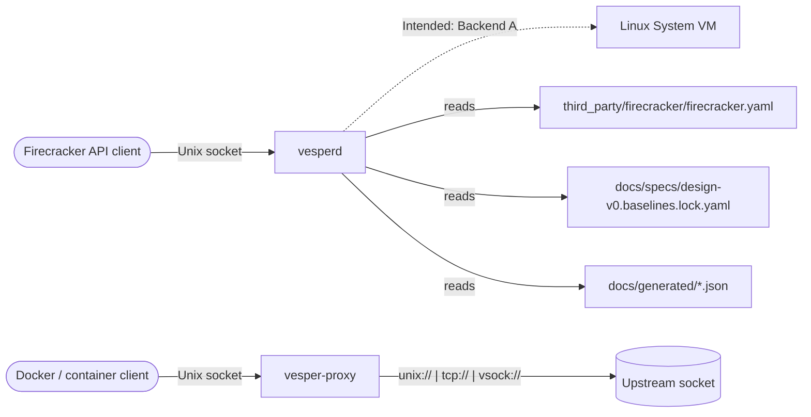
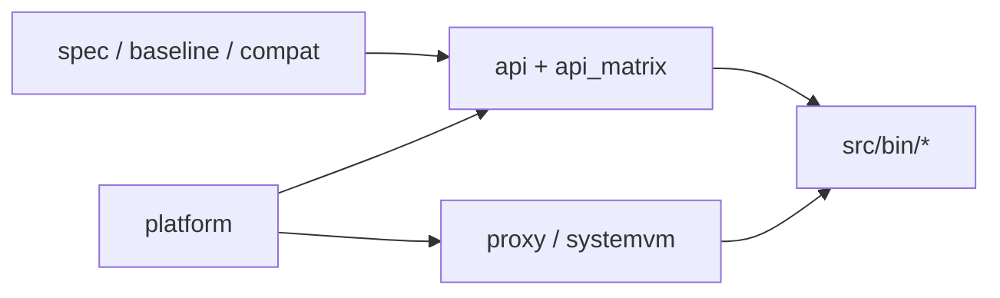
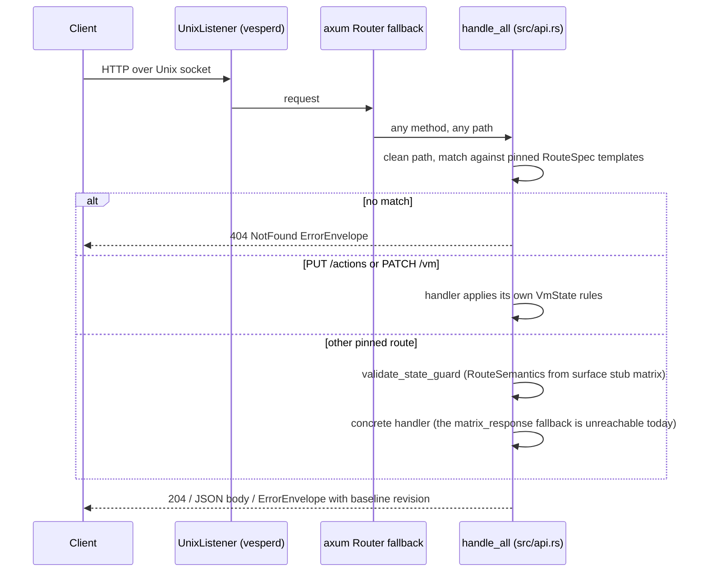

# Architecture

This is the top-level map of Vesper: what exists, where it lives and which way dependencies may point. It is
authoritative for component boundaries and dependency rules. The normative product design lives in
[docs/specs/design-v0.md](docs/specs/design-v0.md); the parity matrix in
[docs/specs/firecracker-feature-parity.md](docs/specs/firecracker-feature-parity.md); decisions in
[ADRs](docs/design-docs/adr/index.md). Claims are labelled **Verified**, **Intended**, **Proposed** or **Unknown**
as defined in [docs/README.md](docs/README.md#evidence-labels).

## Purpose

Vesper exposes a Firecracker-compatible control plane on macOS. **Verified:** the `vesperd` binary serves the pinned
Firecracker OpenAPI route set over a Unix socket from an in-memory VM state machine, and every error is a
deterministic envelope that carries the pinned Firecracker baseline revision
([src/api.rs](src/api.rs), [src/bin/vesperd.rs](src/bin/vesperd.rs)).

**Intended** (per design-v0): parity is reached through staged backends. Backend A runs stock Firecracker inside a
Linux System VM; Backend B is an eventual native macOS implementation behind the same API and lifecycle contract.
**Verified:** the repository today contains the control plane, governance tooling, a socket proxy, and System VM
scaffolding (manifest, launch config, boot smoke). It does not yet run guest microVMs.

Out of scope for this repository: the Linux System VM image contents, containerd shim code, and any Docker Desktop
UX. Those are design-v0 phases that have no code here yet.

## System context

**Verified** for the current code; the System VM and guest boxes are **Intended** and not exercised by any test.

## Components

| Component | Responsibility | Entry point | Owns data | Evidence |
|---|---|---|---|---|
| `vesperd` | Firecracker-compatible HTTP API and VM state machine | [src/bin/vesperd.rs](src/bin/vesperd.rs) | In-memory `AppState` only | [src/api.rs](src/api.rs), [src/api/README.md](src/api/README.md) |
| `vesper-proxy` | Forward a Unix socket to a unix, tcp or vsock upstream | [src/bin/vesper-proxy.rs](src/bin/vesper-proxy.rs) | None | [src/proxy.rs](src/proxy.rs) |
| `baselinectl` | Parity metadata, surface stub matrix, behavior matrix | [src/bin/baselinectl.rs](src/bin/baselinectl.rs) | `docs/generated/*.json`, `artifacts/parity-metadata.json` | [src/baseline.rs](src/baseline.rs), [src/api_matrix.rs](src/api_matrix.rs), [src/api_behavior_matrix.rs](src/api_behavior_matrix.rs) |
| `compatexctl` | Compat exception registry validation | [src/bin/compatexctl.rs](src/bin/compatexctl.rs) | None | [src/compat.rs](src/compat.rs) |
| `contractgen` | Golden route contract generate/check | [src/bin/contractgen.rs](src/bin/contractgen.rs) | `testdata/contracts/firecracker-routes.golden.json` | [src/spec.rs](src/spec.rs) |
| `systemvmctl` | System VM image manifest, launch config, boot smoke | [src/bin/systemvmctl.rs](src/bin/systemvmctl.rs) | `build/systemvm/*.json`, `run/systemvm/*` | [src/systemvm.rs](src/systemvm.rs) |

All six are discovered by Cargo from `src/bin/*.rs`; see [src/bin/README.md](src/bin/README.md).

## Domain boundaries and dependency rules

**Verified.** The library crate is layered, and the allowed intra-crate references are enforced mechanically by the
`RULES` allowlist in [scripts/harness/check_structure.py](scripts/harness/check_structure.py).

| Layer | Purpose | Modules | May reference |
|---|---|---|---|
| 0. Specs and baselines | Pinned upstream contract and parity metadata | `spec`, `baseline`, `compat`, `buildinfo` | nothing local |
| 1. Platform policy | Host capability and entitlement rules | `platform` | nothing local |
| 2. Control plane | State machine, dispatch, deterministic errors | `api`, `api/*`, `api_matrix`, `api_behavior_matrix` | `api_matrix`, `baseline`, `buildinfo`, `compat`, `platform`, `spec` |
| 3. Runtime adapters | Socket proxying and System VM artifacts | `proxy`, `systemvm` | `buildinfo`, `platform` |
| 4. Entry points | `clap` binaries | `src/bin/*` | any library layer |
| 5. Tests and harness | Contract tests, sensors, docs, Symphony templates | `tests/`, `scripts/harness/`, `harness/`, `docs/`, `.symphony/templates/` | observe only |

Disallowed directions (all **Verified** by the same allowlist): control-plane code must not import `proxy` or
`systemvm`; `proxy` and `systemvm` must not import `api`; spec, baseline and compat modules must not import runtime
or control-plane modules. Issue-state automation must not become an implicit source of truth (**Proposed**: enforced
by review and by [docs/process/harness-engineering.md](docs/process/harness-engineering.md)).

## Code map

- `src/`: the `vesper` library crate. Public modules and their contracts are listed in [src/README.md](src/README.md).
  `src/api.rs` holds `AppState`, the dispatch table and most handlers; `src/api/` holds the extracted route families.
- `src/bin/`: the six binaries ([src/bin/README.md](src/bin/README.md)).
- `tests/`: integration suites `api_contract.rs` and `contract_golden.rs` ([docs/TESTING.md](docs/TESTING.md)).
- `scripts/`: CI, macOS dev loop, System VM wrappers and harness sensors ([scripts/README.md](scripts/README.md)).
- `harness/`: the knowledge-base checker and recurring agent prompts ([harness/README.md](harness/README.md)).
- `docs/`: system of record ([docs/README.md](docs/README.md)). `docs/specs/` is normative; `docs/generated/` is
  machine-written.
- `third_party/firecracker/`: vendored Firecracker OpenAPI, read by `spec::load_routes`.
- `packaging/macos/`: entitlement plists validated by `platform` and `scripts/ci/validate-entitlements.sh`.
- `testdata/contracts/`: golden route list written by `contractgen`.
- `assets/systemvm/`: kernel and rootfs inputs for `systemvmctl`. **Verified:** the checked-in files are 47-byte
  placeholders, not bootable images.
- `.symphony/templates/`: verification manifest, milestone report and council rubric templates used by
  [WORKFLOW.md](WORKFLOW.md).

## Main flows

### API request (Verified)

State is held in `AppState` behind `std::sync::RwLock` fields; there is no persistence and no background work.
Startup order in `vesperd` is: validate entitlements (only when `--entitlements-file` is given), load baseline lock, load routes and version from the swagger,
load the surface stub matrix, build `AppState::new_with_matrix`, bind the socket.

### Proxy connection (Verified)

`vesper-proxy` binds a Unix listener, spawns one tokio task per client, parses the upstream with
`proxy::parse_target`, dials it within `dial_timeout`, and relays bytes both ways. A `vsock://<cid>:<port>` upstream
is bridged through `<vsock_socket_dir>/<cid>.sock` with a `CONNECT <port>\n` preface
([src/proxy.rs](src/proxy.rs), [docs/process/systemvm-bringup.md](docs/process/systemvm-bringup.md)).

### Governance tooling (Verified)

`contractgen`, `baselinectl` and `compatexctl` are run by the Makefile and by the GitHub workflows in
`.github/workflows/` to keep the golden route list, generated matrices, parity metadata and compat registry in step
with the pinned baseline ([docs/process/baseline-governance.md](docs/process/baseline-governance.md)).

## Deployment topology

**Verified:** the only runnable deployment in the repository is the local macOS dev loop. `make dev-up` builds and
starts `vesperd` on `run/vesperd.sock` and `vesper-proxy` on `run/docker.sock`
([scripts/macos/README.md](scripts/macos/README.md)). Entitlement plists live in `packaging/macos/`.

**Intended:** design-v0 describes a packaged macOS host process plus a Linux System VM running containerd and
Firecracker. **Unknown:** no installer, launchd, or System VM image build manifests exist here yet; the people who
own the design-v0 phases hold the answer.

## Invariants

| # | Invariant | Enforced by | Evidence |
|---|---|---|---|
| 1 | `vesperd` is the only public control-plane endpoint; raw Firecracker and containerd sockets stay private to the System VM | *Proposed*: review and [docs/SECURITY.md](docs/SECURITY.md); no mechanical check | [src/bin/vesperd.rs](src/bin/vesperd.rs), [src/bin/vesper-proxy.rs](src/bin/vesper-proxy.rs) |
| 2 | Intra-crate dependency directions follow the layer table above | *Verified*: `RULES` in [scripts/harness/check_structure.py](scripts/harness/check_structure.py), run by `.github/workflows/harness-structure.yml` | `python3 scripts/harness/check_structure.py --root .` |
| 3 | Every error response is an `ErrorEnvelope` with the pinned baseline revision | *Verified*: `AppState::new_with_matrix` rejects a blank revision; [tests/api_contract.rs](tests/api_contract.rs) asserts envelopes | `make contract-test` |
| 4 | The golden route list equals the pinned swagger byte for byte | *Verified*: `contractgen --mode check` and [tests/contract_golden.rs](tests/contract_golden.rs) in `.github/workflows/contract-tests.yml` | `make contract-check` |
| 5 | Generated surface stub and behavior matrices are complete and fresh | *Verified*: `baselinectl --mode validate-api-matrix` and `validate-api-behavior-matrix` | `make surface-matrix-check`, `make behavior-matrix-check` |
| 6 | Compat exceptions carry required fields, and none is open past expiry | *Verified*: `compatexctl` in `.github/workflows/compat-exceptions.yml` | `cargo run --bin compatexctl -- --registry docs/specs/compat-exceptions.yaml` |
| 7 | Boundary parsing happens at the edges: request bodies, registries, lock file, proxy targets, launch config | *Verified* per module by unit tests; no cross-cutting lint | [src/README.md](src/README.md) invariants |
| 8 | `src/api.rs` stays under its line budget (warn 2500, error 3200); other modules under 1200 | *Verified*: budgets in `check_structure.py` and [scripts/harness/janitor_scan.py](scripts/harness/janitor_scan.py) | current size is a warning, see tech debt TD-001 |
| 9 | When started with `--entitlements-file`, `vesperd` refuses to start unless the plist has the virtualization key; without the flag no check runs | *Verified* for that path: `platform::validate_entitlements_file`; `make validate-entitlements` lints the plists (TD-010) | [src/platform.rs](src/platform.rs) |
| 10 | A reachable route is not parity; `501 Not Implemented` is not parity | *Proposed*: review against the parity matrix; the janitor only warns on routes without explicit handlers | [docs/specs/firecracker-feature-parity.md](docs/specs/firecracker-feature-parity.md) |

Unenforced rows are tracked in the [tech-debt tracker](docs/exec-plans/tech-debt-tracker.md).

## Hotspots and decomposition queue

**Verified:** `src/api.rs` is above the 2500-line warning budget after the WOR-105 extractions of `actions`,
`machine_config`, `boot_source` and `logger_metrics`. The remaining candidates from the original queue, `errors` and
`vm_config`, are still inline. Each extraction must preserve behavior and move its tests with it.

## Related documents

- [Core beliefs](docs/design-docs/core-beliefs.md): the principles behind these rules.
- [Reliability](docs/RELIABILITY.md) and [Security](docs/SECURITY.md): cross-cutting requirements.
- [Quality score](docs/QUALITY_SCORE.md): how well the code currently follows this architecture.
- [Harness engineering](docs/process/harness-engineering.md): how the boundaries are kept honest in practice.
