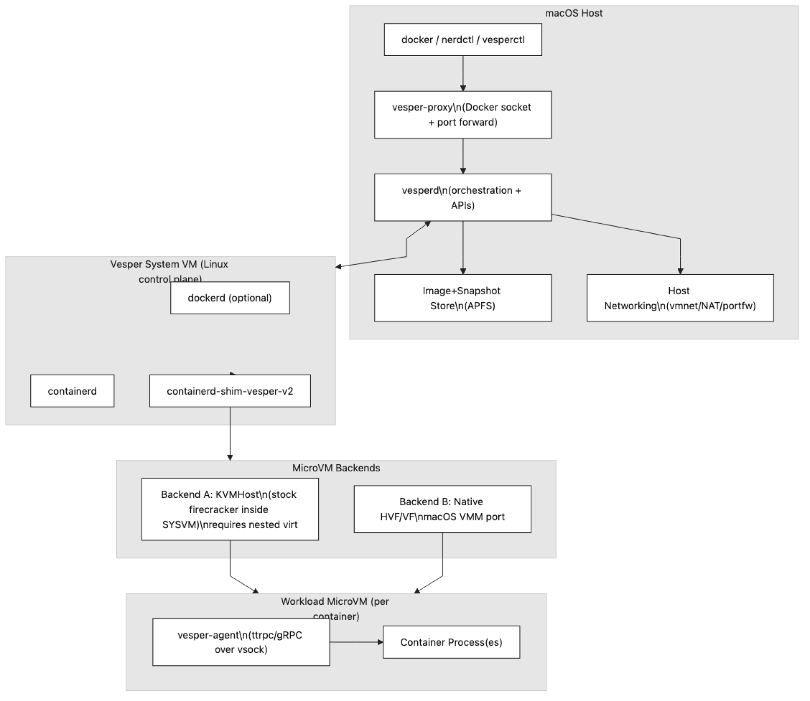
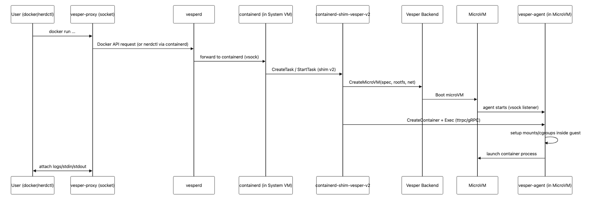

# Vesper: Firecracker‑compatible microVM runtime on macOS using Apple Virtualization

## Summary

Vesper has two goals, and the first leads (decision D-011).

1. A Firecracker-compatible microVM runtime on macOS, for tools and tests that speak the Firecracker API. It uses Apple’s virtualisation frameworks and no kernel extension.
2. A Docker Desktop replacement in which each container runs in one of those microVMs. It is the first workload and the proof of the runtime, not its definition.

No consumer of the Firecracker API exists in this repository beyond the contract tests. The intended consumers are clients written for Firecracker’s API, such as tooling in the style of firecracker-containerd.

Neither goal is met yet. The Docker commands work today without `vesperd`, on runc containers in the System VM, and `vesperd` drives no microVM. [Implementation status](#implementation-status-as-of-2026-11-11-commit-9c5a865) says what exists and what comes next.

## Terms

* **System VM**: the Linux virtual machine that Virtualization.framework boots on macOS. It runs containerd, dockerd and Firecracker.
* **microVM**: a Firecracker virtual machine inside the System VM. The document names the System VM or a microVM and does not use “guest” alone.
* **Backend A**: stock Firecracker in the System VM, on KVM through nested virtualisation.
* **Backend B**: a native macOS implementation of the Firecracker API and device model on Apple’s virtualisation frameworks.
* **Docker path**: dockerd → containerd → runc in the System VM. The container is a set of processes in the System VM.
* **microVM path**: a containerd client that names the runtime `io.containerd.vesper.v2` (today only `ctr`) → the shim → Firecracker → runc inside the microVM.
* **Shim**: `containerd-shim-vesper-v2`, the containerd runtime v2 shim. containerd starts every container through a shim, so the shim is the one integration point with containerd. ([GitHub][3])
* **vsock bridge**: the Unix socket that `vesper-vmlauncher` serves on macOS. A client names a System VM vsock port and the bridge connects it.
* **Share**: a macOS directory that the System VM mounts over virtio-fs so that containers can bind-mount it.
* **Baseline**: the upstream revisions pinned in [design-v0.baselines.lock.yaml](design-v0.baselines.lock.yaml).
* **Parity**: the same observable behaviour as Firecracker at the baseline. [What parity covers](#what-parity-covers) lists the four parts.
* **Parity GA**: Backend A passes the stage gates with zero open compat exceptions.
* **Cross-hardware GA**: Backend B reaches the same bar on all supported Apple Silicon.

## Goals and non-goals

Goals:

* Reach parity with Firecracker on Linux in API, behaviour and tooling. Backend A on M3 and later is the first target (parity GA); Backend B follows on all supported Apple Silicon (cross-hardware GA).
* Provide a containerd runtime (the shim) so that Docker containers can run in microVMs.
* Support the Docker workflows a macOS developer uses: volumes, networking, port publishing and builds. [Phase 4](#phase-4-docker-desktop-experience-on-macos) lists them.
* Run `linux/arm64` images natively and `linux/amd64` images through a documented emulation mode.
* Measure parity against the pinned baseline, not against moving upstream heads.

Non-goals:

* Intel Macs. Every requirement names Apple Silicon and the pinned System VM image is aarch64.
* A general virtual machine manager. Vesper runs Firecracker microVMs and the one System VM that hosts them.
* Changes or extensions to the Firecracker API. `vesperd` accepts the pinned API and nothing else.

## Implementation status (as of 2026-11-11, commit 9c5a865)

This section records how far the code is from this design. The requirements in the later sections still stand.

Every status label in this document is a snapshot at `9c5a865`, except the baseline-revision labels that GH #162 refreshed and the System VM storage labels that GH #164 refreshed. The [parity matrix](firecracker-feature-parity.md) and the [milestone log](../progress/symphony-milestones.md) hold the running status; the labels are refreshed when the design is next revised.

### Labels

The document uses these labels and no others. A label is followed by its pointer in parentheses.

* **Meets the requirement**: the code does what the text requires. A scope in plain words may follow, for example “on the Docker path”.
* **Accepted deviation**: the code differs, and the ADR or decision in the pointer accepts the difference.
* **Not met**: the requirement stands and the code falls short. The pointer is a TD row in the [tech-debt tracker](../exec-plans/tech-debt-tracker.md), a CE entry in [compat-exceptions.yaml](compat-exceptions.yaml) or an open GitHub issue.
* **Not yet measured**: the requirement is a number and no measurement of it exists.
* **Deferred**: the item is not planned before step 2 of [Next work](#next-work) is done, or before the event in the pointer.
* **Provisional**: the text is a decision or a threshold that waits for an ADR, for the owner’s confirmation or for evidence, named in the pointer. It can still change.

An item with no label has not been assessed on its own; the status of its phase in the table below applies. Decisions (D-nnn) are in the [decision log](../design-docs/decision-log.md). `WOR-nn` is an issue identifier in the Linear tracker; the milestone log has an entry for each.

### Phase status

All runtime evidence comes from one developer machine (Apple M3 Pro). No CI job can boot the System VM (TD-005).

| Phase | Exit criterion status | Proven, and by what | Missing | Tracker |
| --- | --- | --- | --- | --- |
| [0: Repository, packaging and API contract](#phase-0-repository-packaging-and-api-contract) | Coverage and errors: [Meets the requirement](#phase-0-exit-criterion). Socket stability: Not met (TD-052). | All 38 pinned routes have handlers with deterministic, baseline-stamped errors: `cargo test` (259 tests after GH #162 on 2026-11-11, of which `tests/api_contract.rs` holds 122), `make contract-check`, `make surface-matrix-check` and `make behavior-matrix-check`, all in CI. The behavior matrix pins 173 cases across the 38 operations. `vesper-proxy` forwards to unix, tcp and vsock upstreams. CI enforces the baseline lock and the compat registry. | Deliverables: logging and metrics (TD-007); packaging (TD-046). Behaviour-level proof is thinner than route coverage (TD-003). | GH #59 |
| [1: System VM bring-up](#phase-1-system-vm-bring-up) | [Meets the requirement](#phase-1-exit-criterion), with TD-027 outstanding against the deliverable on private sockets. | 200 of 200 probed boots under the 5 s threshold (`make systemvm-boot-smoke`; milestone log, WOR-27). `make systemvm-control-suite`, `make systemvm-services-suite`, `make docker-smoke` and `make systemvm-reliability` (default 50 boots plus those suites; WOR-21). `docker version` and a trivial container work from macOS. | The System VM reinstalls its packages on every boot and keeps task drives in tmpfs (TD-025); its other state persists on a data disk (GH #164). The vsock bridge reaches every System VM vsock port (TD-027). No packaged service (TD-046). | GH #54 (closed) |
| [2: Backend A runs stock Firecracker microVMs](#phase-2-backend-a-runs-stock-firecracker-microvms) | [Not met](#phase-2-exit-criterion) (TD-045, CE-0001) | Nested-virtualisation gating (`systemvmctl backend-select`). Jailed stock Firecracker v1.16.0 microVMs: `make systemvm-microvm-suite`, `make systemvm-rootfs-suite`, `make systemvm-workload-suite`. `make systemvm-parity-baseline`: 19 API conformance checks and two performance runs, committed as [backend-a-parity-baseline.json](backend-a-parity-baseline.json). | `vesperd` has no backend flow, and snapshot create and load are stubs (TD-045). The upstream Firecracker suite is not run (CE-0001). The System VM runs Firecracker release v1.16.0, not the pinned commit (CE-0002). No Linux baseline exists (CE-0003). MicroVMs have no network device (TD-032). | GH #156 |
| [3: containerd shim v2](#phase-3-containerd-shim-v2) | [Not met](#phase-3-exit-criterion) (GH #53) | For `ctr`: `make ctr-conformance`, 74 of 74 steps in four suites (shim 22, bundle 15, restart 18, exec 19), committed as [ctr-conformance-baseline.json](ctr-conformance-baseline.json) (generated 2026-11-09 at `74e6544`). `go test` runs in `shim-tests.yml`. | dockerd does not use the runtime (GH #53). `Pause`, `Resume`, `Checkpoint` and `Update` (TD-042). Root drives are copied per task and never pruned (TD-035). | GH #103 |
| [4: Docker Desktop experience on macOS](#phase-4-docker-desktop-experience-on-macos) | [Not met](#phase-4-exit-criterion) (GH #53, TD-005) | For the Docker path, from macOS through `vesper-proxy`: `make docker-conformance` (22 steps), `make ports-suite` (11), `make binds-suite` (20), `make dns-suite` (12), `make workflow-suite` (8) and `make crossarch-suite` (9). Step counts are from [TESTING.md](../TESTING.md) and the milestone log. Host-edit events were delivered by GH #150; the residuals are in TD-038. | The containers are not microVMs (GH #53). No path carries a share into a microVM (TD-049). No pass in CI (TD-005). UDP and non-loopback ports (TD-037). `host.docker.internal` (TD-039). | GH #53 |
| [5: Backend B](#phase-5-backend-b) | [Not met](#phase-5-exit-criterion) (GH #56) | Nothing. `src/platform.rs` selects Backend B only to report that it is not implemented. | All of it. Sub-issues GH #82, #83, #84, #86, #87 and #91 are open. | GH #56 |

### Next work

The order is decision D-008, as amended by D-015 and D-017. Two time-boxed items run before or beside step 1, because each holds an unknown as large as a step. Steps 1 and 2 share no code: the shim does not call `vesperd`. Step 1 comes first as a priority, because the runtime goal leads (D-011). Step 1 closes only the `vesperd` half of the Phase 2 gate; the parity reference closes the other half. Step 3 depends on both.

| Step | Why now | Tracker | Gaps to close first | Done when | Needs the owner’s confirmation |
| --- | --- | --- | --- | --- | --- |
| Prototype: a share path into a microVM (done 2026-11-11, GH #159) | Outcome **partial** (D-020): NFSv3 from userspace `unfs3` over a TAP device. | TD-049 | — | Done. Deviations are recorded in D-020; adoption is GH #160. | The `unfs3` dependency (GH #160). |
| Parity reference (time-boxed, D-017) | It is the other half of the Phase 2 gate, and no later step produces it before step 3 needs it. | CE-0003, CE-0001 | None. | The binary and the lock name one Firecracker revision (done 2026-11-11, GH #162; CE-0002 closed). A Linux baseline is captured on any aarch64 KVM host at the pinned revision (CE-0003). The upstream suite has been tried in the System VM and the result is recorded (CE-0001). | Nothing; a change of the pinned revision follows [baseline-governance.md](../process/baseline-governance.md). |
| 1. Connect `vesperd` to Backend A | It is the unmet Phase 2 deliverable. Until it exists the public API never drives a real microVM, and goal 1 is unproven. | GH #156, TD-045 | An ADR that settles the open questions of the [backend ownership contract](#backend-ownership-contract) (D-013, D-017). A restriction on what the vsock bridge reaches, because this step puts a relay to Firecracker behind the bridge (TD-027, D-018). An owner-only default socket for `vesperd` (TD-050). Where snapshots persist (TD-025). | A Firecracker API client creates, starts, pauses, resumes, snapshots and stops a jailed microVM in the System VM through `vesperd`, and a suite records it. | Any new listener, on macOS or in the System VM (D-013). |
| 2. Run Docker containers in microVMs | It is the unmet Phase 3 exit criterion for dockerd. Without it the Phase 4 suites prove the Docker path, not this design. | GH #53 | Shares over NFS from `unfs3` (GH #160, D-020). A network device for each microVM (TD-032). No full root-drive copy per task (TD-035). Persistent System VM storage (TD-025). | `docker run` from macOS starts a microVM, and the Phase 4 suites pass against microVM containers, within the outcome the prototype recorded. | Nothing further, unless the prototype ends in the fallback or in a partial outcome. |
| 3. Phase 5: Backend B | It removes the dependency on nested virtualisation. | GH #56 | Step 1. The parity reference and the differential harness (GH #87). A design for the boundary between the shim and Backend B (D-017). | The [Phase 5 exit criterion](#phase-5-exit-criterion). | Not known yet. |

## Normative baselines

All parity claims in this document are evaluated against the immutable upstream revisions in [design-v0.baselines.lock.yaml](design-v0.baselines.lock.yaml).

* Any baseline change requires a pull request that updates the lock file and reruns the parity and regression suites.
* Results are reported with the exact baseline revision IDs used in that run.
* Without a populated lock file, parity claims are provisional and cannot be used for GA sign-off.
* Normative documents pin upstream references to tags or commit SHAs, not to a moving `main`.
* The Apple WWDC citations are explanatory. Pinned references, tests and parity harness outputs decide normative behaviour.

## Requirements

* Firecracker API parity: Vesper must accept the same OpenAPI requests, with the same ordering and state-machine rules, and return the same response codes and messages where the baseline specifies them. **Not met** (TD-003, TD-045): the routes answer from memory, and behaviour-level proof is incomplete.
* Parity scope by backend:

  * Backend A on M3 and later must meet full parity with no waived tests at parity GA. The pass set for the upstream suite is defined in [Parity harness](#parity-harness). **Not met** (CE-0001).
  * Backend B may ship with declared gaps, but cannot reach cross-hardware GA until it passes the same full suite. **Not met** (GH #56).
  * Compat exceptions are allowed only before parity GA and must name an owner, a linked issue, an expiry date and a target release.
* Device and feature parity:

  * virtio‑blk (multiple drives, read-only flags, rate limiters), virtio‑net (MAC address configuration, RX and TX rate limiters), virtio‑vsock (CID mapping, connection behaviour), balloon (target size, statistics), entropy, serial console, MMDS (API and access from the microVM), rate limiters, metrics and logging pipes (including back-pressure behaviour), snapshot create and load (full and diff), pause and resume, and CPU templates where the architecture has them. **Not met** (TD-045): Vesper exercises none of these through its API.
  * The same behaviour under load and in failure modes: I/O errors, invalid configuration, state transitions. **Not met** (TD-052): the criterion has no measurable form yet.
* containerd compatibility: implement a containerd shim v2 runtime that runs OCI workloads as microVMs. **Meets the requirement** on the microVM path (`make ctr-conformance`).
* Docker replacement on macOS:

  * Serve the Docker Engine API on an endpoint that the Docker CLI can use unchanged.
  * Run each Docker container in its own microVM. **Not met** (GH #53): Docker containers run on runc in the System VM. D-015 names a fallback that would change this requirement; see [Next work](#next-work).
  * Handle port publishing, volumes and bind mounts, image pulls, logs, exec and signals.
  * Support `docker run --platform linux/amd64` on Apple Silicon through `binfmt_misc` and `qemu-user` inside the System VM. **Meets the requirement** on the Docker path (`make crossarch-suite`).
  * Optional acceleration with Rosetta for Linux, where supported and explicitly enabled. **Deferred** (until step 2 of [Next work](#next-work) is done).
* No kernel extensions. Use Apple frameworks and user-space isolation (App Sandbox or a seatbelt profile). **Not met** (TD-046): only two of the three entitlement plists carry the App Sandbox key and no seatbelt profile exists.
* All artefacts are reproducible in CI:

  * The System VM image, the overlay and the shim binary. **Meets the requirement** (`systemvm-image.yml`, `shim-tests.yml`).
  * The runtime captures and suite reports. **Not met** (TD-005): they are produced on developer hardware only.

### What parity covers

Vesper must match four parts of Firecracker’s observable contract:

1. The OpenAPI control plane (HTTP over a Unix socket): every path and method in the pinned `firecracker.yaml`.
2. The state machine: which endpoints are pre-boot only and which are mutable at run time, and the error returned for a call at the wrong time.
3. Behaviour visible inside the microVM: device IDs, virtio feature bits, MMDS semantics, vsock behaviour, rate limiting and reboot handling.
4. Tooling: Firecracker’s integration tests and snapshot tooling run against Vesper without changes to the tools.

The Firecracker design document fixes the model that Vesper must reproduce: one Firecracker process per microVM with API, VMM and vCPU threads; virtio‑net, virtio‑blk, virtio‑vsock and a serial console; storage backed by files; networking backed by TAP; rate limiting in the I/O thread; snapshots of memory and device state. ([GitHub][1], [GitHub][7])

## Risks and limits

| Risk or limit | Effect | Mitigation |
| --- | --- | --- |
| Nested virtualisation exists only on M3 and later Macs. ([Apple Developer][5]) | Backend A cannot run on M1 or M2. | Backend B (GH #56). |
| Virtualization.framework save and restore state is hardware-encrypted and cannot be restored by another user or on another Mac. ([Apple Developer][4]) | It cannot carry Firecracker snapshots, which must load in a different process. | Backend B implements Firecracker’s snapshot format itself ([Snapshot strategy](#snapshot-strategy)). |
| Bridged networking can require the restricted entitlement `com.apple.vm.networking`. ([Apple Developer][6]) | LAN-visible microVMs are not available by default. | NAT is the default ([Networking strategy](#networking-strategy)). |
| The cost of nested virtualisation against Firecracker on a Linux host is unknown. | The performance thresholds may not be reachable on Backend A. | Capture a Linux baseline (CE-0003). The two relative [thresholds](#performance-thresholds) stand only if a baseline on the same host class can be obtained. |
| One developer machine is the only source of runtime evidence. | A regression in the System VM path is found only when someone runs the suites locally. | A self-hosted Apple Silicon runner, or scheduled local runs that upload the reports (TD-005). |
| Phase 5 is a port of a hypervisor back end and is larger than Phases 0 to 4 together. | Cross-hardware GA may be far from parity GA. | Phase 5 starts after steps 1 and 2 of [Next work](#next-work); Backend A remains the supported path on M3 and later. |
| Step 2 has no design for a share into a microVM. | A microVM per Docker container may not be reachable with bind mounts intact. | The time-boxed prototype and its three outcomes in [Next work](#next-work) (TD-049). |

## High-level architecture

### Component diagram

The diagram shows the component flow as built at `9c5a865`. Solid arrows exist in code; dashed arrows are the target and are not built. The target adds a `vesperd` connection to Backend A, Docker containers on the Vesper runtime instead of runc, a network device for each microVM, and Backend B.

A System VM exists because containerd, dockerd and Firecracker need Linux, and Firecracker needs KVM.

### Components

The table lists the components as built at `9c5a865`.

| Component | Runs in | Role | Record |
| --- | --- | --- | --- |
| `vesperd` | macOS | Serves the Firecracker-compatible API. | [ARCHITECTURE.md](../../ARCHITECTURE.md#components) |
| `vesper-proxy` | macOS | Serves the Docker socket and publishes container TCP ports on loopback. It reaches the System VM only through the vsock bridge. | [ADR 0003](../design-docs/adr/0003-systemvm-control-channel.md), [ADR 0005](../design-docs/adr/0005-published-ports-via-vsock-gateway.md) |
| `vesper-vmlauncher` | macOS | A separate, signed Swift helper. It boots the System VM on Virtualization.framework, serves the vsock bridge, attaches the shares and runs the share watcher. | [ADR 0001](../design-docs/adr/0001-systemvm-launcher-swift-helper.md), [launcher/README.md](../../launcher/README.md) |
| `systemvmctl` | macOS | Verifies the image and package locks, writes the launch configuration, selects the backend, and is the control client that runs the System VM suites. | [src/bin/README.md](../../src/bin/README.md) |
| `baselinectl`, `compatexctl`, `contractgen` | macOS, CI | Governance: parity metadata and generated matrices, compat registry checks, golden route list. | [baseline-governance.md](../process/baseline-governance.md) |
| System VM | Virtualization.framework | The pinned Alpine `virt` ISO plus an initramfs overlay that installs the pinned packages on each boot. It runs containerd and dockerd. | [ADR 0002](../design-docs/adr/0002-systemvm-overlay-via-initramfs.md), [systemvm-bringup.md](../process/systemvm-bringup.md) |
| `vesper-agent` | System VM | The System VM control agent, a line protocol on System VM vsock port 1024. It is not an agent inside a microVM. | [ADR 0003](../design-docs/adr/0003-systemvm-control-channel.md) |
| System VM vsock listeners | System VM | 1024 (`vesper-agent`), 2375 (relay to the Docker socket), 2400 (`vesper-port-relay`, the System VM gateway for published ports), 2401 (`vesper-share notify`, the share notification sink). | [SECURITY.md](../SECURITY.md#trust-boundaries) |
| Shim (`containerd-shim-vesper-v2`) | System VM | The Go runtime v2 shim. It runs each task as one jailed Firecracker microVM through its backend interface. | [ADR 0004](../design-docs/adr/0004-containerd-shim-in-go.md), [shim/README.md](../../shim/README.md) |
| `vesper-microvm` | System VM | A shell script that launches, stops and cleans up one jailed Firecracker microVM. The shim calls it, and so do the `MICROVM` and `WORKLOAD` commands of the agent. | [shim/README.md](../../shim/README.md), [systemvm-bringup.md](../process/systemvm-bringup.md#backend-a-firecracker-microvms-inside-the-system-vm-gh-18) |
| MicroVM init and sessions | microVM | runc inside the microVM runs init and exec, driven by the shim over private vsock sessions. | [ADR 0006](../design-docs/adr/0006-guest-exec-via-runc-delegation.md) |

### Backend ownership contract

This is the target design. **Provisional** (D-013 as amended by D-017; an ADR under GH #156 confirms or replaces it).

* `vesperd` is the only public control-plane endpoint, and raw backend sockets are never public ([AGENTS.md](../../AGENTS.md), invariant 1). It is authoritative for the microVMs created through it.
* For Backend A, `vesperd` drives stock Firecracker inside the System VM. MicroVM execution and data plane stay inside the System VM. **Not met** (TD-045, GH #156): `vesperd` answers every route from memory.
* The current seam between the shim and a backend is the `backend.Backend` interface in `shim/internal/backend`. It is shaped by Backend A and is not a stable boundary. For Backend A the shim implements it by calling `vesper-microvm` in the System VM, with no call to `vesperd`. The shim owns the microVMs it creates.
* For Backend B, `vesperd` executes microVMs on macOS. How a containerd task in the System VM reaches a microVM on macOS is not designed (D-017).

The path from `vesperd` to Firecracker is not designed. The vsock bridge reaches System VM vsock ports only; the Firecracker API is a Unix socket inside each jail; the paths in API requests are macOS paths; and `vesper-microvm` boots a microVM from a configuration file, not through the API. The ADR must settle these questions before any code:

1. Whether `vesperd` is a pass-through relay to one jailed Firecracker per socket, with its own state machine serving Backend B only, or a stateful front end for both backends (D-017). Questions 4, 5 and 7 arise only for a stateful front end.
2. Where the paths in Firecracker API requests live (macOS or the System VM) and how files move between them.
3. The relay and the launch mode that give `vesperd` an unconfigured Firecracker process.
4. One `vesperd` per microVM, as Firecracker has one process per microVM, or one `vesperd` that multiplexes.
5. How `vesperd` reconciles its state with running microVMs after a restart.
6. Where snapshots persist (TD-025).
7. How `vesperd` and the shim, two owners of one backend, stay apart. Partition comes first: disjoint microVM id prefixes and jailer uids, where every microVM has one uid today. A shared inventory, resource budget and orphan clean-up follow only if partition is not enough.
8. Whether `vesperd` should run inside the System VM instead. That conflicts with Backend B, where `vesperd` must run on macOS ([Alternatives considered](#alternatives-considered)).

Any new listener needs the owner’s confirmation.

### Runtime lifecycle sequence

The diagram shows the sequence as built at `9c5a865`. `docker run` ends in a runc container in the System VM; only a client that names the runtime `io.containerd.vesper.v2` reaches the shim and gets a microVM. The target joins the two halves, so that the task dockerd creates goes to the shim. `vesperd` is not on this path for Backend A (D-013).

## Backends

Parity is not guaranteed by either backend. It is measured, by the chain in [Parity harness](#parity-harness).

### Backend A

A Linux System VM runs containerd and stock Firecracker. MicroVMs run inside the System VM on KVM, which needs nested virtualisation ([Risks and limits](#risks-and-limits)).

Backend A runs stock Firecracker on Linux, so its parity depends on the System VM, not on a port. That holds for a client of Firecracker inside the System VM. For a client of `vesperd` it depends on step 1 of [Next work](#next-work). Backend A is also the supported path if an Apple API prevents part of Backend B.

* System VM kernel: tuned for boot time, with KVM, TAP and vsock. **Accepted deviation** ([ADR 0002](../design-docs/adr/0002-systemvm-overlay-via-initramfs.md)): the System VM boots the stock Alpine `virt` kernel from the pinned ISO, with an initramfs overlay, inside the 5 s boot threshold. The pins are [systemvm-image.lock.yaml](systemvm-image.lock.yaml) and [systemvm-packages.lock.yaml](systemvm-packages.lock.yaml).
* `vesper-vmlauncher` owns the System VM and applies the nested-virtualisation policy from the image lock ([ADR 0001](../design-docs/adr/0001-systemvm-launcher-swift-helper.md), [systemvm-bringup.md](../process/systemvm-bringup.md#nested-virtualization-and-backend-selection-gh-17)).
* Control channel: the vsock bridge carries connections from macOS to System VM vsock ports, and `vesper-agent` answers in the System VM ([ADR 0003](../design-docs/adr/0003-systemvm-control-channel.md)).
* Only the Docker-compatible socket is exported to macOS:

  * Published TCP ports on loopback are visible on macOS as well. **Accepted deviation** ([ADR 0005](../design-docs/adr/0005-published-ports-via-vsock-gateway.md)).
  * The vsock bridge is visible on macOS as well and reaches every System VM vsock port. **Not met** (TD-027).
* Shares use virtio-fs between macOS and the System VM. **Meets the requirement** (`make binds-suite`): a share is mounted in the System VM at its macOS path ([systemvm-bringup.md](../process/systemvm-bringup.md#bind-mounts-over-virtio-fs-gh-29)).
* 9p is not a supported GA transport for shares.
* A microVM can use bind-mounted data from a share. **Not met** (TD-049): no path carries a share into a microVM.
* A microVM gets the vCPUs and memory its workload asks for. **Not met** (TD-048): every microVM has 1 vCPU and 256 MiB.
* Stock Firecracker runs under the jailer in the System VM. **Meets the requirement** (`make systemvm-microvm-suite`).
* The System VM uses a NAT attachment by default, which needs no restricted entitlement. MicroVM networking is in [Networking strategy](#networking-strategy).

### Backend B

A macOS implementation that exposes the Firecracker API and executes the microVM on macOS with Hypervisor.framework or Virtualization.framework. **Not met** (GH #56): no code exists.

It is used where nested virtualisation is unavailable (M1 and M2), and it removes the layer of a virtual machine inside a virtual machine. Whether it is also preferred on M3 and later is decided by the [performance thresholds](#performance-thresholds) once both backends can be measured.

The main difficulty is to reproduce Firecracker’s behaviour on different primitives: Apple frameworks in place of KVM. Snapshots are the clearest case ([Snapshot strategy](#snapshot-strategy)).

How Docker containers run on Backend B is not designed: containerd and the shim are in the System VM and the microVM would be on macOS (D-017).

## Alternatives considered

| Option | Outcome and reason | Record |
| --- | --- | --- |
| Backend A only | Rejected. Nested virtualisation exists only on M3 and later, so M1 and M2 would have no path. | [Risks and limits](#risks-and-limits) |
| `vesperd` inside the System VM | Open. No recorded reason; to be weighed in the ADR under GH #156. It conflicts with Backend B, where `vesperd` must run on macOS. | D-013 |
| `vesperd` as a pass-through relay to one jailed Firecracker per socket, with its state machine serving Backend B only | Open; to be weighed in the ADR under GH #156. A relay avoids the multiplexing, restart and inventory questions of a stateful front end. | D-017 |
| An RPC from the shim to `vesperd` for Backend A | Rejected for Backend A: every container start would make a round trip from the System VM to macOS and depend on a macOS daemon. Open for Backend B. | D-013, [ADR 0004](../design-docs/adr/0004-containerd-shim-in-go.md) |
| Backend B on Virtualization.framework save state instead of Firecracker’s snapshot format | Rejected. The saved state is hardware-encrypted and cannot be restored by another user or on another Mac. | [Risks and limits](#risks-and-limits) |
| 9p for shares | Rejected: 9p is not a supported GA transport. The stated reason is variance in consistency and performance; no measurement is recorded. The share prototype does not re-examine it. | [Backend A](#backend-a), TD-049 |
| A custom System VM image or kernel | Rejected for the image: a Linux-only build and a second image pipeline. A dedicated microVM kernel remains open (TD-033). | [ADR 0002](../design-docs/adr/0002-systemvm-overlay-via-initramfs.md) |
| A microVM per container as opt-in, with runc as the default | Held as the fallback if the share prototype fails. It changes a hard requirement and needs the owner’s confirmation. | D-015 |
| A custom agent inside the microVM instead of runc | Not chosen: runc already owns the kernel-facing work (clone, namespaces, `pivot_root`, exec, seccomp). The ADR keeps a custom agent as its fallback. Vendoring the Kata or firecracker-containerd agent was rejected as unmaintained or mismatched with containerd 2.1. | [ADR 0006](../design-docs/adr/0006-guest-exec-via-runc-delegation.md) |
| Rust bindings to Virtualization.framework, or an external launcher (`vfkit`, `limactl`), instead of a Swift helper | Rejected. The bindings were a new dependency with unverified coverage; an external launcher would make boot evidence depend on a tool outside the repository. | [ADR 0001](../design-docs/adr/0001-systemvm-launcher-swift-helper.md) |
| A Rust shim, or building the shim inside the System VM | Rejected. No maintained Rust implementation of containerd’s shim framework exists; a build inside the System VM is slow and not pinned by the repository. | [ADR 0004](../design-docs/adr/0004-containerd-shim-in-go.md) |

## Component mapping: Firecracker → Vesper

| Firecracker component | Linux (KVM) behaviour | Provided by stock Firecracker (Backend A) | Backend B plan |
| --- | --- | --- | --- |
| `/dev/kvm`, `KVM_RUN` loop | vCPU threads run the `KVM_RUN` loop ([GitHub][1]) | Yes, on nested KVM | Port: a Hypervisor.framework vCPU run loop |
| TAP networking | virtio‑net backed by TAP ([GitHub][1]) | Yes, with TAP and CNI in the System VM | Port: a user-space net backend with vmnet or NAT |
| Block devices | virtio‑blk backed by files ([GitHub][1]) | Yes | ext4 disk images attached as virtio‑blk |
| MMDS | metadata service exposed to the microVM ([GitHub][1]) | Yes | Port: an HTTP handler on macOS and routing from the microVM |
| Rate limiter | token bucket in the I/O path ([GitHub][1]) | Yes | Reuse Firecracker’s algorithm at the device back end |
| Logger and metrics | named pipes configured through the API ([GitHub][1]) | Yes | Map to macOS FIFOs or sockets with the same semantics |
| Snapshots | memory and device state, full and diff ([GitHub][7]) | Yes | Port: Firecracker’s snapshot format |
| Jailer | cgroups, namespaces, chroot, seccomp ([GitHub][1]) | Yes, inside the System VM | Port: a macOS sandbox profile, a dedicated user and scoped file access |
| CPU templates | control of CPU information exposed to the microVM ([GitHub][1]) | Yes | Port: the API and its behaviour for aarch64 |

The Backend A column records what stock Firecracker provides inside the System VM, not what Vesper exercises: at `9c5a865` Vesper configures only a boot source, one root drive, the machine configuration and a vsock device.

## Phases

Each phase has deliverables, verification and an exit criterion. A phase must pass its exit criterion before the next begins. Time-boxed prototypes are exempt from this rule.

The gate was not followed for Phases 3 and 4: they were built while the Phase 2 exit criterion was unmet. [Next work](#next-work) restores the order. The status of each exit criterion is in [Phase status](#phase-status).

### Phase 0: Repository, packaging and API contract

#### Phase 0 deliverables

* The `vesperd` daemon, which exposes the Firecracker OpenAPI surface and has versioning, logging and metrics ([Auditing](#security-model)).
* `vesper-proxy`, which forwards a Unix socket on macOS to a vsock port in the System VM.
* A macOS application or service with the virtualisation entitlement `com.apple.security.virtualization`. **Not met** (TD-046): the entitlement plists exist; no application bundle, installer or launchd service does.
* Golden API contract tests built from the pinned `firecracker.yaml`.
* The governance artefacts and tools that the parity rules depend on: the golden route list, the generated surface stub and behavior matrices, the capture registries, the compat registry and the committed captures. [index.md](index.md) lists each file; [baseline-governance.md](../process/baseline-governance.md) and [compat-exceptions.md](../process/compat-exceptions.md) give the rules.

#### Phase 0 verification

* Every path and method in the Firecracker specification exists.
* For implemented, unimplemented and state-invalid cases, the status code and error payload match the pinned Firecracker behaviour, not a fixed 4xx envelope.
* State-machine unit tests: for example, `PUT /actions` with `InstanceStart` before `PUT /boot-source` fails as Firecracker does.

#### Phase 0 exit criterion

* Every pinned endpoint is covered and errors are deterministic. **Meets the requirement** (`make contract-test`).
* The API socket is stable. **Not met** (TD-052): the criterion has no measurable form yet.

### Phase 1: System VM bring-up

#### Phase 1 deliverables

* Build and boot a minimal Linux System VM on macOS with Virtualization.framework, on NAT by default ([ADR 0001](../design-docs/adr/0001-systemvm-launcher-swift-helper.md), [ADR 0002](../design-docs/adr/0002-systemvm-overlay-via-initramfs.md)).
* A vsock channel between macOS and the System VM ([ADR 0003](../design-docs/adr/0003-systemvm-control-channel.md)).
* containerd and dockerd installed and running in the System VM.
* The Docker socket is served on macOS only by `vesper-proxy`, at `/var/run/vesper/docker.sock` in a packaged install. **Not met** (TD-046): no packaged install exists; the development loop serves an owner-only socket under `run/` ([systemvm-bringup.md](../process/systemvm-bringup.md#docker-ingress-gh-15)).
* Raw containerd and Firecracker sockets stay private to the System VM.

#### Phase 1 verification

* The System VM boots 200 times in a row with zero kernel panics and zero unrecoverable launcher failures.
* `docker version` works from macOS against the forwarded socket.

#### Phase 1 exit criterion

A macOS user can start and stop Vesper and run a trivial container, even if the container runs as a process in the System VM.

### Phase 2: Backend A runs stock Firecracker microVMs

#### Phase 2 deliverables

* Nested virtualisation enabled on machines that support it.
* `firecracker` and `jailer` running inside the System VM.
* A backend flow from `vesperd` to the Firecracker API for the lifecycle primitives `CreateVM`, `StartVM`, `PauseVM`, `ResumeVM`, `StopVM` and `DeleteVM` ([Backend ownership contract](#backend-ownership-contract)).
* A rootfs flow in the style of firecracker-containerd: OCI image → ext4 root drive → microVM boot → runc inside the microVM runs the container. **Meets the requirement** ([ADR 0006](../design-docs/adr/0006-guest-exec-via-runc-delegation.md), `make systemvm-rootfs-suite`).

#### Phase 2 verification

* The upstream Firecracker integration suite runs against Firecracker inside the System VM, with the pass set defined in [Parity harness](#parity-harness).
* Snapshot tests on upstream semantics confirm a create and load cycle. ([GitHub][7]) **Not met** (CE-0001): the local checks create one full snapshot and never load one.
* MicroVM boot time and create rate are measured against the [performance thresholds](#performance-thresholds). ([GitHub][8])

#### Phase 2 exit criterion

Backend A passes the upstream integration suite as defined in [Parity harness](#parity-harness), and a workload runs through backend calls from `vesperd`, with one microVM per workload.

### Phase 3: containerd shim v2

#### Phase 3 deliverables

* The shim implements `Create`, `Start`, `Kill`, `Delete`, `State`, `Wait`, `Exec`, `ResizePty` and `Stats`. **Meets the requirement** (`make ctr-conformance`).
* `Pause`, `Resume`, `Checkpoint` and `Update`. **Not met** (TD-042): they return `ErrNotImplemented`.
* A stable boundary between the shim and a backend, as an RPC over vsock or a Unix socket. **Accepted deviation** ([ADR 0004](../design-docs/adr/0004-containerd-shim-in-go.md)): for Backend A the shim calls `vesper-microvm` directly, through the `backend.Backend` seam. The boundary for Backend B is not designed (D-017).
* MicroVM sessions: init and exec run through runc inside the microVM, driven by the shim over private vsock sessions ([ADR 0006](../design-docs/adr/0006-guest-exec-via-runc-delegation.md), [shim/README.md](../../shim/README.md#guest-session-protocol)).
* Exec sessions are reclaimed when they end. **Not met** (TD-041): one task accepts a bounded number of execs.
* OCI bundle unpacking and a block root drive (ext4). **Meets the requirement** (`make systemvm-bundle-suite`). The storage model is in [Rootfs strategy](#rootfs-strategy).

#### Phase 3 verification

* containerd conformance through `ctr`: `ctr run`, `ctr tasks exec`, `ctr tasks kill`, `ctr tasks metrics`.
* The shim stays the parent of its task and survives a containerd restart; attach works after containerd reconnects.

#### Phase 3 exit criterion

containerd runs workloads on the Vesper runtime without special handling, including the containers that dockerd creates.

### Phase 4: Docker Desktop experience on macOS

#### Phase 4 deliverables

* Docker Engine API forwarding through `vesper-proxy`. **Meets the requirement** on the Docker path (`make docker-conformance`). The path is `vesper-proxy` → vsock bridge → dockerd; `vesperd` is not on it.
* Port publishing with one owner for each hop, macOS → `vesper-proxy` → System VM gateway → microVM, reachable on localhost ([Networking strategy](#networking-strategy)).
* Bind mounts of macOS paths into the System VM over virtio-fs. **Meets the requirement** (`make binds-suite`).
* Bind mounts passed on into the container. **Meets the requirement** on the Docker path (`make binds-suite`). For the microVM path, see the share requirement under [Backend A](#backend-a).
* Edits made on macOS reach containers as inotify events. **Accepted deviation** (D-002, D-003): the launcher watches read-write shares and the System VM replays each changed path, so containers see `IN_MODIFY` only, and nothing on read-only shares. GH #150 delivered this; TD-038 lists the residuals and [systemvm-bringup.md](../process/systemvm-bringup.md#bind-mounts-over-virtio-fs-gh-29) describes the mechanism.
* DNS and network defaults match Docker Desktop for the cases in `make dns-suite`, and containers can resolve `host.docker.internal`. **Not met** (TD-039): `host.docker.internal` is not provided.
* `linux/arm64` is the native default on Apple Silicon.
* `linux/amd64` runs through emulation in the System VM, and the image and container metadata report the architecture. **Meets the requirement** on the Docker path (`make crossarch-suite`).

#### Phase 4 verification

* A developer workflow suite: `docker compose up` for a stack of a web server, Redis and a database; bind mounts that reload on edit; port publishing collisions; `docker run --platform linux/amd64` on Apple Silicon.
* File system behaviour: inotify events for watchers, uid and gid mapping, permissions.

#### Phase 4 exit criterion

The workload matrix passes in CI and on a reference developer machine: the compose stack; bind-mount reload; the same error on every port collision; `docker exec`, `docker logs`, graceful and forced stop; and the `linux/amd64` flow.

### Phase 5: Backend B

Phase 5 ports the hypervisor back end and keeps Firecracker’s semantics.

#### Phase 5 deliverables

1. Execution: `vesperd` executes microVMs on macOS behind the API it already serves.
2. CPU and memory: create microVM memory, load the kernel and initrd, run vCPUs.
3. Devices: virtio‑blk, virtio‑net, virtio‑vsock, serial console, entropy, balloon.
4. MMDS: the Firecracker MMDS access path from inside the microVM.
5. Rate limiting: a token bucket on block and network I/O with Firecracker’s semantics. ([GitHub][1])
6. Snapshots: Firecracker’s snapshot format, full and diff, readable by Firecracker’s tools ([Snapshot strategy](#snapshot-strategy)).

#### Phase 5 verification

The [parity harness](#parity-harness), a snapshot round trip (pause → snapshot → new process → restore → the workload continues) and failure injection (corrupted rootfs, dropped network back end, full pipes).

#### Phase 5 exit criterion

Backend B passes the same parity suite as Backend A at the same pinned baseline revision.

## Verification plan

### Parity harness

Parity has one reference chain (D-014):

1. The truth is stock Firecracker on Linux aarch64 at the revision in the baseline lock, on any aarch64 KVM host. **Not met** (CE-0003): no Linux baseline exists.
2. The binary and the lock name the same revision before any reference capture. **Meets the requirement** (GH #162): the lock pins the v1.16.0 tag commit `d83d72b7…`, the release the System VM runs.
3. Backend A stands in for the truth only for the cases where a captured Linux result agrees with it.
4. Backend B is compared with the truth, and with Backend A where item 3 allows.

The upstream integration suite targets raw Firecracker inside the System VM, not `vesperd`. Its pass set is the tests that pass on the Linux baseline of item 1. D-014 changed this from “unmodified, with no exclusions”, because the suite has kernel and architecture expectations that a nested Alpine System VM has not been shown to meet. A feasibility run of the suite in the System VM comes before anything depends on it. **Not met** (CE-0001): the suite has never been run; 19 local API checks stand in for it.

`vesperd` is checked separately, by the behavior matrix and by a differential harness (working name `vesper-parity`). Comparing Backend B with Backend A through the same `vesperd` would hide an error in `vesperd`, so the harness compares each candidate with the Linux capture. **Not met** (GH #87): no differential harness exists.

The harness:

* takes the Firecracker OpenAPI schema, a corpus of microVM configurations (machine configuration, drives, network interfaces, vsock, balloon, MMDS) and workload scripts that check devices and behaviour inside the microVM;
* runs a case against the Linux reference environment, which is outside the System VM under test, and against a candidate;
* compares API responses, behaviour visible inside the microVM (device enumeration, IP addressing patterns, MMDS) and log and metric counters, and fails on any mismatch;
* writes a JSON report per test with API traces (request, response, headers), microVM logs, a metrics snapshot, and the hashes and metadata of snapshot files.

Before parity GA, a mismatch requires an approved compat exception with an owner, a linked issue, an expiry date and a target release. At parity GA no compat exception is open.

### Feature-area gates

Each row is a check that must pass before the feature area counts as done.

| Area | Check | Status | Pointer |
| --- | --- | --- | --- |
| API | Contract tests generated from the OpenAPI schema: required fields, error responses | Meets the requirement | `make contract-test` |
| API | State-machine tests: pre-boot-only enforcement | Meets the requirement | `tests/api_contract.rs` |
| API | Fuzzing of JSON bodies and of invalid call sequences | Not met | TD-047 |
| Devices | Inside a microVM: virtio device enumeration, network device name and MAC address, virtio queue features | Not met | TD-032 |
| Networking | Outbound access and DNS; container-to-container traffic on one network; Compose service discovery and aliases | Meets the requirement on the Docker path | `make dns-suite` |
| Networking | Localhost port forwarding through the whole forwarding chain | Meets the requirement on the Docker path | `make ports-suite` |
| Networking | IPv6: supported, or disabled with an explicit error | Not met | TD-037, TD-039; which of the two outcomes is not decided |
| Networking | iperf3 throughput and latency distribution | Not met | TD-047 |
| Storage | fio read and write patterns | Not met | TD-033 |
| Storage | Recovery after a sudden stop and a simulated macOS crash | Not met | TD-047 |
| Storage | Rate limiter: token bucket behaviour matches Firecracker’s model ([GitHub][1]) | Not met | TD-047 |
| Snapshots | Full restore; diff chain restore; snapshot under network and disk load; rejection of an incompatible version, a corrupted memory file and an invalid state file | Not met | TD-045 |
| Logging and metrics | Behaviour when the pipes are full, including the lost-log counters ([GitHub][8]) | Not met | TD-047 |
| Security | Jailer equivalence on macOS: the microVM process is sandboxed, file access is limited to its bundle, network is denied unless configured | Not met | TD-046, TD-047 |
| Security | Review of the [threat table](#threats) against Firecracker’s containment model ([GitHub][1]) | Not met | TD-051 |

### Test levels

Unit:

* API state-machine transitions against upstream. **Meets the requirement** (`cargo test`).
* The rate limiter with a deterministic time source; the snapshot serialiser against golden files; virtio descriptor framing in the network back end. **Deferred** (Phase 5, GH #56): these belong to Backend B.

Integration, on one machine and automated:

* Boot a microVM with a kernel and initrd and assert the boot banner; add a drive, mount it inside the microVM, read and write files; a ping protocol over vsock between the System VM and a microVM; inflate and deflate the balloon and check the memory the microVM reports.
* Add a network interface, configure an address, ping the System VM and a peer. **Not met** (TD-032).

End to end, from macOS against a running Vesper:

* `docker run hello-world`; `docker run -p 8080:80 nginx`; `docker run --platform linux/amd64 alpine uname -m`; `docker compose up` on a small stack; a bind mount edited on macOS and observed in the container; `docker logs -f`, `docker exec -it`, `docker stop` (SIGTERM, then SIGKILL).
* `docker build` with BuildKit in the System VM. **Meets the requirement** on the Docker path (`make workflow-suite`).

[TESTING.md](../TESTING.md) lists the suites that exist, their Make targets and what each needs. Every suite writes a JSON report.

* JUnit output from the suites. **Deferred** (until a consumer of JUnit exists).
* A CI matrix: M3 and later runs Backend A and Backend B side by side; M1 and M2 run Backend B; Linux runs the Firecracker baseline. **Deferred** (until TD-005 is closed: no CI job can boot the System VM).

### Performance thresholds

The measurements track Firecracker’s published targets for boot latency, microVM create rate and overhead. ([GitHub][8]) The thresholds are initial values.

* Backend A p95 boot latency is within 20% of the Linux Firecracker baseline on the same host class. **Provisional** (CE-0003): the threshold stands only if a Linux baseline on the same host class can be obtained; nothing is measured against one yet.
* Backend A create rate is within 20% of the Linux baseline at the same vCPU and memory shape. **Provisional** (CE-0003): as above.
* Idle System VM memory is at most 1.5 GiB. **Not yet measured** (TD-033).
* Firecracker’s published overhead target for a microVM. **Not yet measured** (TD-033).
* The macOS CPU cost per microVM, and I/O throughput against the baseline. **Not yet measured** (TD-033).

## Containerd compatibility design

### Shim and microVM responsibilities

The shim is written in Go ([ADR 0004](../design-docs/adr/0004-containerd-shim-in-go.md)). It prepares the OCI bundle, creates the microVM through its backend interface, and maintains the container life cycle and stdio.

Inside the microVM the requirement is to mount the rootfs, set up the container’s namespaces and cgroups, exec the process, and stream I/O and exit status back over vsock.

* Execution through runc inside the microVM, with no custom agent and no ttrpc or gRPC. **Accepted deviation** ([ADR 0006](../design-docs/adr/0006-guest-exec-via-runc-delegation.md)).
* The workload’s requested security posture is honoured inside the microVM. **Not met** (CE-0004): runc runs the processes with no new namespaces and with full capabilities, whatever the workload asked for.

### Rootfs strategy

* The root file system is a block device (an ext4 disk image), as Firecracker expects.
* System VM storage persists across boots: images, the rootfs cache and task drives.
  * Images, containerd and dockerd state and the rootfs cache. **Meets the requirement** (GH #164) on the persistent data disk, unless the disk is turned off or refused. The guest packages are still reinstalled into the tmpfs root on every boot (TD-025).
  * Task drives. **Not met** (TD-025): each shim task’s copy of its root drive is made in its bundle under `/run/containerd`, a tmpfs.
* Disk images and the image store live on APFS on macOS.
  * The image store and the rootfs cache. **Meets the requirement** (GH #164) on the data disk, a sparse image in the repository’s `run/systemvm/` on macOS.
  * Task drives. **Not met** (TD-025): they live in the System VM’s tmpfs.
* A dedicated microVM kernel is pinned. **Not met** (TD-033): microVMs boot the System VM’s kernel. Apple’s Containerization project is the reference for ext4 creation and for a kernel built for boot time. ([GitHub][2])
* OCI blobs live in containerd’s content-addressed store, so that an image is pulled once.
* An immutable base ext4 per image digest, with a writable delta disk per microVM. **Not met** (TD-035): each task gets a full copy of the drive.
* Explicit garbage collection with high and low watermarks for blobs, base images and deltas. **Deferred** (until step 2 of [Next work](#next-work) is done).
* A BuildKit cache in the System VM that is exported and imported by content-addressed metadata and evicted by size and age. **Deferred** (until step 2 of [Next work](#next-work) is done).

### Networking strategy

* NAT is the default, because it needs no restricted entitlement. ([Apple Developer][6])
* Bridged mode for LAN-visible microVMs, where the entitlement is available. **Deferred** (until step 2 of [Next work](#next-work) is done).
* CNI inside the System VM, with a TAP device for each microVM. **Not met** (TD-032): microVMs have no network device.
* The forwarding contract for published ports ([ADR 0005](../design-docs/adr/0005-published-ports-via-vsock-gateway.md)):

  * A TCP bind on `127.0.0.1`, and on `::1` when IPv6 is enabled, terminates in `vesper-proxy`. **Meets the requirement** (`make ports-suite`); IPv6 is not enabled.
  * UDP ports and non-loopback addresses on macOS. **Not met** (TD-037).
  * `vesper-proxy` forwards to the System VM gateway over vsock. **Meets the requirement** (`make ports-suite`).
  * The System VM gateway forwards to the interface and port of the target microVM. **Not met** (TD-032, GH #53): the gateway reaches Docker-path containers only.
  * A port collision produces the same recorded error every time. **Meets the requirement** (`make ports-suite`).
* For Backend B, network traffic routes through the System VM gateway, which acts as the network controller. **Deferred** (Phase 5, GH #56).
* A user-space network back end on macOS for Backend B, to replace that route once it matches it on latency, packet loss and failure behaviour. **Deferred** (until step 2 of [Next work](#next-work) is done).

## Snapshot strategy

Vesper must match Firecracker’s snapshot semantics: full and diff snapshots, a state file and a memory file, a load into a different process, and the documented limits on restoring network state. ([GitHub][7])

Virtualization.framework save state cannot provide this ([Risks and limits](#risks-and-limits)).

* Backend A uses stock Firecracker snapshots. **Not met** (TD-045, TD-042): neither `vesperd` nor the shim reaches them.
* Backend B implements Firecracker’s snapshot format: it serialises device models and vCPU state, saves microVM memory, and for a diff snapshot finds dirty pages by comparing pages with the parent snapshot. **Not met** (GH #56).
* Dirty-page tracking in place of that comparison, if Hypervisor.framework allows it. **Deferred** (until step 2 of [Next work](#next-work) is done).

## Security model

Firecracker relies on layers: the virtualisation boundary, seccomp, and a jailer that uses cgroups, namespaces and chroot. ([GitHub][1]) On macOS Vesper adds:

* Process sandboxing: App Sandbox or a seatbelt profile, file access limited to the microVM bundle directories, and no network access unless configured. The status is under [Requirements](#requirements).
* Privilege separation: `vesperd` runs unprivileged. A root helper exists only if networking needs one; it does network set-up only, validates its input, denies by default and writes an audit record for each call.
* CPU and memory ceilings in the microVM configuration. **Not met** (TD-048).
* Process priorities and limits on macOS. **Not met** (TD-046).
* Auditing: structured logs and metrics that record every API call. **Not met** (TD-007): no binary has logging, metrics or tracing.
* A threat-model review and a security review before parity GA. **Not met** (TD-051): neither has an owner, and the table below is a first draft.

### Threats

The components on macOS must treat every byte from the System VM as untrusted (D-016). A control-channel mechanism is required only if a row of this table names it (D-018).

| Actor | Boundary crossed | Asset | Mitigation today | Required mechanism | Pointer |
| --- | --- | --- | --- | --- | --- |
| A process of the same user on macOS | The vsock bridge, the Docker socket and the `vesperd` socket | Every System VM vsock port: the agent (which can run and stop microVMs and power off the System VM), the Docker API, the port relay and the share notification sink | None against the same user. The sockets under `run/` are owner-only, which stops other users; the `vesperd` default is `/tmp/vesperd.sock` with mode 0660 | A restriction on what the vsock bridge reaches (a port allow-list or a check of the peer); an owner-only `vesperd` socket | TD-027, TD-050 |
| A hostile container on the Docker path | Container → System VM kernel, which every container shares; read-write shares → macOS files | Other containers, the System VM, and macOS files in the shares, written as the sharing user | Whatever isolation dockerd and runc apply by default; Vesper adds none and no Vesper test checks it. Only directories named at launch are shared, and a read-only share is enforced at the virtio-fs level | A microVM per container | GH #53 |
| A hostile workload in a microVM | microVM → shim, over its private vsock session; microVM → Firecracker and the jailer | The shim, other tasks and the System VM | The microVM boundary and the jailer (dedicated uid, pivot-root jail, cgroup limits, seccomp); the shim bounds control replies; microVMs have no network device. Inside the microVM the workload has full capabilities, and every microVM shares one jailer uid | The workload’s requested posture honoured, or the full-capability model confirmed by the security review; a jailer uid per owner | CE-0004, GH #156 |
| A compromised System VM | System VM → `vesper-proxy`, the launcher and, after step 1, `vesperd` | macOS listeners, files in the shares, and later the state of `vesperd` | `vesper-proxy` opens loopback TCP listeners only, from what dockerd reports. The launcher sends path names only, never file contents. Nothing limits or validates control replies | Schema validation and bounded replies in every macOS component that reads from the System VM | TD-026 |

### Trust boundaries and control-plane security invariants

* The `vesperd` API socket and the Docker-compatible socket are local endpoints restricted to their owner:

  * In the development loop both are Unix sockets under `run/`, restricted by file mode. **Meets the requirement** ([SECURITY.md](../SECURITY.md#trust-boundaries)).
  * The shipped default of `vesperd`. **Not met** (TD-050): `/tmp/vesperd.sock` with mode 0660.
* Access attempts by another uid or gid are rejected and audited. **Not met** (TD-007): the kernel refuses them through the file mode; nothing in Vesper rejects or records them.
* The vsock bridge limits what a client can reach, by a port allow-list or a check of the peer. **Not met** (TD-027). This gap closes before step 1 of [Next work](#next-work), because step 1 puts a relay to Firecracker behind the bridge (D-018).
* Control messages are versioned and validated against a schema, and replies are bounded. **Not met** (TD-026): the protocol carries a version number only.
* Further control RPC mechanisms. **Deferred** (D-018, until a row of the threat table requires them): a same-user process can read any token the client can, and a compromised System VM is the peer that would hold the key. The mechanisms are:

  * capability-scoped auth tokens and replay protection on the control RPC between `vesperd` and the System VM;
  * bootstrap trust from per-boot ephemeral key material that `vesperd` generates and delivers only over an already-authenticated local channel (a 0600 file descriptor hand-off or equivalent);
  * replay defence with a monotonic nonce and a bounded timestamp window, where out-of-window and duplicate messages are rejected and audited;
  * key rotation on every System VM restart, which an administrator can also force.
* Sinks in the System VM accept names, not content: the share notification sink can do no more than make a path inside a read-write share emit an event ([SECURITY.md](../SECURITY.md#shared-host-directories-gh-29)).

## Release checklist

The status of each item is the status of what decides it.

| Item | Decided by |
| --- | --- |
| All parity tests pass against the Linux baseline | [Parity harness](#parity-harness) (CE-0003, GH #87) |
| Backend A meets parity GA on M3 and later, with no open compat exception | [compat-exceptions.yaml](compat-exceptions.yaml) (CE-0001, CE-0003, CE-0004) |
| Backend B parity status is published: full parity, or a gap list with owners and dates | [Phase 5](#phase-5-backend-b) (GH #56) |
| The baseline lock is current and cited in test reports | [Normative baselines](#normative-baselines) (GH #162; both committed captures re-taken at the new pin on 2026-11-11) |
| The Docker replacement suite passes: compose, bind mounts, exec, logs | [Phase 4](#phase-4-docker-desktop-experience-on-macos) (GH #53) |
| A 24-hour soak with 100 containers in mixed life cycles ends with zero unrecoverable daemon failures | TD-047 |
| Performance thresholds are defined and met | [Performance thresholds](#performance-thresholds) (CE-0003, TD-033) |
| The security review is complete: sandbox, file access, network | [Security model](#security-model) (TD-051, CE-0004) |
| Hardware and operating system requirements are documented, including the nested-virtualisation gate | [systemvm-bringup.md](../process/systemvm-bringup.md#nested-virtualization-and-backend-selection-gh-17) |
| Cross-architecture behaviour is documented: native `linux/arm64`, emulated `linux/amd64`, and the limits | [systemvm-bringup.md](../process/systemvm-bringup.md#cross-architecture-containers-gh-39) |
| The installer and uninstaller remove services and data | [Phase 0](#phase-0-repository-packaging-and-api-contract) (TD-046) |

## Related documents

* [AGENTS.md](../../AGENTS.md) and [ARCHITECTURE.md](../../ARCHITECTURE.md): how to work in the repository and how it is laid out.
* [Parity matrix](firecracker-feature-parity.md) and [milestone log](../progress/symphony-milestones.md): the running status.
* [ADR index](../design-docs/adr/index.md) and [decision log](../design-docs/decision-log.md): the decisions cited here.
* [TESTING.md](../TESTING.md), [SECURITY.md](../SECURITY.md) and [systemvm-bringup.md](../process/systemvm-bringup.md): suites, exposure rules and the System VM mechanisms.

## References

* Firecracker design, snapshot support and specification at the pinned revision. ([GitHub][1], [GitHub][7], [GitHub][8])
* Apple Containerization: a virtual machine per container, an init over vsock, ext4 tooling. ([GitHub][2])
* containerd runtime v2 and its shim API. ([GitHub][3])
* Apple: save and restore state is tied to one Mac and one user. ([Apple Developer][4])
* Apple: nested virtualisation support and the bridged network attachment. ([Apple Developer][5], [Apple Developer][6])

[1]: https://raw.githubusercontent.com/firecracker-microvm/firecracker/d83d72b710361a10294480131377b1b00b163af8/docs/design.md "https://raw.githubusercontent.com/firecracker-microvm/firecracker/d83d72b710361a10294480131377b1b00b163af8/docs/design.md"
[2]: https://raw.githubusercontent.com/apple/containerization/636eef0eff00e451de6d5d426e6a6785b90b44e2/README.md "https://raw.githubusercontent.com/apple/containerization/636eef0eff00e451de6d5d426e6a6785b90b44e2/README.md"
[3]: https://github.com/containerd/containerd/blob/d1d9d07f1960f7f3648298e44963a263eac87fa5/core/runtime/v2/README.md "https://github.com/containerd/containerd/blob/d1d9d07f1960f7f3648298e44963a263eac87fa5/core/runtime/v2/README.md"
[4]: https://developer.apple.com/videos/play/wwdc2023/10007/ "Create seamless experiences with Virtualization - WWDC23 - Videos - Apple Developer"
[5]: https://developer.apple.com/documentation/virtualization/vzgenericplatformconfiguration/isnestedvirtualizationsupported "isNestedVirtualizationSupported"
[6]: https://developer.apple.com/documentation/virtualization/vzbridgednetworkdeviceattachment "VZBridgedNetworkDeviceAttach..."
[7]: https://raw.githubusercontent.com/firecracker-microvm/firecracker/d83d72b710361a10294480131377b1b00b163af8/docs/snapshotting/snapshot-support.md "https://raw.githubusercontent.com/firecracker-microvm/firecracker/d83d72b710361a10294480131377b1b00b163af8/docs/snapshotting/snapshot-support.md"
[8]: https://raw.githubusercontent.com/firecracker-microvm/firecracker/d83d72b710361a10294480131377b1b00b163af8/SPECIFICATION.md "https://raw.githubusercontent.com/firecracker-microvm/firecracker/d83d72b710361a10294480131377b1b00b163af8/SPECIFICATION.md"

## Appendix: Mermaid source

The two diagrams in [High-level architecture](#high-level-architecture) are rendered from these files:

* [assets/design-v0-component-diagram.mmd](assets/design-v0-component-diagram.mmd)
* [assets/design-v0-runtime-lifecycle.mmd](assets/design-v0-runtime-lifecycle.mmd)
