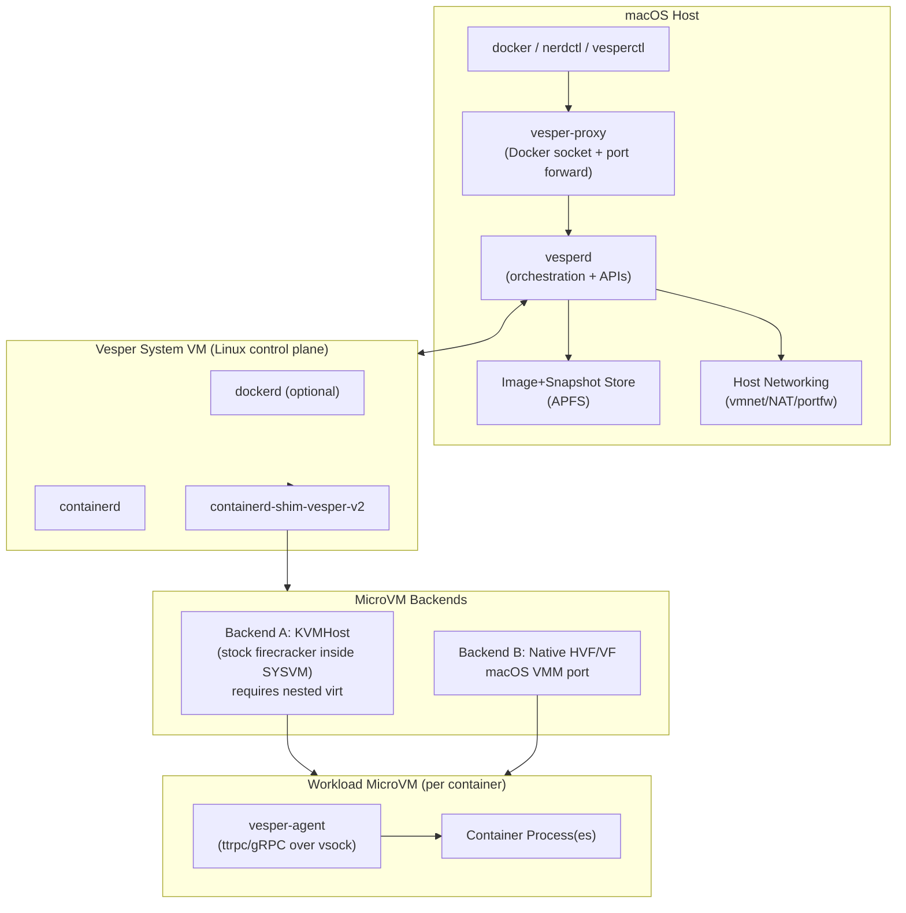
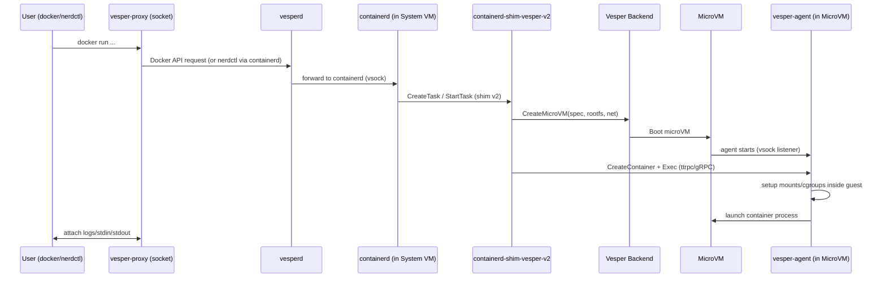

# Vesper: Firecracker‑compatible microVM runtime on macOS using Apple Virtualization

## Summary

Vesper is a macOS‑native system that replaces Docker Desktop by running **each container inside a Firecracker‑compatible microVM**, while using Apple’s first‑party virtualization stack (no third‑party KEXTs). It must:

* Achieve **100% feature parity** with Firecracker on Linux (API + behavior + tooling expectations), with explicit scope:

  * Backend A (`Vesper-KVMHost`) on M3+ is the first GA parity target.
  * Backend B (`Vesper-HVF`) on all supported Apple Silicon reaches the same parity bar before cross-hardware GA.
* Provide **containerd runtime compatibility** (shim v2) so it can be used as a Docker replacement path.
* Offer a practical macOS developer UX (volumes, networking, port publishing, build workflows).
* Support cross-architecture image workflows (`linux/arm64` and `linux/amd64`) with documented execution mode and limits.
* Treat parity as **versioned and reproducible** against a pinned baseline manifest, not against moving upstream heads.

This design intentionally borrows proven ideas from:

* Firecracker’s architecture (API thread + VMM thread + vCPU threads, minimal virtio device model, jailer hardening, rate limiting, MMDS, snapshots). ([GitHub][1])
* Apple’s direction for “containers on macOS” (VM‑per‑container, vsock control plane, minimal init, ext4 tooling). ([GitHub][2])
* containerd runtime v2 (shim API as the runtime integration point). ([GitHub][3])
* Apple Virtualization limitations (e.g., save/restore state encryption and portability constraints). ([Apple Developer][4])

Vesper ships with **two execution backends** so feature parity is not blocked by framework limits:

1. **Parity Backend (Vesper‑KVMHost)** — runs *stock Firecracker on Linux* inside a lightweight Linux “system VM” started by Virtualization.framework, with **nested virtualization** enabled (M3+). This delivers feature parity immediately because it is literally Firecracker on Linux. Nested virt availability is exposed by Apple’s API and is available on **M3 and later**. ([Apple Developer][5])
2. **Native Backend (Vesper‑HVF)** — ports Firecracker’s VMM core to macOS using Apple’s virtualization stack (Hypervisor.framework / Virtualization.framework). This removes reliance on nested virtualization over time, but must still match Firecracker’s API and behavior.

Vesper uses the **Parity Backend as the gold reference** and as a continuous “truth oracle” for conformance testing, while the Native Backend closes gaps until it reaches full parity.

`vesperd` is the single external control-plane owner (Firecracker-compatible API and lifecycle state machine). Backends are execution engines behind `vesperd`:
* Backend A delegates execution to stock Firecracker running inside the Linux System VM.
* Backend B executes directly on macOS with Apple virtualization APIs.

### Normative baselines (pinned)

All parity claims in this document are evaluated against immutable upstream revisions captured in:
`docs/specs/design-v0.baselines.lock.yaml`

Rules:
* Any baseline change requires a PR that updates the lock file and reruns parity/regression suites.
* Results are reported with the exact baseline revision IDs used in that run.
* Without a populated lock file, parity claims are provisional and cannot be used for GA sign-off.

---

## Requirements

### Hard requirements (must ship)

* **Firecracker API parity**: Vesper must accept the same OpenAPI/REST requests (including ordering and state machine semantics) and return the same response codes/messages where specified.
* **Parity scope by backend/hardware**:

  * Backend A on M3+ must meet full parity with no waived tests at parity GA.
  * Backend B on M1/M2/M3+ may launch with declared gaps, but cannot be marked parity-GA until it passes the same full suite.
  * Compatibility exceptions are allowed only pre-parity-GA and must include owner, linked issue, expiry date, and target release.
* **Device & feature parity**:

  * virtio‑blk (multiple drives), virtio‑net, virtio‑vsock, balloon, entropy, serial/console, MMDS, rate limiters, metrics/logging pipes, snapshot create/load (full + diff), pause/resume, CPU templates (when applicable by arch).
  * Equivalent behavior under load and failure modes (I/O errors, invalid config, state transitions).
* **containerd compatibility**:

  * Implement a **containerd shim v2 runtime** to run OCI workloads as microVMs. containerd uses shims as the integration point and does not directly launch containers. ([GitHub][3])
* **Docker replacement story on macOS**:

  * Provide a Docker‑like workflow (docker CLI compatibility via a compatible endpoint or via nerdctl).
  * Handle port publishing, volumes/binds, image pulls, logs, exec, signals.
  * Support `docker run --platform linux/amd64` on Apple Silicon via a deterministic execution path:
    * required baseline: `binfmt_misc + qemu-user` inside the System VM
    * optional acceleration: Rosetta-for-Linux where supported and explicitly enabled
* **No kernel extensions**; use Apple frameworks + user‑space isolation (App Sandbox / seatbelt).

### Platform constraints to account for

* **Nested virtualization** is only available on M3+ Macs (and later). ([Apple Developer][5])
* **Virtualization.framework save/restore state** is hardware‑encrypted and **cannot be restored by other users or on another Mac**, limiting portability/migration if you rely on it. ([Apple Developer][4])
* **Bridged networking** via Virtualization.framework can require the restricted entitlement `com.apple.vm.networking`. ([Apple Developer][6])
* **M1/M2 support** cannot rely on nested KVM backend; it uses the Native backend until parity is reached.

(Background references from your Apple research notes are incorporated as guidance and constraints.)

---

## High‑level architecture

### Component diagram

**Why a System VM exists:** Vesper’s runtime path relies on Linux-native container runtime components (containerd + shim + guest agent), with shim v2 as the integration contract. ([GitHub][3])
So Vesper uses a minimal Linux System VM to host containerd/dockerd and integrates via shim v2.

**Backend ownership contract**
* `vesperd` is the only external API endpoint and authoritative lifecycle/state-machine implementation.
* In Backend A, `vesperd` translates/forwards backend calls to stock Firecracker inside the System VM; microVM execution and dataplane live inside the System VM.
* In Backend B, `vesperd` executes microVMs directly on macOS.
* Conformance is always measured against Backend A as the baseline oracle.
* No direct external access to raw containerd or Firecracker sockets is supported in GA mode.

### Runtime lifecycle sequence (container create/start)

---

## Feature parity: what “100% parity” means in practice

Vesper must match Firecracker’s **observable contract**:

1. **OpenAPI control plane** (HTTP over Unix socket): endpoints like `/machine-config`, `/boot-source`, `/drives`, `/network-interfaces`, `/vsock`, `/mmds`, `/balloon`, `/snapshot/*`, `/actions`, `/logger`, `/metrics`, etc.
2. **State machine**: “pre‑boot only” vs “runtime mutable” endpoints; error codes when called at wrong time.
3. **Guest‑visible behavior**: device IDs, virtio feature bits (where relevant), MMDS semantics, vsock behavior, rate limiting, reboot handling.
4. **Tooling compatibility**: Firecracker’s integration tests and snapshot tooling should work without special‑casing.

Firecracker’s design doc is explicit about:

* One Firecracker process per microVM, threads: API, VMM, and vCPU(s). ([GitHub][1])
* Devices: virtio‑net, virtio‑blk, virtio‑vsock, serial console, keyboard controller for reset, plus KVM‑provided PIC/IOAPIC/PIT (x86). ([GitHub][1])
* Storage backed by files; networking backed by TAP; rate limiting in the I/O thread. ([GitHub][1])
* Snapshots: Firecracker has snapshot support and associated semantics (see below). ([GitHub][8])

---

## Backends: how we guarantee parity

### Backend A: Vesper‑KVMHost (Parity backend)

**What it is:**
A Linux System VM (started with Virtualization.framework) runs containerd and stock Firecracker. MicroVMs run **inside** that System VM using KVM, requiring nested virtualization. Nested virtualization is available on M3+ Macs and later. ([Apple Developer][5])

**Why it matters:**

* Immediate 100% parity (because it is Firecracker on Linux).
* Serves as the “oracle” to validate the Native backend.
* Provides a fallback path if Apple APIs restrict something needed (e.g., exact snapshot portability semantics).

**Key design points**

* System VM kernel: tuned for fast boot and KVM + tap + vsock.
* Export only the Docker-compatible socket to macOS via `vesper-proxy`; keep raw containerd sockets private to the System VM.
* Host filesystem sharing: `virtio-fs` is the required path between macOS and System VM for bind mounts.
* 9p is not a supported GA transport due to consistency/performance variance.
* Firecracker microVM consumes bind-mounted data via the runtime rootfs strategy (typically block-rootfs + writable delta).
* Networking:

  * System VM uses NAT attachment by default (no restricted entitlement).
  * MicroVM networking uses standard Linux TAP + CNI inside the System VM.

**Stage‑gate parity bar:** Vesper passes Firecracker’s upstream integration suite with no exclusions.

### Backend B: Vesper‑HVF/VF (Native backend)

**What it is:**
A macOS VMM implementation that exposes Firecracker’s API but uses Apple’s virtualization stack to execute the microVM directly on macOS.

**When it is used:**

* When nested virt is unavailable (M1/M2).
* When performance/latency is better with direct host microVMs.
* When you want to eliminate the “VM‑in‑VM” layering.

**Key technical challenge:** achieving Firecracker’s exact behavior while using different host primitives (KVM vs Apple frameworks). Apple’s “save state” facility is hardware‑encrypted and not portable across Mac/user. ([Apple Developer][4])
Therefore, for full Firecracker snapshot parity, Vesper‑HVF must implement Firecracker’s snapshot format itself (not just call `saveMachineState`).

---

## Component mapping: Firecracker → Vesper

### Mapping table (port plan)

| Firecracker component / dependency | Linux (KVM) behavior                                           | Vesper mapping                                                                                         | Backend A            | Backend B |
| ---------------------------------- | -------------------------------------------------------------- | ------------------------------------------------------------------------------------------------------ | -------------------- | --------- |
| `/dev/kvm`, `KVM_RUN` loop         | vCPU threads run `KVM_RUN` main loop ([GitHub][1])             | **A:** nested KVM inside System VM; **B:** HVF vCPU run loop                                           | ✅ native             | 🔧 port   |
| TAP networking                     | virtio‑net backed by TAP ([GitHub][1])                         | **A:** TAP + CNI inside System VM; **B:** user‑space net backend + vmnet/NAT                           | ✅                    | 🔧        |
| Block devices                      | virtio‑blk backed by files ([GitHub][1])                       | ext4 disk images stored on APFS; attach as virtio‑blk                                                  | ✅                    | ✅         |
| MMDS                               | metadata service exposed to guest ([GitHub][1])                | replicate: host HTTP handler + guest routing (netfilter or virtio‑net interception)                    | ✅                    | 🔧        |
| Rate limiter                       | token bucket limiter in I/O path ([GitHub][1])                 | reuse Firecracker algo; enforce at device backend                                                      | ✅                    | ✅         |
| Logger + metrics                   | named pipes configured via API ([GitHub][1])                   | map to macOS FIFOs or sockets; preserve semantics                                                      | ✅                    | ✅         |
| Snapshots                          | save memory + device state; full/diff, semantics ([GitHub][8]) | implement Firecracker snapshot format; do not rely solely on VF encrypted state ([Apple Developer][4]) | ✅                    | 🔧        |
| Jailer                             | cgroups/namespaces/chroot/seccomp ([GitHub][1])                | macOS sandbox profile + seatbelt + dedicated user + file access scoping                                | ✅ (inside System VM) | 🔧        |
| CPU templates                      | control CPU info exposure ([GitHub][1])                        | implement API + behavior per arch; may require HVF CPUID/MSR control on Intel                          | ✅                    | 🔧        |

Legend: ✅ mostly “works as-is” | 🔧 needs port/build

---

## Phases to implement Vesper (with stage‑gated verification)

Below are phases that lead to a production‑ready tool. Each phase includes:

* **Deliverables**
* **Verification/Evals**
* **Exit criteria** (must pass before proceeding)

### Phase 0 — Repo, packaging, and API contract scaffolding

**Deliverables**

* `vesperd` daemon skeleton

  * exposes Firecracker OpenAPI surface (no‑op handlers initially)
  * versioning, logging, metrics plumbing
* `vesper-proxy` socket forwarder (unix socket on macOS ↔ vsock in System VM)
* Build system:

  * macOS app/service with required virtualization entitlements (at minimum `com.apple.security.virtualization`; bridged networking is optional due to restricted entitlement). ([Apple Developer][6])
* Golden API contract tests built from Firecracker’s `firecracker.yaml`

**Verification/Evals**

* OpenAPI schema conformance test:

  * Ensure every path+method in Firecracker spec exists.
  * For implemented/unimplemented/state-invalid cases, validate status code + error payload against the pinned Firecracker baseline behavior (not a hardcoded 4xx envelope).
* “API state machine” unit tests:

  * e.g., calling `/actions InstanceStart` before `/boot-source` should fail exactly as Firecracker does.

**Exit criteria**

* 100% endpoint coverage, deterministic errors, API socket stable.

---

### Phase 1 — System VM bring‑up (required for Docker replacement + parity baseline)

**Deliverables**

* Build and boot a minimal Linux System VM on macOS using Virtualization.framework (NAT networking by default).
* vsock channel between macOS ↔ System VM.
* Install + run `containerd` and optionally `dockerd` in System VM.
* Expose runtime access on macOS only through `vesper-proxy` (`/var/run/vesper/docker.sock` by default).
* Keep raw containerd and Firecracker sockets private to the System VM.

**Verification/Evals**

* Boot time and stability smoke tests:

  * System VM boots reliably 200 times in a row with zero kernel panics and zero unrecoverable launcher failures.
* Socket round‑trip:

  * `docker version` works from macOS against forwarded socket.
  * Or `nerdctl` talking to containerd (note: nerdctl is Docker‑compatible CLI for containerd). ([GitHub][9])

**Exit criteria**

* macOS user can start/stop the Vesper service and run a trivial container (even if it runs as a process in the System VM initially).

---

### Phase 2 — Backend A (KVMHost): run stock Firecracker microVMs (fastest path to 100% parity)

**Deliverables**

* Enable nested virtualization on supported machines (M3+). ([Apple Developer][5])
* Run `firecracker` + `jailer` inside System VM.
* Integrate a direct backend flow (`vesperd` -> backend adapter -> Firecracker API) for lifecycle primitives:

  * `CreateVM`, `StartVM`, `PauseVM`, `ResumeVM`, `StopVM`, `DeleteVM`
* Integrate `firecracker-containerd` style rootfs flow:

  * OCI image → ext4 rootfs block → microVM boot → agent executes container

**Verification/Evals**

* Firecracker integration tests (upstream suite) run inside System VM:

  * Must pass unmodified for parity-GA at the pinned baseline revision.
* Snapshot tests based on upstream semantics:

  * Firecracker snapshot semantics include memory snapshot + microVM state snapshot; confirm create/load cycle. ([GitHub][8])
* Performance sanity:

  * MicroVM boot time, create rate, etc. (Firecracker publishes performance expectations/specs in-tree). ([GitHub][10])

**Exit criteria**

* Backend A passes Firecracker integration tests and can execute a container workload through direct backend calls (`vesperctl`/integration harness), with one microVM per workload.

---

### Phase 3 — containerd shim v2: make Vesper a drop‑in runtime (contract‑level)

Even if you use Firecracker inside System VM, you still must provide a **shim v2** runtime so containerd can treat it as a runtime.

**Deliverables**

* `containerd-shim-vesper-v2` implementing:

  * `Create`, `Start`, `Kill`, `Delete`, `State`, `Wait`, `Exec`, `ResizePty`, `Stats`
* A stable RPC boundary:

  * shim ↔ Vesper backend over vsock or unix socket
* Implement Vesper’s containerd shim v2 in System VM (or reuse upstream patterns), delegating runtime requests to Firecracker through Vesper backend APIs.
* OCI bundle unpacking + rootfs preparation

  * Prefer block rootfs (ext4) for Firecracker compatibility
  * Apple’s Containerization project explicitly includes “Create and populate ext4 file systems” and netlink tooling—this is a good reference for how to do it efficiently. ([GitHub][2])

**Verification/Evals**

* containerd conformance:

  * `ctr run`, `ctr tasks exec`, `ctr tasks kill`, `ctr tasks metrics`
* lifecycle correctness:

  * shim must remain as parent, survive containerd restart
  * restart test: restart containerd while microVM is running; attach works after reconnect

**Exit criteria**

* containerd can run workloads entirely via Vesper runtime without special casing.

---

### Phase 4 — macOS UX parity with Docker Desktop

**Deliverables**

* `vesper-proxy` supports:

  * Docker Engine API socket forwarding (if dockerd is enabled in System VM) through the canonical `vesper-proxy` ingress
  * deterministic port publishing ownership path (`host -> vesper-proxy -> System VM gateway -> microVM`) and “localhost” usability
* Volume mounts:

  * bind mount host paths into System VM (virtio‑fs best)
  * pass into microVM rootfs or mount into container
* DNS and networking defaults consistent with Docker Desktop expectations
* Cross-architecture execution policy:

  * `linux/arm64` is native default on Apple Silicon.
  * `linux/amd64` is supported via System VM emulation (`binfmt_misc + qemu-user`) and surfaced clearly in runtime metadata.

**Verification/Evals**

* “Developer workflow suite”:

  * `docker compose up` common stacks (nginx+redis+db)
  * hot‑reloading bind mounts
  * port publishing collisions
  * `docker run --platform linux/amd64` smoke tests on Apple Silicon
* filesystem correctness:

  * inotify behavior expectations (often required for dev servers)
  * uid/gid mapping; permission correctness

**Exit criteria**

* Workload matrix passes in CI and on a reference developer machine:

  * compose stack (`web + redis + db`)
  * bind mount hot reload
  * deterministic port-collision behavior
  * `docker exec`, `docker logs`, graceful + forced stop
  * `--platform linux/amd64` smoke flow on Apple Silicon

---

### Phase 5 — Backend B (Native): port Firecracker VMM behavior to macOS (HVF/VF)

This is the long phase: you’re porting the hypervisor backend while keeping Firecracker semantics.

**Deliverables (incremental)**

1. **API parity**: Vesper already matches OpenAPI; now it must actually execute microVMs.
2. **CPU/memory bring‑up**:

   * Create guest memory, load kernel/initrd, run vCPUs.
3. **Devices parity**:

   * virtio‑blk, virtio‑net, virtio‑vsock, serial console, rng, balloon.
4. **MMDS**:

   * emulate Firecracker MMDS guest access path.
5. **Rate limiting**:

   * token bucket limiter on block+net I/O (match Firecracker semantics). ([GitHub][1])
6. **Snapshot parity**:

   * implement Firecracker snapshot format (full+diff) and tool compatibility. Firecracker snapshot semantics are documented; don’t rely on Virtualization.framework state saving because it is hardware‑encrypted and non‑portable across Mac/user. ([GitHub][8])

**Verification/Evals**

* **Differential conformance harness** (critical):

  * For every test case, run it against:

    * stock Firecracker (Linux baseline)
    * Vesper Native backend
  * Compare:

    * API responses
    * guest observable behavior (device enumeration, IP addressing patterns, MMDS)
    * logs/metrics counters
* Snapshot round‑trip:

  * Pause → snapshot → new process → restore → validate process continues.
* Chaos/failure injection:

  * corrupted rootfs; network backend drop; full pipes; etc.

**Exit criteria**

* Native backend passes the same full parity suite as Backend A for the same pinned baseline revision.

---

## Comprehensive verification & evaluation plan

### A. Parity test harness (the core of “100% parity”)

Build a dedicated harness called `vesper-parity`:

**Inputs**

* Firecracker OpenAPI schema (firecracker.yaml)
* A corpus of microVM configs (machine‑config, drives, nets, vsock, balloon, MMDS)
* Workload scripts (in‑guest) that validate devices and behavior

**Execution modes**

* `--baseline=linux-firecracker` (runs Firecracker in a dedicated Linux reference environment outside the System VM-under-test)
* `--candidate=vesper-native` (runs Vesper HVF backend on macOS)
* `--compare` (diff outputs and fail on mismatch)

**Outputs**

* JSON report per test with:

  * API traces (request, response, headers)
  * guest logs
  * metrics snapshot
  * snapshot files hash / metadata

**Pass criteria**

* Pre-parity-GA: mismatches require a documented, approved compat exception with owner, linked issue, expiry date, and target release for removal.
* Parity-GA: zero open compat exceptions.

### B. Stage‑gated verifications per feature area

**1) API correctness**

* Contract tests generated from OpenAPI:

  * ensure required fields, error responses
* State machine tests:

  * “pre‑boot only” enforcement
* Fuzzing:

  * JSON body fuzzing + invalid sequences

**2) Guest device verification**

* Boot a minimal kernel and run:

  * `lspci`/`ls /sys/bus/virtio/devices` checks
  * network device name and MAC checks
  * virtio queue feature checks (where relevant)

**3) Networking**

* Connectivity:

  * outbound internet, DNS
  * container‑to‑container comms (same network)
  * deterministic localhost port-forward behavior through the full forwarding chain
  * Compose service discovery and network alias resolution
  * IPv6 mode behavior (explicitly supported or explicitly disabled with clear error)
* Performance:

  * iperf3 throughput
  * latency distribution

**4) Storage**

* fio read/write patterns
* corruption resistance:

  * sudden stop, host crash simulation
* rate limiter conformance:

  * verify token bucket behavior aligns with Firecracker’s model ([GitHub][1])

**5) Snapshots**
Firecracker snapshot expectations:

* Snapshot contains memory + emulated device state, stored in files; used to load later in a different process. ([GitHub][8])
  Tests:
* full snapshot restore
* diff snapshot chain restore
* snapshot under load (network active, disk IO active)
* negative tests: incompatible version, corrupted memory file, invalid state file

**6) Logging + metrics**

* Pipe backpressure tests:

  * verify behavior when pipes are full (lost logs counters, etc.) ([GitHub][10])

**7) Security**

* Jailer equivalence tests:

  * confirm microVM process is sandboxed (macOS sandbox profile)
  * filesystem access restricted to VM bundle
  * deny network if not configured
* Threat model reviews aligned with Firecracker containment model. ([GitHub][1])

---

## Comprehensive test strategy (unit → integration → e2e)

### 1) Unit tests

* Firecracker API state machine implementation:

  * ensure transitions match upstream
* Rate limiter:

  * deterministic time source; verify token bucket refill logic
* Snapshot serializer/deserializer:

  * golden files compatibility checks
* Networking backend framing:

  * virtio descriptors correctness

### 2) Integration tests (single node, automated)

* Start VM with kernel+initrd, attach console, assert boot banner
* Add drive, mount inside guest, read/write files
* Add network interface, configure IP, ping host/peer
* Vsock:

  * host ↔ guest ping protocol
* Balloon:

  * inflate/deflate and validate guest memory reporting

### 3) End-to-end (Docker replacement) tests

Run on macOS with Vesper service installed:

* Basic:

  * `docker run hello-world`
  * `docker run -p 8080:80 nginx`
  * `docker run --platform linux/amd64 alpine uname -m` (verify emulation path + architecture reporting)
* Compose:

  * `docker compose up` on a small stack
* Volumes:

  * bind mount: edit file on host, observe inside container
* Logs/exec/signals:

  * `docker logs -f`
  * `docker exec -it`
  * `docker stop` (SIGTERM then SIGKILL)
* Build:

  * buildkit inside System VM; `docker build` typical Dockerfile

### 4) Regression + performance tests

Track against Firecracker’s own published targets:

* boot latency, microVM create rate, overhead (where feasible). ([GitHub][10])
  Also track:
* System VM overhead (memory idle footprint)
* host CPU overhead per microVM
* I/O throughput vs baseline
* Target thresholds (initial, can be tightened over time):

  * Backend A p95 boot latency within 20% of Linux Firecracker baseline on the same host class
  * Backend A create-rate within 20% of Linux baseline at equal vCPU/memory shape
  * Idle System VM memory budget <= 1.5 GiB

### 5) Test harness implementation details

* Canonical parity harness is `vesper-parity`; `vesper-test` is an orchestration wrapper that invokes `vesper-parity` plus integration/e2e suites.
* `vesper-test` can:

  * build images
  * start/stop Vesper
  * run all suites
  * emit JUnit + JSON
* CI matrix:

  * macOS (M3+): run Backend A + Backend B side-by-side comparisons
  * macOS (M1/M2): run Backend B only
  * Linux: run baseline Firecracker tests

---

## Containerd compatibility design

### Why shim v2

Runtime v2 is containerd’s supported integration point: it introduces a first‑class shim API for runtime authors. ([GitHub][3])

### Implementation approach

* Implement `containerd-shim-vesper-v2` (Go recommended for ecosystem fit).
* Shim responsibilities:

  * prepare OCI bundle
  * request microVM creation from Vesper
  * maintain container lifecycle and stdio
* Guest agent responsibilities (`vesper-agent`):

  * mount rootfs
  * set up container namespace/cgroups *inside the guest Linux*
  * exec process
  * stream IO and exit status back over vsock

### Rootfs strategy

* Prefer **block‑based rootfs** (ext4 disk images) for Firecracker‑compatibility and isolation.
* Use APFS on host for storage; attach disk images accordingly.
* Leverage ideas from Apple Containerization which includes explicit ext4 creation tooling and an optimized kernel for fast boot. ([GitHub][2])
* Layer sharing and CoW model:

  * Keep OCI blobs in a shared content-addressed store (containerd content store) to avoid duplicate pulls.
  * Build immutable base ext4 artifacts keyed by image digest, then attach a writable delta disk per container/microVM.
  * Garbage collection must be explicit (high-watermark/low-watermark) for blobs, base ext4 artifacts, and writable deltas.
* Build cache strategy:

  * BuildKit cache lives in the System VM and is exported/imported using content-addressed cache metadata.
  * Cache eviction policy is metrics-driven (size + age), not ad-hoc.

### Networking strategy

* Default: NAT to avoid restricted bridged entitlement. ([Apple Developer][6])
* Optional (if entitlement available): bridged mode for LAN‑visible microVMs.
* Provide CNI inside System VM (Backend A).
* Explicit forwarding contract:

  * host bind on `127.0.0.1` and `::1` (if IPv6 enabled) terminates in `vesper-proxy`
  * `vesper-proxy` forwards to System VM gateway over vsock
  * System VM gateway forwards to target microVM interface/port
  * port-collision behavior is deterministic and returns a stable error surface
* Native backend networking decision:

  * production path (v0/v1): route via System VM gateway as the network controller for deterministic behavior and shared policy enforcement
  * direct macOS user-space net backend is experimental until it matches production path on latency, packet-loss handling, and failure semantics

---

## Snapshot strategy (full parity)

Firecracker snapshot semantics are non‑trivial and must match:

* full vs diff snapshots
* state file + memory file
* load into a different process
* caveats around runtime network restoration, etc. ([GitHub][8])

**Key decision:**
Do not rely solely on Virtualization.framework’s save state because it’s hardware‑encrypted and cannot be restored by other users or on another Mac. ([Apple Developer][4])
Instead:

* Backend A: use stock Firecracker snapshotting (already correct).
* Backend B: implement Firecracker’s snapshot format directly:

  * serialize device models and vCPU state
  * save guest RAM
  * diff snapshots:

    * phase 1: compute dirty pages by scanning/hashing pages vs parent snapshot
    * phase 2: optimize using dirty tracking if HVF APIs allow

---

## Security model (Firecracker‑equivalent hardening on macOS)

Firecracker relies on layers: virtualization boundary + seccomp + jailer using cgroups/namespaces/chroot. ([GitHub][1])

Vesper’s macOS mapping:

* Process sandboxing:

  * App Sandbox / seatbelt profile
  * restrict file access to VM bundle directories
  * restrict network access unless explicitly configured
* Privilege separation:

  * root helper only if strictly needed (e.g., special networking)
  * otherwise run `vesperd` unprivileged
* Resource controls:

  * enforce CPU/memory ceilings at VM config
  * host side process priorities and limits
* Auditing:

  * structured logs + metrics; record all API calls

### Trust boundaries and control-plane security invariants

* Socket access control:

  * `vesperd` API socket and Docker-compatible socket are local-only endpoints with explicit filesystem ACLs.
  * unauthorized UID/GID access attempts are rejected and audited.
* Backend RPC hardening:

  * `vesperd <-> System VM` control RPC must include capability-scoped auth tokens and replay protection.
  * control messages are versioned and schema-validated.
  * bootstrap trust uses per-boot ephemeral key material generated by `vesperd` and delivered only over an already-authenticated local channel (0600 file descriptor handoff or equivalent).
  * replay defense uses monotonic nonce + bounded timestamp window; out-of-window and duplicate messages are rejected and audited.
  * key rotation is mandatory on every System VM restart and can be forced via admin action.
* Privileged helper minimization:

  * any root helper must expose a minimal syscall surface (network setup only) with strict input validation.
  * helper calls are deny-by-default and observable in audit logs.

---

## Checklists

### Implementation checklist (engineering)

* [ ] Firecracker OpenAPI endpoints implemented (all methods)
* [ ] API state machine matches upstream
* [ ] System VM boot + vsock connectivity
* [ ] containerd + shim v2 working end‑to‑end
* [ ] Backend A: Firecracker microVM per container (nested KVM)
* [ ] Backend B: native microVM boot
* [ ] virtio‑blk parity (multi-drive, read-only flags, rate limiters)
* [ ] virtio‑net parity (MAC config, RX/TX rate limiters)
* [ ] vsock parity (CID mapping, connection behavior)
* [ ] MMDS parity (API + guest access)
* [ ] balloon parity (set target, stats)
* [ ] metrics/logging parity (pipes/backpressure behavior)
* [ ] snapshot create/load parity (full + diff)
* [ ] CPU templates parity (where applicable)
* [ ] docker socket proxy + port publish + volumes

### Release readiness checklist

* [ ] All parity tests pass vs Linux baseline
* [ ] Backend A parity GA criteria met on M3+ (no open compat exceptions)
* [ ] Backend B parity status published (full parity or explicit gap list with owners and dates)
* [ ] Baseline lock file (`docs/specs/design-v0.baselines.lock.yaml`) is up to date and referenced in test reports
* [ ] “Docker replacement suite” passes (compose, bind mounts, exec/logs)
* [ ] Stability soak test passes (24h, 100 mixed-lifecycle containers, zero unrecoverable daemon failures)
* [ ] Performance regression thresholds defined + met
* [ ] Security review complete (sandbox, file access, network)
* [ ] Clear hardware/OS requirements documented (nested virt gating) ([Apple Developer][5])
* [ ] Cross-architecture behavior documented (`linux/arm64` native and `linux/amd64` emulated path + caveats)
* [ ] Installer + uninstall cleanly removes services and data

---

## Detailed prompt for a coding agent

Use the following prompt as an implementation accelerator.
This section is **informative**; the normative source of truth is the design sections above.
If any prompt text conflicts with the normative sections, the normative sections win.

---

**Coding Agent Prompt: Implement “Vesper” (Firecracker‑compatible microVM runtime on macOS using Apple Virtualization)**

You are implementing a production‑grade system called **Vesper**. The goal is to replace Docker Desktop on macOS by running each container inside a **Firecracker‑compatible microVM** using Apple’s first‑party virtualization stack. Requirements:

### A. Top-level deliverables

1. A macOS daemon `vesperd` that:

   * Exposes a **Firecracker‑compatible REST API** over a Unix domain socket (OpenAPI parity).
   * Exposes a **private containerd runtime v2 integration endpoint** (used by shim components, not as a public external API).
   * Manages microVM lifecycle, logging, metrics, snapshots.
2. A Linux “System VM” image + launcher:

   * booted via Apple Virtualization (Virtualization.framework)
   * runs containerd and optionally dockerd
3. A containerd shim v2: `containerd-shim-vesper-v2`:

   * implements containerd runtime v2 Task API
   * creates a microVM per container via Vesper
4. A guest agent `vesper-agent` that runs inside the microVM:

   * receives commands over vsock (ttrpc/gRPC)
   * sets up rootfs and execs the container process
5. A test harness `vesper-parity`:

   * runs contract + integration + e2e tests
   * compares Vesper behavior to Linux Firecracker baseline

### B. Architecture constraints

* Must support **two backends**:

  * **Backend A (Parity/KVMHost):** run stock Firecracker inside the System VM using nested virtualization (M3+). This must pass upstream Firecracker tests.
  * **Backend B (Native):** run microVMs directly on macOS using Apple virtualization APIs. This must eventually match Backend A.
* `vesperd` is the only external control-plane endpoint; both backends are internal execution engines behind the same API/state machine.
* Do NOT rely on Virtualization.framework `saveMachineState` for Firecracker snapshot parity (it is hardware-encrypted and non-portable). Implement Firecracker snapshot format for Backend B.
* Networking default must work without restricted bridged entitlement; use NAT/port-forwarding by default.
* Support cross-architecture workloads on Apple Silicon: `linux/arm64` native, `linux/amd64` via documented emulation mode.
* Use pinned baseline revisions from `docs/specs/design-v0.baselines.lock.yaml` for all parity and regression evaluations.

### C. Repository layout (create)

* `vesperd/` (Rust preferred; Swift allowed only as FFI shim)

  * `api/` Firecracker REST API handlers + state machine
  * `backend/` backend trait + implementations
  * `backend_kvmhost/` client to Firecracker inside System VM
  * `backend_native/` native macOS backend
  * `snapshot/` Firecracker snapshot format implementation
  * `metrics/`, `logging/`
* `systemvm/`

  * kernel config, rootfs build scripts
  * containerd + shim install
* `shim/` (Go)

  * `containerd-shim-vesper-v2`
* `agent/` (Rust or Go)

  * vsock RPC server, OCI exec support
* `tests/`

  * parity tests
  * docker replacement tests
  * performance tests

### D. Implementation phases

Implement in this order, with each phase producing working software + tests:

1. Firecracker OpenAPI surface stubbed in `vesperd` + contract tests.
2. System VM boot + vsock + socket forwarding; prove `docker version` works via `vesper-proxy`.
3. Backend A: run Firecracker inside System VM with direct backend lifecycle primitives and parity harness hooks.
4. Implement shim v2 runtime contract (`containerd-shim-vesper-v2`) and wire it to backend APIs.
5. End-to-end Docker workflow on Backend A: `docker run`, `docker logs`, `docker exec`, bind mounts, port publish, plus `--platform linux/amd64`.
6. Backend B: native microVM boot with block rootfs + console output.
7. Add devices + MMDS + rate limiting + balloon on Backend B.
8. Implement snapshot create/load parity (full+diff) for Backend B.
9. Full parity harness: run same suites on Backend A and Backend B, fail on mismatches.

### E. Test requirements

* Provide `make test` running:

  * unit tests
  * contract tests against OpenAPI
* Provide `make integration` running:

  * bring-up tests
  * shim+agent tests
* Provide `make e2e` running:

  * docker replacement suite
* Provide a JSON report for parity differences.

### F. Definition of done

* Backend A passes upstream Firecracker integration tests for the pinned baseline revision with no exclusions.
* Backend B passes the same parity suite as Backend A.
* Docker Desktop can be replaced for common workflows (compose, binds, ports, exec, logs) on supported hardware.
* Cross-architecture behavior is validated in CI (`linux/arm64` and `linux/amd64` execution paths).
* All artifacts are reproducible in CI.

---

## Appendix: Mermaid source

### Component diagram

### Runtime lifecycle sequence (container create/start)

---

## Notes / references used

* Apple virtualization & containerization background from your supplied research notes.
* Apple Containerization project details: VM‑per‑container, vminitd over vsock, ext4 tooling. ([GitHub][2])
* Firecracker internal architecture and device model expectations. ([GitHub][1])
* Firecracker snapshot semantics (full/diff, memory + state). ([GitHub][8])
* containerd runtime v2 shim API rationale. ([GitHub][3])
* Apple limitation: save/restore state is hardware‑encrypted and tied to Mac/user. ([Apple Developer][4])
* Nested virtualization availability on M3+ Macs. ([Apple Developer][5])
* Reference hygiene policy: normative implementation documents should pin upstream references to tags or commit SHAs (not moving `main`) during execution-phase docs and RFCs.
* Apple WWDC video citations are explanatory; normative behavior is enforced by pinned references, implementation tests, and parity harness outputs.
* Locked baselines used by this spec are captured in `docs/specs/design-v0.baselines.lock.yaml`.

---

[1]: https://raw.githubusercontent.com/firecracker-microvm/firecracker/083c4cf69281178acc910f7f857f88e69c51d3b5/docs/design.md "https://raw.githubusercontent.com/firecracker-microvm/firecracker/083c4cf69281178acc910f7f857f88e69c51d3b5/docs/design.md"
[2]: https://raw.githubusercontent.com/apple/containerization/636eef0eff00e451de6d5d426e6a6785b90b44e2/README.md "https://raw.githubusercontent.com/apple/containerization/636eef0eff00e451de6d5d426e6a6785b90b44e2/README.md"
[3]: https://github.com/containerd/containerd/blob/d1d9d07f1960f7f3648298e44963a263eac87fa5/core/runtime/v2/README.md "https://github.com/containerd/containerd/blob/d1d9d07f1960f7f3648298e44963a263eac87fa5/core/runtime/v2/README.md"
[4]: https://developer.apple.com/videos/play/wwdc2023/10007/ "Create seamless experiences with Virtualization - WWDC23 - Videos - Apple Developer"
[5]: https://developer.apple.com/documentation/virtualization/vzgenericplatformconfiguration/isnestedvirtualizationsupported?utm_source=chatgpt.com "isNestedVirtualizationSupported"
[6]: https://developer.apple.com/documentation/virtualization/vzbridgednetworkdeviceattachment?utm_source=chatgpt.com "VZBridgedNetworkDeviceAttach..."
[8]: https://raw.githubusercontent.com/firecracker-microvm/firecracker/083c4cf69281178acc910f7f857f88e69c51d3b5/docs/snapshotting/snapshot-support.md "https://raw.githubusercontent.com/firecracker-microvm/firecracker/083c4cf69281178acc910f7f857f88e69c51d3b5/docs/snapshotting/snapshot-support.md"
[9]: https://github.com/containerd/nerdctl "https://github.com/containerd/nerdctl"
[10]: https://raw.githubusercontent.com/firecracker-microvm/firecracker/083c4cf69281178acc910f7f857f88e69c51d3b5/SPECIFICATION.md "https://raw.githubusercontent.com/firecracker-microvm/firecracker/083c4cf69281178acc910f7f857f88e69c51d3b5/SPECIFICATION.md"
